# Foundations of Data: File Handling, JSON, APIs & NumPy
> **Pre-Read — Academic Session 8 & 9** | Module 1: Foundations of Data
---
## Mental Map
> 📄 Also provided as a printable PDF in this folder: **mental-map: File Handling, JSON, APIs & NumPy.pdf**

```mermaid
%%{init: {'flowchart': {'useMaxWidth': false, 'htmlLabels': true, 'nodeSpacing': 60, 'rankSpacing': 95, 'wrappingWidth': 620, 'padding': 18}}}%%
flowchart LR

START["<b>Course Start</b>"]

subgraph foundation[" WHERE WE ARE "]
direction TB
    CURMOD["<b>CURRENT MODULE</b><br/><i>Module 1: Foundations of Data</i><br/>&nbsp;<br/><b>Covered so far:</b> AI Landscape; Python Fundamentals; Control Flow; Loops; Master class: Numbers/Logic/Structure; Functions; Python Data Structures<br/>This is Session 8 & 9 of 39"]
    CURSES["<b>CURRENT SESSIONS</b><br/><b>File Handling, JSON & APIs</b><br/>&nbsp;<br/><i>The shift:</i> from <i>'my data lives only inside my code'</i> to <b>'I can read, save, and fetch real data from files and the internet'</b><br/>&nbsp;<br/>File I/O & context managers · JSON structure<br/>The requests library & APIs · Ethical key & rate-limit usage<br/><hr/><b>NumPy: Numerical Foundation</b><br/>&nbsp;<br/><i>The shift:</i> from <i>'I loop through numbers one at a time'</i> to <b>'I operate on entire collections of numbers at once'</b><br/>&nbsp;<br/>Arrays & dtype · Shape, indexing & slicing<br/>Element-wise ops & broadcasting · Reshape & flatten"]
end

subgraph outcome[" OUTCOME OF THIS SESSION "]
direction TB
    OUT["<b>By the end, you can…</b><br/>&nbsp;<br/>Read and write files safely, parse and generate JSON, make API calls with requests,<br/>apply ethical usage of API keys and rate limits,<br/>create and manipulate NumPy arrays with indexing and slicing, perform element-wise arithmetic and broadcasting without loops,<br/>and reshape or flatten arrays for downstream use"]
end

subgraph value[" WHY IT MATTERS "]
direction TB
    CVAL["<b>Course Value</b><br/>This is the bridge from 'toy examples' to real data — every dataset and API you'll touch for the rest of the course arrives exactly this way.<br/>NumPy is the numerical engine underneath Pandas — every DataFrame column you'll use starting next module is secretly a NumPy array."]
    RVAL["<b>Real-Life Value</b><br/>The same skill behind an app checking Swiggy's menu (GET) or placing your order (POST) behind the scenes, and applying a festival discount to an entire price list instantly."]
end

subgraph future[" WHAT COMES NEXT "]
direction TB
    U0["<b>Next Session</b><br/>Pandas: Loading, Inspection & Filtering<br/><i>Put this numerical power inside labeled, spreadsheet-like tables</i>"]
    U1["<b>Later in Module 1</b><br/>Pandas (Loading & Aggregation), Master class: Tables & Relationships"]
    U2["<b>Upcoming Modules</b><br/>Course continues beyond Foundations of Data<br/><i>Details as the curriculum unfolds</i>"]
end

START ==>|" begin "| CURMOD
CURMOD ==>|" progress "| CURSES
CURSES ==>|" you get "| OUT
OUT ==>|" course "| CVAL
OUT ==>|" real life "| RVAL
CURSES ==>|" next up "| U0
U0 -.->|" then "| U1
U1 -.->|" ahead "| U2

classDef startBox fill:#F7FAFC,stroke:#4A5568,stroke-width:2px,color:#1A202C
classDef curModBox fill:#FFF8E6,stroke:#B7791F,stroke-width:2px,color:#1A202C
classDef curSessBox fill:#E6FFFA,stroke:#0D9488,stroke-width:3px,color:#1A202C
classDef outBox fill:#FEF2F2,stroke:#DC2626,stroke-width:3px,color:#1A202C
classDef valueBox fill:#F3E8FF,stroke:#7C3AED,stroke-width:2px,color:#1A202C
classDef futureBox fill:#ECFDF5,stroke:#047857,stroke-width:2px,color:#1A202C

class START startBox
class CURMOD curModBox
class CURSES curSessBox
class OUT outBox
class CVAL,RVAL valueBox
class U0,U1,U2 futureBox
```



## What You'll Learn (Session 8)
In this pre-read, you'll discover:
- How to **read and write files** safely using `open()` and context managers
- How **JSON** structures data, and how to convert between JSON and Python
- How to make **API calls** using the `requests` library, and read GET/POST responses and status codes
- How to use **API keys responsibly** — respecting rate limits and terms of service

## What You'll Learn (Session 9)
In this pre-read, you'll discover:
- What a **NumPy array** is, and why `dtype` makes it different from a Python list
- How **shape**, indexing and slicing work across multiple dimensions
- How **element-wise operations** and **broadcasting** let you skip loops entirely
- How to **reshape** and **flatten** arrays for downstream use

---

## Part 1: File Handling, JSON & APIs

### A. File I/O & Context Managers

- 💡 **Analogy** — Think of **borrowing a book from a library**. You check it out (`open()`), read or write in it, and must return it when done — otherwise the library can't lend it to anyone else. A **context manager** (`with`) is an auto-return system: it guarantees the file gets closed properly, even if something goes wrong while you're using it.

- **`open()` gives you access to a file; a context manager (`with`) ensures it's automatically and safely closed when you're done, even if an error occurs.**

- **Core explanation:**

| Task | Code | Notes |
|---|---|---|
| Open and read a file | `with open("data.txt", "r") as f: content = f.read()` | `"r"` = read mode |
| Open and write a file | `with open("data.txt", "w") as f: f.write("Hello")` | `"w"` overwrites; `"a"` appends |
| File closes automatically | (end of the `with` block) | No need to call `f.close()` manually |

- **Worked example:**
```python
with open("orders.txt", "w") as f:
    f.write("Order 1: Chai, ₹20\n")
    f.write("Order 2: Samosa, ₹15\n")

with open("orders.txt", "r") as f:
    print(f.read())
```

- ⚠️ **Common trap:** Opening a file without `with` and forgetting to call `.close()`. The file may stay locked or unsaved changes may be lost — `with` prevents this class of bug entirely by handling closing for you automatically.

---

### B. JSON Structure

- 💡 **Analogy** — Think of a **filled-out application form** with clearly labeled fields — name, phone, list of previous addresses. **JSON** (JavaScript Object Notation) is exactly this: a standard, text-based way of writing structured data that looks almost identical to Python's nested dictionaries and lists from Session 3.3.

- **JSON is a text format for structured data, built from the same key-value and list ideas as Python dictionaries and lists — `json.loads()` converts JSON text into Python objects, and `json.dumps()` does the reverse.**

- **Core explanation:**

| Task | Code | Direction |
|---|---|---|
| JSON text → Python object | `data = json.loads(json_text)` | Parsing |
| Python object → JSON text | `json_text = json.dumps(data)` | Generating |

- **Worked example:**
```python
import json

json_text = '{"name": "Priya", "orders": ["Chai", "Samosa"]}'
data = json.loads(json_text)
print(data["orders"][0])   # "Chai" — now a normal Python dict/list

python_dict = {"city": "Hyderabad", "pincode": 500081}
print(json.dumps(python_dict))   # back to JSON text
```

- ⚠️ **Common trap:** Assuming JSON and a Python dictionary are literally the same object type. They look almost identical, but JSON is TEXT until you `json.loads()` it — you can't use dictionary methods on raw JSON text directly.

---

### C. APIs & the requests Library

- 💡 **Analogy** — Think of using a **food delivery app**. Checking the menu is a **GET** request — you're asking for information, not sending anything new. Placing an order is a **POST** request — you're sending new data to be processed. The app then tells you the order status — that's a **status code**.

- **An API lets your code talk to another service over the internet; GET retrieves data, POST sends data, and status codes tell you what happened.**

- **Core explanation:**

| Concept | Meaning |
|---|---|
| `requests.get(url)` | Ask a server for data (like checking a menu) |
| `requests.post(url, data=...)` | Send data to a server (like placing an order) |
| `200` status code | Success |
| `404` status code | Not found — the requested resource doesn't exist |
| `429` status code | Too many requests — you've hit a rate limit |
| `500` status code | Server error — something broke on their end |

- **Worked example:**
```python
import requests

response = requests.get("https://api.example.com/weather?city=Hyderabad")
print(response.status_code)   # e.g. 200
data = response.json()        # parses the JSON response directly into a Python dict
print(data)
```

- ⚠️ **Common trap:** Assuming a request always succeeds. Always check `response.status_code` (or wrap the call in error handling) before trusting the data — a `404` or `500` response won't contain the data you expect.

---

### D. Ethical API Usage — Keys & Rate Limits

- 💡 **Analogy** — Recall the **ATM PIN** analogy from Session 1.1: an API key proves you're allowed to use a service, and must never be shared publicly. A **rate limit** is like a shopkeeper telling you "please don't call me every 5 seconds asking for updates" — call too often, and the service may block you entirely.

- **API keys authenticate your requests and must be kept secret; rate limits cap how often you can call an API, and exceeding them (or violating a service's Terms of Service) can get your access revoked.**

- **Core explanation:**

| Practice | Why it matters |
|---|---|
| Store keys in `.env`, never in code | Prevents accidental public exposure (Session 1.1 recap) |
| Respect documented rate limits | Avoids `429` errors and service bans |
| Read the API's Terms of Service (ToS) | Some data can't legally be reused or redistributed |
| Add delays between many requests | Reduces load on the server, avoids being flagged as abuse |

- **Worked example:**
```python
import time
import requests

for city in ["Hyderabad", "Mumbai", "Delhi"]:
    response = requests.get(f"https://api.example.com/weather?city={city}")
    print(response.json())
    time.sleep(1)   # respectful pause between requests
```

- ⚠️ **Common trap:** Looping through hundreds of API calls with no delay or limit-checking. This can trigger rate limiting, get your key suspended, or in some cases violate the provider's terms of service entirely.

---

### Quick Reference — Which Tool, When (Session 8)

| Your situation | Use this | Because |
|---|---|---|
| You need to save or load data from your own machine | `open()` with `with` | Safe, auto-closing file access |
| Your data is structured with nested key-value pairs | JSON (`json.loads`/`json.dumps`) | Standard format for structured data exchange |
| You need to fetch data from an external service | `requests.get()` | Retrieves data without modifying anything |
| You need to send new data to an external service | `requests.post()` | Submits data for processing |
| You're calling an API repeatedly | Respect rate limits, add delays | Avoids bans and respects the provider's infrastructure |

---

## Part 2: NumPy — Numerical Foundation

### E. Arrays & dtype

- 💡 **Analogy** — Think of a **train coach where every seat is the same class** — all sleeper, or all AC, never mixed. A NumPy array is like this coach: every element must be the same data type (`dtype`), unlike a Python list, which can freely mix types like `["milk", 3, True]`.

- **A NumPy array is a grid of values, all of the same data type — this uniformity is exactly what makes it fast for numerical operations.**

- **Core explanation:**

| Concept | Meaning |
|---|---|
| `np.array([...])` | Creates a NumPy array from a list |
| `dtype` | The single data type shared by every element (e.g., `int64`, `float64`) |
| Why it's faster | Uniform type lets NumPy store and process data far more efficiently than a mixed-type Python list |

- **Worked example:**
```python
import numpy as np

prices = np.array([49.5, 20, 15, 99.9])
print(prices.dtype)   # float64 — NumPy upgraded all values to match
```

- ⚠️ **Common trap:** Mixing types when creating an array, expecting them to stay separate like a Python list. NumPy will silently convert everything to a single common type (often float or string) — this can quietly change your data if you're not paying attention.

---

### F. Shape, Indexing & Slicing

- 💡 **Analogy** — Think of a **stadium seating chart**: block, row, and seat number together locate any single seat. A multi-dimensional NumPy array works the same way — its **shape** tells you the size along each dimension, and you index using multiple coordinates.

- **Shape describes an array's dimensions; indexing and slicing work similarly to lists, but extend across multiple dimensions using comma-separated coordinates.**

- **Core explanation:**

| Task | Code | Notes |
|---|---|---|
| Check shape | `arr.shape` | e.g. `(3, 4)` = 3 rows, 4 columns |
| Access one element (2D) | `arr[1, 2]` | Row 1, column 2 |
| Slice a range | `arr[0:2, :]` | First 2 rows, all columns |

- **Worked example:**
```python
seating = np.array([
    [1, 2, 3, 4],
    [5, 6, 7, 8],
    [9, 10, 11, 12]
])
print(seating.shape)     # (3, 4) — 3 rows, 4 columns
print(seating[1, 2])     # 7 — row 1, column 2
print(seating[0:2, :])   # first two rows, all columns
```

- ⚠️ **Common trap:** Confusing `arr[1][2]` (which also works, but is slower and less idiomatic) with the NumPy-preferred `arr[1, 2]`. Both give the same result for 2D arrays, but `arr[1, 2]` is the standard, more efficient NumPy style.

---

### G. Element-wise Operations & Broadcasting

- 💡 **Analogy** — Think of a shopkeeper announcing **"10% off everything!"** instead of walking around relabeling every single item by hand. That instant, whole-list discount is exactly what NumPy's **broadcasting** does — apply one operation to an entire array at once, no loop required.

- **Element-wise operations apply an action to every element of an array simultaneously; broadcasting lets you combine arrays (or an array and a single number) of different shapes without writing a manual loop.**

- **Core explanation:**

| Task | Loop version (slow) | NumPy version (fast) |
|---|---|---|
| Add 10 to every price | `for p in prices: p + 10` (needs a new list) | `prices + 10` |
| Multiply all by 0.9 (10% off) | Manual loop | `prices * 0.9` |
| Compare two equal-length arrays | Manual loop with zip | `array_a + array_b` |

- **Worked example:**
```python
prices = np.array([49.5, 20, 15, 99.9])
discounted = prices * 0.9   # 10% off everything, instantly
print(discounted)
```
No loop was written — NumPy applied the multiplication to every element automatically, which is both shorter to write and dramatically faster on large datasets.

- ⚠️ **Common trap:** Trying this exact syntax on a plain Python list — `[49.5, 20, 15] * 0.9` doesn't apply the discount element-wise; it either errors or behaves unexpectedly, because plain lists don't support broadcasting.

---

### H. Reshape & Flatten

- 💡 **Analogy** — Think of a **tray of chapatis arranged in a 3×4 grid**, versus the same chapatis lined up in a single row of 12. The chapatis themselves don't change — only how they're arranged. `reshape()` and `flatten()` do exactly this to array data.

- **`reshape()` rearranges an array's data into a different shape (same total number of elements); `flatten()` collapses a multi-dimensional array into a single 1D array.**

- **Core explanation:**

| Task | Code | Result |
|---|---|---|
| Reshape to a new grid | `arr.reshape(2, 6)` | Same 12 values, arranged as 2 rows × 6 columns |
| Flatten to 1D | `arr.flatten()` | All values in a single row |

- **Worked example:**
```python
grid = np.array([[1,2,3,4],[5,6,7,8],[9,10,11,12]])   # shape (3, 4)
reshaped = grid.reshape(2, 6)                           # shape (2, 6) — same 12 values
flat = grid.flatten()                                    # shape (12,) — one long row
```

- ⚠️ **Common trap:** Trying to reshape into dimensions that don't multiply to the same total count. A 12-element array can become `(2,6)`, `(3,4)`, `(1,12)`, or `(12,1)` — but never `(2,5)`, since `2×5=10 ≠ 12`.

---

### Quick Reference — NumPy Essentials (Session 9)

| Your situation | Use this | Because |
|---|---|---|
| You need fast numerical operations on many values | NumPy array, not a Python list | Uniform dtype makes it far faster |
| You need to apply the same math to every element | Element-wise operation | No loop needed — `arr * 0.9` |
| You're combining arrays of different shapes | Broadcasting | NumPy expands automatically where compatible |
| You need to check an array's dimensions | `.shape` | Tells you rows, columns, etc. |
| You need to rearrange data without changing values | `.reshape()` or `.flatten()` | Same data, different layout |

---

## Practice Exercises

### Session 8 Exercises
**1. Concept Detective**
Explain, in your own words, why using `with open(...) as f:` is safer than calling `open()` and `close()` manually.

**2. Real-Life Application**
Describe an app you use that clearly makes both GET requests (viewing data) and POST requests (submitting data) — name one example of each.

**3. Spot the Error**
A student's code calls an API 500 times in a tight loop with no delay and no status code checking. List two problems with this approach.

**4. Pattern Recognition**
Given a JSON response `{"status": "success", "data": {"price": 150}}`, write the exact Python expression to access the price value after parsing it.

**5. Planning Ahead**
You're about to build a script that checks a weather API every hour for five cities. List the ethical practices from today's session you'd apply, and why each matters.

### Session 9 Exercises
**1. Concept Detective**
Explain, in your own words, why `np.array([1, "two", 3])` behaves differently from a Python list containing the same mixed values.

**2. Real-Life Application**
Describe a real scenario where applying one operation to an entire collection at once (like broadcasting) would save significant manual effort.

**3. Spot the Error**
A student tries `[10, 20, 30] * 2` expecting `[20, 40, 60]`, but gets `[10, 20, 30, 10, 20, 30]` instead. Explain why, and how using a NumPy array would fix it.

**4. Pattern Recognition**
Given an array with shape `(4, 3)`, list two other valid reshape targets (same total element count) and one invalid one.

**5. Planning Ahead**
You have a NumPy array of 100 exam scores and want to add 5 bonus marks to every score at once. Write the one line of code that does this, without any loop.

---
> ✅ **You're done!** You can now read and write files safely, parse and generate JSON, make API calls with requests, apply ethical usage of API keys and rate limits, create and manipulate NumPy arrays, perform element-wise arithmetic and broadcasting without loops, and reshape or flatten arrays for downstream use.
> Next session, you'll put this numerical power inside labeled, spreadsheet-like tables in **Pandas: Loading, Inspection & Filtering**.
