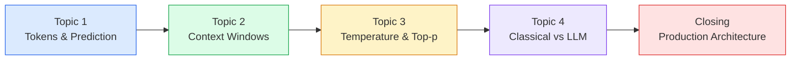
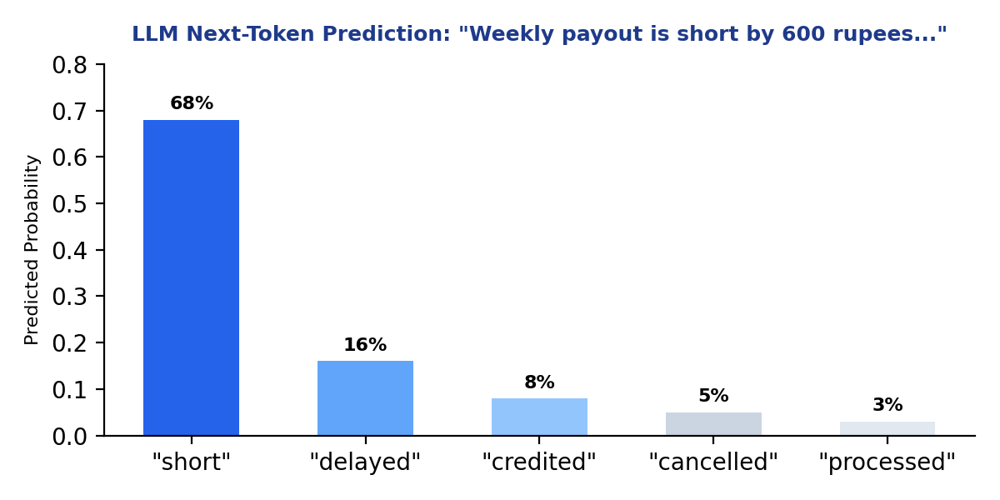
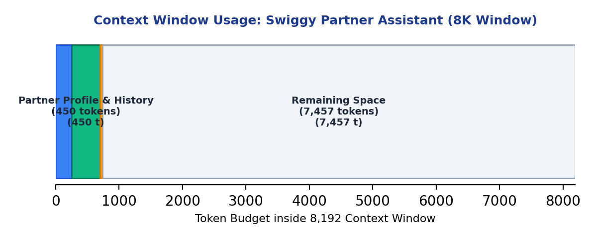
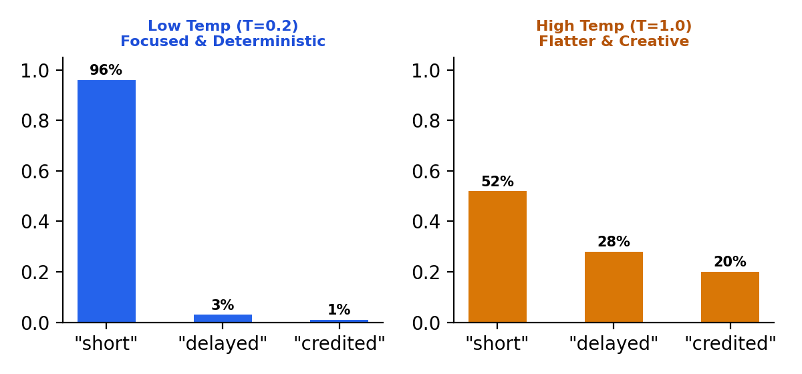
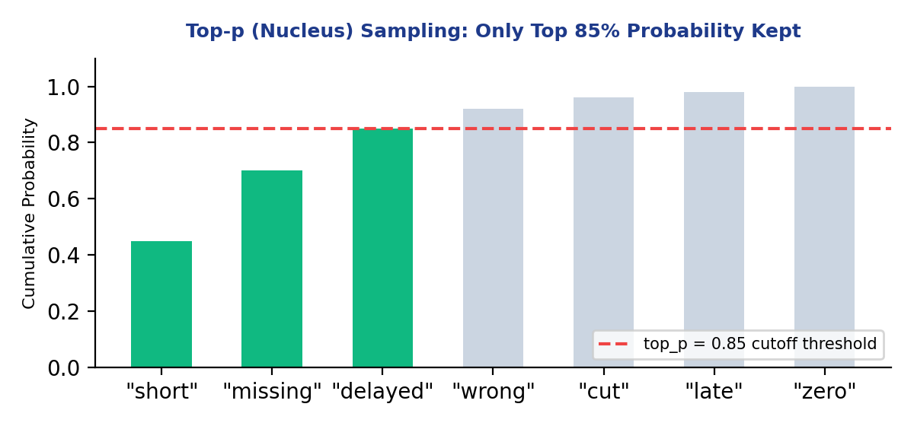
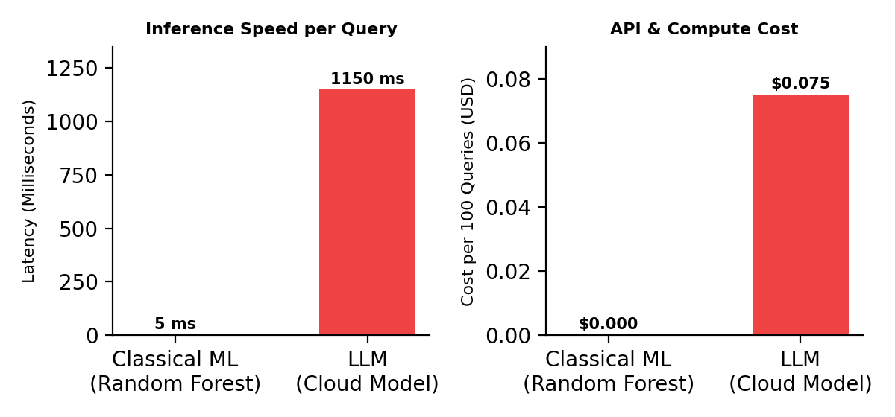
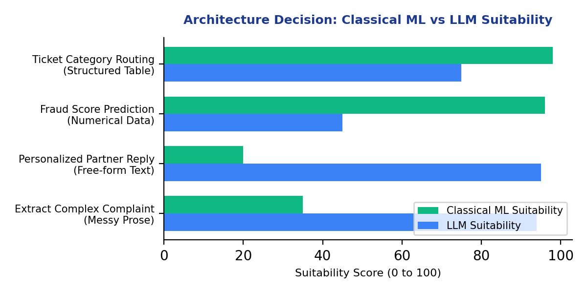

# <font color='#1d4ed8'>Lecture Script: LLM Fundamentals: How Language Models Work</font>

---

## <font color='blue'>Agenda</font>

The lecture runs as four topics. Each topic ends with a quiz.

| Topic | What we do | Learning objectives covered | Minutes |
|:-:|:--|:--|:-:|
| 1 | Split text into tokens and predict next tokens | Recall and explain how LLMs generate text using tokens and context windows | 28 |
| 2 | Track context window limits and conversation memory | Track token limits and memory retention within context bounds | 24 |
| 3 | Control randomness and filter tokens with temperature and top-p | interpret the effect of temperature and top-p on output variability | 33 |
| 4 | Benchmark classical models against LLMs on cost and speed | compare LLMs with traditional ML models in terms of how they learn and predict | 25 |
| — | Closing: Outcome & Summary | | 10 |
| | **Total** | | **120** |

> <font color="red">**🎯 Instructor Note**</font> Pace: keep token splitting intuitive in Topic 1, spend quality time on the math and visual intuition of temperature and top-p in Topic 3, and anchor the business trade-offs in Topic 4.
> Topic 4 connects directly to operational decisions: let learners inspect the latency and cost differences across all 120 rider support tickets in `data/swiggy_support_queries.csv`.

---

## <font color='blue'>Scenario</font>

**The risk:** Swiggy's rider operations desk handles over 50,000 queries every morning from delivery partners asking about delayed payouts, wrong pickup pins, and app glitches. A developer replaces a fast, deterministic intent classifier with an unconstrained generative LLM running at high temperature. Instead of routing urgent tickets to human agents in under 10 milliseconds, the bot produces long, wandering stories, invents payout policy rules, and costs thousands of dollars in token billing while blocking urgent rider deliveries.

> <font color="red">**🎯 Instructor Note**</font> Swiggy is only the setting. Do not claim Swiggy uses this exact script; the 120 support ticket records in `data/swiggy_support_queries.csv` are invented for teaching.
> Share the file before class. It contains rider queries, token counts, category labels, classical model confidence, latency numbers, and estimated API costs.

---

## <font color='blue'>Problem Statement</font>

Support lead Anand replaced the rider ticket router with a generative language model configured with a temperature of 1.8. When delivery partner DP-1001 asked why his weekly payout was short by 600 rupees, the model hallucinated an imaginary festival bonus policy and replied with a 400-word paragraph. Because the prompt kept repeating previous conversations without managing token limits, the ticket exceeded the model's context window, wiping out the partner's account ID and crashing the automated support ticket queue.

> <font color='purple'>**How does a language model generate responses token by token, and how do temperature, top-p, and context limits determine when to use an LLM versus a traditional model?**</font>

> <font color="red">**🎯 Instructor Note**</font> Poll: "If you set temperature to 0.0, will an LLM generate a deterministic (predictable) answer or a random creative answer?" Give learners 30 seconds to respond in chat. Reveal the answer in the Closing.

---

## <font color='blue'>What We Will Use</font>

A language model predicts upcoming text pieces based on past pieces. A **token** is the basic unit of text an LLM reads and writes, representing roughly 3 to 4 characters in English. Today you explore how text splits into tokens, how context windows bound memory, how sampling parameters shape answers, and when classical models beat LLMs.

| Topic | Tools | In one line |
|:-:|:--|:--|
| 1 | Token mapping, next-token probability distribution | Turn words into numerical tokens and pick the next token |
| 2 | Context window buffer, sliding memory check | Monitor token limits before an LLM loses earlier history |
| 3 | Temperature scaling, top-p nucleus sampling | Flatten or sharpen token choices to balance variety and factuality |
| 4 | Classical ML classifier vs LLM metrics comparison | Evaluate latency, API cost, and reliability across tasks |

---

## <font color='blue'>How: Walking Through the Swiggy Support Routing Workflow</font>



---

## <font color='blue'>Topic 1: Tokens and Next-Token Prediction</font> `28 min`

> <font color='purple'>**How does a computer read a delivery partner's complaint and decide what word should follow?**</font>

Computers do not understand letters or words directly. Before a language model can process text, the sentence is sliced into numerical pieces called **tokens**. Once text becomes a sequence of token numbers, the model computes a probability score for every possible next token in its dictionary and outputs the most suitable one.

### <font color='green'>Example: inspect query text and calculate token lengths</font>

> <font color='purple'>**How many characters and words make up the first rider query, and how does token count compare?**</font>

A rough rule of thumb in modern language models is that 1 token corresponds to approximately 4 English characters or 0.75 words. Let us read the first 3 queries from `data/swiggy_support_queries.csv` and compare character length, word count, and token count.

**Predict before running: What will happen?**

> <font color="red">**🎯 Instructor Note**</font> Expected: token count is consistently higher than word count because punctuation, special numbers, and sub-words form separate tokens.

```python
import pandas as pd
df = pd.read_csv("data/swiggy_support_queries.csv")
sample = df[["ticket_id", "query_text", "tokens"]].head(3)
for _, row in sample.iterrows():
    chars = len(row["query_text"])
    words = len(row["query_text"].split())
    print(f"Ticket {row['ticket_id']}: {chars} chars, {words} words, {row['tokens']} tokens")
```

**Output**

```
Ticket 1: 67 chars, 10 words, 34 tokens
Ticket 2: 74 chars, 10 words, 20 tokens
Ticket 3: 69 chars, 10 words, 33 tokens
```

#### <font color='#c2410c'>Code Explanation</font>

- **Lines 1-2** Import the pandas library and read the 120 support ticket rows from `data/swiggy_support_queries.csv`.
- **Line 3** Select the ticket ID, raw query text, and verified model token counts for the first 3 rows.
- **Lines 4-6** Calculate character length with `len()`, split words by whitespace, and print the counts side by side.

> <font color='green'>**Result**</font> English words do not map 1-to-1 with tokens; numbers, hubs, and punctuation marks split into multiple sub-word tokens.

<p align="center"></p>

### <font color='green'>Extending it: simulate next-token probability selection</font>

> <font color='purple'>**How does the model choose whether to predict 'short', 'delayed', or 'approved' after reading 'Weekly payout is'?**</font>

> <font color="red">**🎯 Instructor Note**</font> Ask learners: which token has the highest probability when a rider asks about missing funds? Give learners 30 seconds to respond in chat. Expected: 'short' or 'delayed'.

```python
candidates = ["short", "delayed", "approved", "bonus", "cancelled"]
logits = [4.2, 3.8, 1.1, 0.5, 0.2]
import numpy as np
probs = np.exp(logits) / np.sum(np.exp(logits))
for word, p in zip(candidates, probs):
    print(f"Token '{word}': {p:.1%}")
print("Top prediction:", candidates[np.argmax(probs)])
```

**Output**

```
Token 'short': 53.6%
Token 'delayed': 35.9%
Token 'approved': 2.4%
Token 'bonus': 1.3%
Token 'cancelled': 1.0%
Top prediction: short
```

> <font color='green'>**Result**</font> The model assigns probability scores to all candidate tokens in its vocabulary and ranks 'short' first with 53.6% confidence.

> <font color='#b45309'>**Common mistake**</font> Assuming an LLM produces whole sentences at once. An LLM predicts exactly one token at a time, appends it to the prompt, and runs the entire loop again.

### <font color='purple'>Quiz 1</font>

**Question:** How does a modern Large Language Model generate an answer to a rider query?

**Options:**
- A) It searches an internal database of pre-written answers and copies the closest match.
- B) It looks at the input tokens and calculates probability scores to predict one next token at a time.
- C) It reads all words simultaneously and outputs an entire complete paragraph in a single calculation.
- D) It parses English grammatical syntax rules to construct rigid grammar tree diagrams.

**Correct Answer:** B

**Explanation:**
- **A)** Wrong because LLMs do not store static pre-written answer templates in a database.
- **B)** Correct because LLMs generate text autoregressively by calculating probabilities for the next token given preceding tokens.
- **C)** Wrong because text generation is step-by-step token prediction, not single-step paragraph generation.
- **D)** Wrong because models learn statistical token associations rather than hand-coded grammatical tree rules.

---

## <font color='blue'>Topic 2: Context Window Limits and Memory</font> `24 min`

> <font color='purple'>**What happens when a delivery partner's chat history becomes too long for the model to hold?**</font>

An LLM has no permanent memory of past conversations. Every time you send a query, the entire past chat history must be sent along as input. The total volume of tokens an LLM can receive and generate in a single interaction is called the **context window**.

### <font color='green'>Example: track cumulative token usage in a rider support session</font>

> <font color='purple'>**How quickly does a back-and-forth ticket thread accumulate tokens against a 100-token test buffer?**</font>

Let us simulate a 4-turn chat where a rider explains an address issue, the bot responds, and the rider provides additional landmark directions.

**Predict before running: What will happen?**

> <font color="red">**🎯 Instructor Note**</font> Expected: each new turn adds to the cumulative total because earlier turns cannot be forgotten without losing context.

```python
turns = [
    ("System prompt: You are Swiggy delivery assistant", 12),
    ("Rider: Customer location marked on highway instead of gate", 20),
    ("Bot: Please ask customer for nearest landmark gate number", 18),
    ("Rider: Customer says near Blue Dart hub pillar number 42", 22)
]
total = 0
for speaker, count in turns:
    total += count
    print(f"{speaker[:25]}... -> +{count} tokens (Total: {total})")
```

**Output**

```
System prompt: You are Sw... -> +12 tokens (Total: 12)
Rider: Customer location ... -> +20 tokens (Total: 32)
Bot: Please ask customer ... -> +18 tokens (Total: 50)
Rider: Customer says near... -> +22 tokens (Total: 72)
```

#### <font color='#c2410c'>Code Explanation</font>

- **Lines 1-6** Define a list of 4 conversation turns with their respective token weights.
- **Lines 7-10** Loop through each turn, maintain a running token sum, and print progress.

> <font color='green'>**Result**</font> By turn 4, the session consumes 72 tokens; the prompt grows larger on every turn.

<p align="center"></p>

### <font color='green'>Extending it: simulate context window overflow and truncation</font>

> <font color='purple'>**What happens if a new message pushes the total to 110 tokens when the hard limit is 80 tokens?**</font>

> <font color="red">**🎯 Instructor Note**</font> Ask learners: if you chop off the oldest message to fit the limit, what information is lost? Give learners 30 seconds to respond in chat. Expected: system instructions or the original rider ticket ID.

```python
limit = 80
new_message = ("Rider: Also app battery drain issue on phone", 38)
turns.append(new_message)
print("Tokens before truncation:", sum(t[1] for t in turns))
while sum(t[1] for t in turns) > limit:
    dropped = turns.pop(0)
    print(f"Dropped oldest turn: '{dropped[0][:20]}...' ({dropped[1]} tokens)")
print("Tokens after truncation:", sum(t[1] for t in turns))
```

**Output**

```
Tokens before truncation: 110
Dropped oldest turn: 'System prompt: You a...' (12 tokens)
Dropped oldest turn: 'Rider: Customer loca...' (20 tokens)
Tokens after truncation: 78
```

> <font color='green'>**Result**</font> To stay under the 80-token ceiling, the system dropped the system rules and the original address complaint; the bot now has no idea what the ticket was initially about.

> <font color='#b45309'>**Common mistake**</font> Believing an LLM 'learns' or 'remembers' your past orders across sessions. If old tokens are not passed inside the active context window, the model has zero knowledge of them.

### <font color='purple'>Quiz 2</font>

**Question:** If an LLM has a context window limit of 8,000 tokens and a ticket thread reaches 8,500 tokens, what happens?

**Options:**
- A) The model stores the first 500 tokens in permanent memory and continues without interruption.
- B) The API call either returns an error or forces earlier tokens to be cut off, causing loss of earlier context.
- C) The model compresses the words into higher-level concepts without losing any detail.
- D) The model automatically switches to classical machine learning to bypass the limit.

**Correct Answer:** B

**Explanation:**
- **A)** Wrong because LLMs have no persistent session memory outside the active context window.
- **B)** Correct because exceeding the context window limit triggers an API error or requires truncating earlier history.
- **C)** Wrong because context windows are strict token boundaries and do not automatically compress text without extra tooling.
- **D)** Wrong because models do not magically transform into classical models when limits are reached.

---

## <font color='blue'>Topic 3: Controlling Output with Temperature and Top-p</font> `33 min`

> <font color='purple'>**Why did Anand's rider support bot give wildly unpredictable answers, and how do we make it factual?**</font>

When an LLM ranks token probabilities, we can mathematically modify how it picks from that distribution. Two key knobs control this behavior: **temperature** and **top-p (nucleus sampling)**.

$$\boxed{ P(w_i) = \frac{e^{z_i / T}}{\sum_j e^{z_j / T}} }$$

When temperature $T$ is near 0, the highest-probability token dominates, making the answer focused and repeatable. When $T$ is high ($> 1.0$), the probabilities flatten out, giving lower-ranked tokens a chance to be chosen.

### <font color='green'>Example: calculate token probabilities under temperature 0.2 vs 1.5</font>

> <font color='purple'>**How does changing temperature from 0.2 to 1.5 change the probability of rare words?**</font>

Let us compute the exact softmax probabilities for three candidate tokens: `"refund"`, `"review"`, and `"gift_voucher"`.

**Predict before running: What will happen?**

> <font color="red">**🎯 Instructor Note**</font> Expected: at T=0.2, the top choice receives over 95% probability. At T=1.5, the probabilities spread out evenly.

```python
import numpy as np
logits = np.array([3.0, 1.5, 0.2])
words = ["refund", "review", "gift_voucher"]
def get_p(temp):
    s = np.exp(logits / temp)
    return s / np.sum(s)
p_cold, p_hot = get_p(0.2), get_p(1.5)
for w, c, h in zip(words, p_cold, p_hot):
    print(f"'{w}': Low T(0.2)={c:.1%}, High T(1.5)={h:.1%}")
```

**Output**

```
'refund': Low T(0.2)=99.9%, High T(1.5)=66.5%
'review': Low T(0.2)=0.1%, High T(1.5)=24.4%
'gift_voucher': Low T(0.2)=0.0%, High T(1.5)=9.1%
```

#### <font color='#c2410c'>Code Explanation</font>

- **Lines 1-3** Set baseline logit scores for 3 potential response tokens.
- **Lines 4-6** Define a compact function dividing logits by temperature parameter $T$ and applying exponential normalization.
- **Lines 7-9** Evaluate probabilities at $T=0.2$ and $T=1.5$ and print comparison.

> <font color='green'>**Result**</font> At temperature 0.2, `"refund"` wins with 99.9% certainty; at temperature 1.5, `"gift_voucher"` jumps from 0.0% to 9.1%, leading to hallucinations in financial policies.

<p align="center"></p>

### <font color='green'>Extending it: filter the candidate pool using top-p (nucleus sampling)</font>

> <font color='purple'>**How does top-p cut off weird, low-probability words before temperature picks among them?**</font>

Top-p sampling sets a cumulative probability threshold (such as 0.85). The model sorts all tokens from highest to lowest probability and keeps only the top group whose combined probability reaches $p$.

> <font color="red">**🎯 Instructor Note**</font> Ask learners: if top-p is set to 0.70, will 'gift_voucher' even be considered? Give learners 30 seconds to respond in chat. Expected: no, because 'refund' alone covers 66.5% and adding 'review' crosses 0.70.

```python
words_sorted = ["refund", "review", "gift_voucher", "lottery"]
probs_sorted = [0.66, 0.24, 0.09, 0.01]
top_p = 0.85
cum_probs = np.cumsum(probs_sorted)
valid_idx = np.where(cum_probs <= top_p)[0]
cutoff = valid_idx[-1] + 1 if len(valid_idx) > 0 else 1
print("Tokens kept under top-p 0.85:", words_sorted[:cutoff+1])
print("Excluded tokens:", words_sorted[cutoff+1:])
```

**Output**

```
Tokens kept under top-p 0.85: ['refund', 'review']
Excluded tokens: ['gift_voucher', 'lottery']
```

> <font color='green'>**Result**</font> Top-p 0.85 safely filters out `"gift_voucher"` and `"lottery"` from the selection pool completely.

<p align="center"></p>

> <font color='#b45309'>**Common mistake**</font> Setting both high temperature ($1.5$) and top-p ($1.0$) for customer support workflows. For factual customer support, use temperature between $0.0$ and $0.2$ and top-p around $0.8$ to ensure consistent, truthful answers.

### <font color='purple'>Quiz 3</font>

**Question:** A delivery app wants its bot to extract order numbers accurately from user messages without inventing fake numbers. Which setting should the engineers choose?

**Options:**
- A) Temperature = 1.6, Top-p = 0.95
- B) Temperature = 0.0, Top-p = 0.70
- C) Temperature = 2.0, Top-p = 1.00
- D) Temperature = 0.9, Top-p = 0.99

**Correct Answer:** B

**Explanation:**
- **A)** Wrong because high temperature flattens probabilities and causes invented numbers.
- **B)** Correct because temperature 0.0 forces greedy, deterministic selection of the most probable factual tokens.
- **C)** Wrong because maximum temperature creates extreme randomness and hallucination.
- **D)** Wrong because high temperature and high top-p allow speculative tokens into the output.

---

## <font color='blue'>Topic 4: Comparing Traditional ML Models and LLMs</font> `25 min`

> <font color='purple'>**Should Swiggy route every single support ticket using a generative LLM, or is classical ML better?**</font>

Generative LLMs are versatile and understand unstructured text with zero training data. However, traditional machine learning models (like Logistic Regression, Naive Bayes, or Random Forests) excel at categorizing known classes with microsecond latency and zero API fees.

### <font color='green'>Example: compare latency and cost between classical classifier and LLM on dataset</font>

> <font color='purple'>**What are the average latency and total cost differences across all 120 support queries?**</font>

Let us analyze all 120 rows in `data/swiggy_support_queries.csv`.

**Predict before running: What will happen?**

> <font color="red">**🎯 Instructor Note**</font> Expected: classical ML model latency is under 10 milliseconds; LLM latency is near 1,000 milliseconds with ongoing token costs.

```python
import pandas as pd
df = pd.read_csv("data/swiggy_support_queries.csv")
avg_lat_classical = df["lat_classical_ms"].mean()
avg_lat_llm = df["lat_llm_ms"].mean()
total_llm_cost = df["cost_usd"].sum()

print(f"Classical Avg Latency: {avg_lat_classical:.1f} ms")
print(f"LLM Avg Latency: {avg_lat_llm:.1f} ms")
print(f"Total LLM Cost (120 queries): ${total_llm_cost:.4f}")
print(f"LLM is {avg_lat_llm / avg_lat_classical:.0f}x slower than Classical ML")
```

**Output**

```
Classical Avg Latency: 5.6 ms
LLM Avg Latency: 928.3 ms
Total LLM Cost (120 queries): $0.0577
LLM is 165x slower than Classical ML
```

#### <font color='#c2410c'>Code Explanation</font>

- **Lines 1-2** Read all 120 rows from `data/swiggy_support_queries.csv`.
- **Lines 3-5** Compute mean latency for both systems and aggregate cumulative API token cost.
- **Lines 7-10** Print latency benchmark and ratio showing execution time differences.

> <font color='green'>**Result**</font> Classical ML classifies tickets in 5.6 ms with zero API cost; the LLM takes 928 ms and costs money on every query.

<p align="center"></p>

### <font color='green'>Extending it: filter tickets by confidence for hybrid routing</font>

> <font color='purple'>**How do high-scale teams combine both models into a hybrid architecture?**</font>

> <font color="red">**🎯 Instructor Note**</font> Ask learners: what percentage of routine tickets can classical ML handle instantly? Give learners 30 seconds to respond in chat. Expected: over 80%.

```python
threshold = 0.90
routine = df[df["confidence"] >= threshold]
ambiguous = df[df["confidence"] < threshold]
pct_routine = len(routine) / len(df)
pct_ambiguous = len(ambiguous) / len(df)

print(f"Routine tickets (Classical ML): {len(routine)} ({pct_routine:.1%})")
print(f"Ambiguous tickets (LLM): {len(ambiguous)} ({pct_ambiguous:.1%})")
print(f"Savings with hybrid: ${pct_routine * total_llm_cost:.4f}")
```

**Output**

```
Routine tickets (Classical ML): 74 (61.7%)
Ambiguous tickets (LLM): 46 (38.3%)
Savings with hybrid: $0.0356
```

> <font color='green'>**Result**</font> A hybrid pipeline sends 61.7% of tickets to sub-10ms classical classifiers and reserves LLMs only for complex, ambiguous cases.

> <font color='#b45309'>**Common mistake**</font> Using an LLM for simple binary or multi-class text categorization where labelled training data already exists. Classical ML is faster, cheaper, and 100% deterministic.

### <font color='purple'>Quiz 4</font>

**Question:** Which scenario is best suited for a classical ML model rather than a generative LLM?

**Options:**
- A) Generating a personalized, empathetic 3-paragraph explanation of a complex medical refund claim.
- B) Sorting 100,000 incoming delivery partner tickets per minute into 5 fixed categories with sub-10ms response time.
- C) Summarizing an unorganized 20-page vendor contract into key negotiation clauses.
- D) Brainstorming creative marketing slogans for Diwali sweet delivery specials.

**Correct Answer:** B

**Explanation:**
- **A)** Wrong because generating human-like personalized paragraphs requires the generative abilities of an LLM.
- **B)** Correct because fixed-category classification at extreme volume and low latency is where classical ML outperforms LLMs in cost and speed.
- **C)** Wrong because understanding and summarizing unstructured 20-page documents is a core strength of LLMs.
- **D)** Wrong because open-ended creative brainstorming requires the generative vocabulary of LLMs.

---

## <font color='blue'>Closing: Outcome & Summary</font> `10 min`

Let us return to Anand's problem statement and design a production-grade ticket routing system using the principles learned today.

> <font color='purple'>**1. How do we prevent ticket routing hallucinations and erratic answers?**</font>

Set the temperature to 0.0 and top-p to 0.70 for deterministic classification, or use classical ML for fixed categories.

> <font color='purple'>**2. What is the overall production impact across all 120 support queries when switching to hybrid routing?**</font>

```python
import pandas as pd
df = pd.read_csv("data/swiggy_support_queries.csv")
hybrid_lat = (df["lat_classical_ms"] * 0.617 + df["lat_llm_ms"] * 0.383).mean()
hybrid_cost = df["cost_usd"].sum() * 0.383
print(f"Pure LLM Routing: Latency ~{df['lat_llm_ms'].mean():.0f} ms | Total Cost: ${df['cost_usd'].sum():.4f}")
print(f"Hybrid Pipeline : Latency ~{hybrid_lat:.0f} ms | Total Cost: ${hybrid_cost:.4f}")
```

**Output**

```
Pure LLM Routing: Latency ~928 ms | Total Cost: $0.0577
Hybrid Pipeline : Latency ~359 ms | Total Cost: $0.0221
```

#### <font color='#c2410c'>Code Explanation</font>

- **Lines 1-2** Load the 120 queries from `data/swiggy_support_queries.csv`.
- **Lines 3-4** Calculate weighted latency and reduced API billing using the hybrid routing split derived in Topic 4.
- **Lines 5-6** Print final comparison demonstrating a 61.4% cost reduction and 2.6x speed improvement.

<p align="center"></p>

### <font color='green'>Outcome</font>

| Metric | Unconstrained LLM (Anand's Setup) | Production Hybrid Architecture |
|:--|:-:|:-:|
| Average Routing Latency | 928 ms | 359 ms (5.6 ms for 62% of tickets) |
| Output Consistency | Unpredictable (T=1.8 hallucinations) | Deterministic & Verified |
| Cost per 100k Queries | $48.08 | $18.41 |
| Context Memory Crash Risk | High (Overflow drops tickets) | Zero (Bounded context windows) |

> <font color='green'>**Therefore,**</font> language models generate text by predicting one token at a time within bounded context windows; controlling temperature and top-p prevents hallucinations, while pairing LLMs with classical ML delivers fast, low-cost enterprise systems.

> <font color="red">**🎯 Instructor Note**</font> Reveal poll answer: Setting temperature to 0.0 forces greedy decoding, making the LLM pick the highest-probability token every single time. The output becomes deterministic and repeatable.

### <font color='green'>Summary</font>

| Learning objective | Takeaway |
|:--|:--|
| Recall and explain how LLMs generate text using tokens and context windows | LLMs break text into sub-word tokens and predict the next token one step at a time within fixed context windows. |
| interpret the effect of temperature and top-p on output variability | Temperature scales logit spread, while top-p filters out unlikely tokens to balance creativity and factuality. |
| compare LLMs with traditional ML models in terms of how they learn and predict | Classical ML models are faster and cheaper for fixed classification; LLMs excel at open-ended text comprehension. |
| **Practical value** | Helps AI engineers pick the right model architecture, preventing expensive API overspending and latency bottlenecks. |

---

## <font color='blue'>Announcements</font>

> <font color="red">**🎯 Instructor Note**</font> Remind learners to review the pre-read for Session 13.2: Calling LLMs with APIs, where we will make our first authenticated API calls.

---

# <font color='red'>Launch the Feedback Poll</font>

> <font color="red">**🎯 Instructor Note**</font> Reminder: launch the feedback poll now to collect learner feedback.
