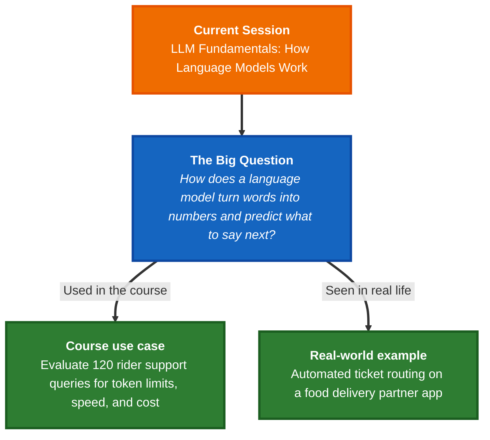

## <span style="color:#2F7DDE">LLM Fundamentals: How Language Models Work</span>

### <span style="color:#2F7DDE">Mental Map</span>



---

### <span style="color:#2F7DDE">What You'll Learn</span>

Have you ever wondered how an AI chat app writes out human-like answers word by word, and why it sometimes gives two completely different responses to the exact same question?

By the end of this session, you will be able to:

- <span style="color:#D9660B">**Explain**</span> how language models break sentences into numerical tokens.
- <span style="color:#D9660B">**Calculate**</span> token usage and monitor conversation limits inside a fixed context window.
- <span style="color:#D9660B">**Adjust**</span> temperature to make model responses factual or creative.
- <span style="color:#D9660B">**Filter**</span> unlikely words using top-p nucleus sampling.
- <span style="color:#D9660B">**Compare**</span> latency, cost, and accuracy between classical ML classifiers and generative LLMs.

> <span style="color:#2F7DDE">**Topics you will meet:**</span> Tokenization; Next-token prediction; Context windows and memory limits; Temperature scaling; Top-p sampling; Classical ML versus LLM trade-offs.
>
> Join the session to learn each of these in detail.

---

### <span style="color:#2F7DDE">Why You Are Learning This Topic</span>

A food delivery rider opens the partner support app to report a missing incentive bonus.

Instead of a human reading every ticket, an AI assistant reads the complaint.

The assistant does not understand the meaning of words like a human does.

It cuts the rider's message into small numerical chunks called tokens.

A <span style="color:#D9660B">**token**</span> means a basic piece of text (around 3 to 4 English letters) that a language model reads, calculates probabilities for, and generates one at a time.

Knowing how tokens, context windows, and sampling settings work helps you control model accuracy, prevent hallucinations, and avoid expensive API bills in your AI projects.

> <span style="color:#2F7DDE">**Think about it:**</span> If an AI model only predicts one word piece at a time, how does it write paragraphs that make complete sense?

---

### <span style="color:#2F7DDE">The Delivery Partner Ticket Puzzle</span>

A support desk log records four incoming messages from delivery riders in Bengaluru.

| Ticket ID | Partner ID | Query Text | Tokens | Classical Latency (ms) |
|:---------:|:----------:|:-----------|:------:|:----------------------:|
| 1001 | DP-1001 | Weekly payout is short by 600 rupees | 34 | 3 |
| 1002 | DP-1002 | Customer location marked on highway | 20 | 4 |
| 1003 | DP-1003 | Restaurant delay of 25 minutes | 33 | 8 |
| 1004 | DP-1004 | App froze during OTP entry | 14 | 3 |

<span style="color:#D9660B">**What you want to happen:**</span>

- Understand why a 7-word message like `App froze during OTP entry` splits into 14 tokens.
- Keep urgent rider tickets under strict token budgets so the system never runs out of context memory.
- Choose whether to route routine questions through sub-10ms classical classifiers or through generative models.

Here is how it might start. You do not need to understand it yet.

```python
import pandas as pd
df = pd.read_csv("data/swiggy_support_queries.csv").head(4)
print(df[["ticket_id", "query_text", "tokens", "lat_classical_ms"]])
```

> <span style="color:#D9660B">**Wonder about this:**</span>
>
> - Why does an LLM take 900 milliseconds to answer when a classical classifier takes only 5 milliseconds?
> - What happens when a long conversation exceeds the model's maximum context window?

---

### <span style="color:#2F7DDE">Think It Through</span>

There is no wrong first try. Keep your guesses for the session.

**1. If you ask an LLM the same question five times with temperature set to 0.0, will the answer change each time?**
Hint: Temperature controls the amount of randomness applied to word probabilities.

**2. If an English word has 12 letters and uncommon punctuation, will it count as one token or multiple tokens?**
Hint: Models break long or uncommon words into smaller sub-word pieces.

**3. Why is a classical classification model often better than an LLM for sorting tickets into five fixed categories?**
Hint: Think about speed, cost, and predictability when categorizing thousands of tickets every minute.

---

### <span style="color:#2F7DDE">One Question to Carry Into the Session</span>

> <span style="color:#2F7DDE">**How does a simple probability calculator predicting one token at a time produce intelligent, structured answers?**</span>
>
> When would you deliberately choose NOT to use an LLM for a text classification task in production?
