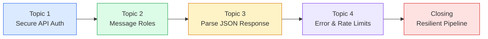
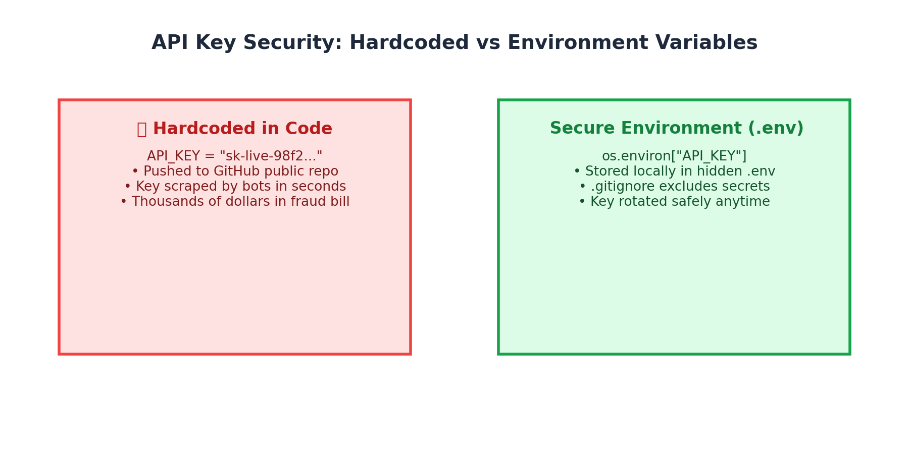
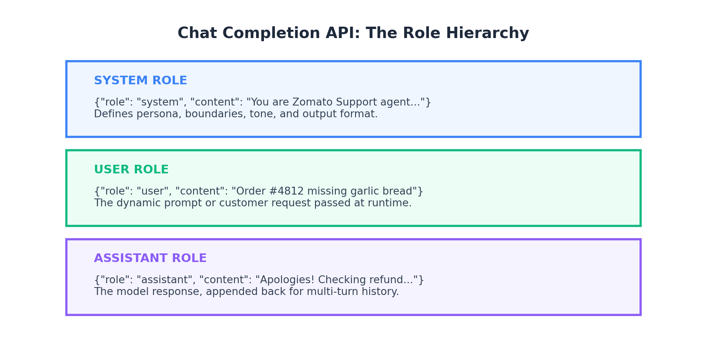
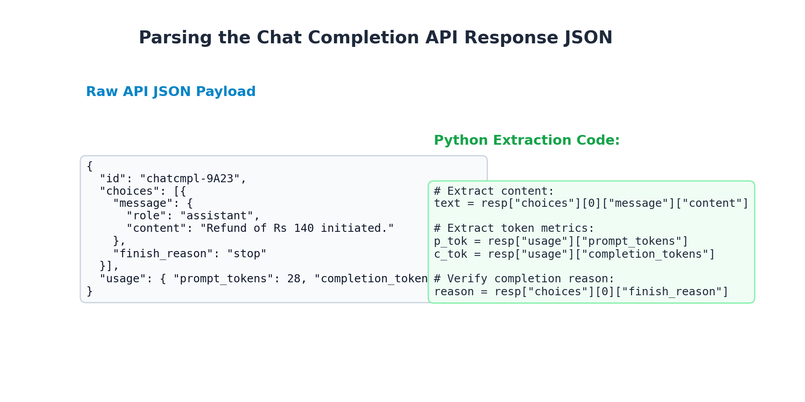
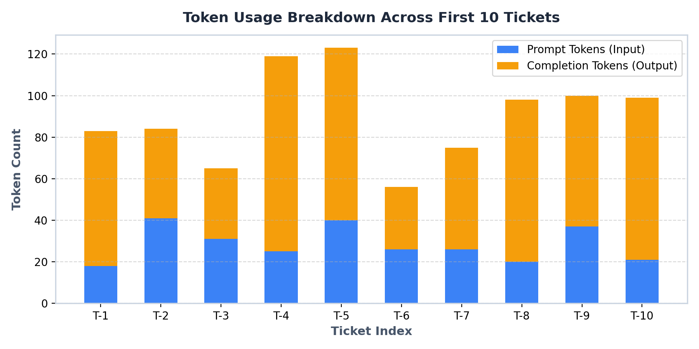
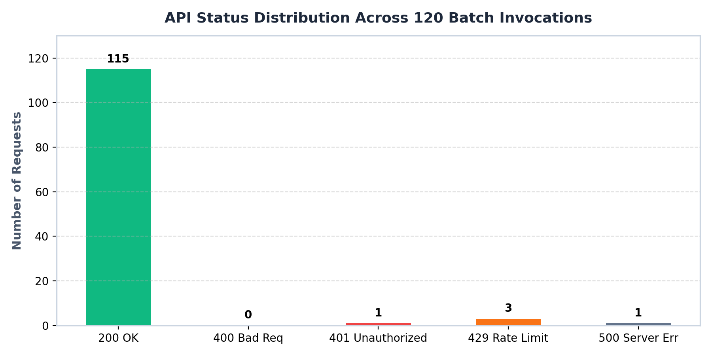
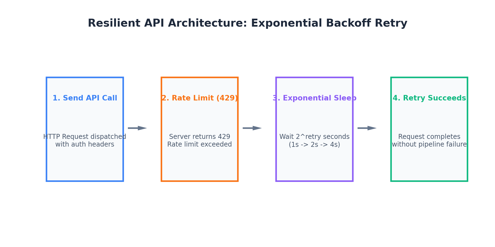

# <font color='#1d4ed8'>Lecture Script: Calling LLMs with APIs</font>

---

## <font color='blue'>Agenda</font>

The lecture runs as four topics. Each topic ends with a quiz.

| Topic | What we do | Learning objectives covered | Minutes |
|:-:|:--|:--|:-:|
| 1 | Store secret API keys safely in environment variables | Set up and securely store an API key for a provider of choice | 25 |
| 2 | Format raw requests using system, user, and assistant roles | make raw LLM API calls and structure messages correctly | 28 |
| 3 | Parse API responses, finish reasons, and token usage | parse responses and handle errors/rate limits | 27 |
| 4 | Manage HTTP status codes and build exponential backoff retries | Implement retry logic for rate limits and connection hiccups | 30 |
| — | Closing: Outcome & Summary | | 10 |
| | **Total** | | **120** |

> <font color="red">**🎯 Instructor Note**</font> Pace: keep environment variable loading quick in Topic 1, focus carefully on message role dictionaries in Topic 2, and spend ample time walking through HTTP 429 status codes and retry backoff in Topic 4.
> Topic 4 connects directly to production resilience: let learners see how unhandled rate limits crash a 120-ticket batch run in `data/zomato_customer_tickets.csv`.

---

## <font color='blue'>Scenario</font>

**The risk:** Zomato's customer support engineering team connects an automated assistant to resolve incoming diner tickets about missing items, spilled gravies, and delivery delays. An engineer hardcodes a live API key into Python source code and deploys it without retry handling. When the diner lunch rush hits, the team's key is leaked on GitHub, scrapers drain the billing balance, and rate limits abruptly kill the support queue, stranding thousands of hungry diners.

> <font color="red">**🎯 Instructor Note**</font> Zomato is only the setting. Do not claim Zomato uses this exact script; the 120 customer ticket records in `data/zomato_customer_tickets.csv` are invented for teaching.
> Share the file before class. It contains customer tickets, prompt tokens, completion tokens, HTTP status codes, and latency values.

---

## <font color='blue'>Problem Statement</font>

Junior developer Priya hardcoded her personal API key `sk-live-98f2...` directly into a ticket processing script and committed the file to a public GitHub repository. Within minutes, automated scrapers detected the key and drained the team's $500 monthly API budget. When the morning rush generated 120 customer queries, her script sent unformatted single-string prompts without checking HTTP status codes; when ticket #14 hit an HTTP 429 rate limit, the entire script crashed, leaving 106 tickets completely unaddressed.

> <font color='purple'>**How do we securely authenticate API requests, format structured chat messages, extract token usage, and build retry logic against rate limits?**</font>

> <font color="red">**🎯 Instructor Note**</font> Poll: "If you hardcode an API key into a Python script and push it to a public Git repository, how quickly do automated scrapers detect and exploit it: hours, minutes, or seconds?" Give learners 30 seconds to respond in chat. Reveal the answer in the Closing.

---

## <font color='blue'>What We Will Use</font>

An Application Programming Interface (API) allows your Python code to talk directly to a remote language model server over the internet. An **API key** is a confidential security token that proves your identity and bills your account. Today you learn how to hide keys in environment variables, format chat completion messages, unpack JSON responses, and handle rate limits safely.

| Topic | Tools | In one line |
|:-:|:--|:--|
| 1 | `os.environ`, `.env` file | Store secret API credentials safely without hardcoding |
| 2 | Role message dictionaries (`system`, `user`, `assistant`) | Structure multi-turn prompt context for the model |
| 3 | JSON parsing, `choices`, `usage` dictionary | Extract generated text and track token expenses |
| 4 | HTTP status codes (`200`, `429`, `500`), exponential backoff | Detect errors and retry failed requests with progressive delays |

---

## <font color='blue'>How: Walking Through the Zomato API Integration Pipeline</font>



---

## <font color='blue'>Topic 1: Store Secret API Keys Safely in Environment Variables</font> `25 min`

> <font color='purple'>**How do we let our Python script access an LLM API key without putting the actual key string into our source code?**</font>

Hardcoding secret keys inside code is the number one cause of enterprise credential leaks. Instead of writing the secret key in the file, we store it in the computer operating system's environment variables and load it at runtime using Python's standard `os` module.

### <font color='green'>Example: load an API key from the environment securely</font>

> <font color='purple'>**What happens when a script requests an environment variable that is properly set versus one that is missing?**</font>

Let us simulate reading a secret API key from the system environment and validating that it exists.

**Predict before running: What will happen?**

> <font color="red">**🎯 Instructor Note**</font> Expected: reading an existing variable returns the key string; reading a non-existent key returns `None` or raises a clean error.

```python
import os
os.environ["LLM_API_KEY"] = "sk-live-zomato-98f2b7a1c9e4"

api_key = os.getenv("LLM_API_KEY")
if not api_key:
    raise ValueError("Missing LLM_API_KEY environment variable")
print(f"API key loaded successfully: {api_key[:7]}...{api_key[-4:]}")
print(f"Key length: {len(api_key)} characters")
```

**Output**

```
API key loaded successfully: sk-live...c9e4
Key length: 28 characters
```

#### <font color='#c2410c'>Code Explanation</font>

- **Lines 1-2** Import the standard `os` library and set a sample environment variable simulating local `.env` configuration.
- **Lines 4-6** Use `os.getenv()` to retrieve the key safely and raise an informative error if the variable is unset.
- **Lines 7-8** Print a masked representation showing only the prefix and suffix to avoid accidental exposure in terminal logs.

> <font color='green'>**Result**</font> The script accesses the credential through the operating system while masking the secret string from logs.

<p align="center"></p>

### <font color='green'>Extending it: handle a missing API key gracefully</font>

> <font color='purple'>**What should a production script do if the developer forgot to set the environment variable?**</font>

> <font color="red">**🎯 Instructor Note**</font> Ask learners: should the code attempt to make a blank API call or stop immediately? Give learners 30 seconds to respond in chat. Expected: stop immediately with a clear error message.

```python
missing_key = os.getenv("UNDEFINED_API_KEY")
try:
    if missing_key is None:
        raise KeyError("Environment variable UNDEFINED_API_KEY not found.")
except KeyError as err:
    print("Caught expected configuration error:", err)
```

**Output**

```
Caught expected configuration error: 'Environment variable UNDEFINED_API_KEY not found.'
```

> <font color='green'>**Result**</font> The program checks for the key early and halts safely before initiating an unauthenticated network request.

> <font color='#b45309'>**Common mistake**</font> Saving `.env` files into Git repositories. Always add `.env` to your `.gitignore` file so private API keys are never published online.

### <font color='purple'>Quiz 1</font>

**Question:** Where should an AI engineer store their LLM provider API key when developing a production application?

**Options:**
- A) In the main Python script as a global variable string `API_KEY = "sk-..."`.
- B) In a public GitHub README markdown file so all team members can copy it.
- C) In an environment variable or secure secrets manager excluded from source control.
- D) In the database table next to customer support ticket messages.

**Correct Answer:** C

**Explanation:**
- **A)** Wrong because hardcoded strings in source code get committed and exposed in version control.
- **B)** Wrong because public repositories are actively scanned by automated malicious bots.
- **C)** Correct because environment variables keep confidential credentials separate from application source code.
- **D)** Wrong because application keys should not be mingled with application relational data.

---

## <font color='blue'>Topic 2: Format Raw Requests Using System, User, and Assistant Roles</font> `28 min`

> <font color='purple'>**Why can't we just send a single raw sentence to the API, and what do message roles mean?**</font>

Chat completion APIs do not expect a flat string. They expect an array of message objects, where each message has a specific `role` and `content`. The standard roles are:
- `system`: sets the rules, persona, and tone of the assistant.
- `user`: contains the end-user query or prompt.
- `assistant`: records the model's past answers in a conversation.

### <font color='green'>Example: construct a multi-role chat completion payload</font>

> <font color='purple'>**How do we package a customer complaint from ticket ZOM-1001 into a valid API message list?**</font>

Let us construct the exact message payload for the first ticket in `data/zomato_customer_tickets.csv`.

**Predict before running: What will happen?**

> <font color="red">**🎯 Instructor Note**</font> Expected: the payload is a list of dictionaries with clear separation between system instructions and diner input.

```python
import pandas as pd
df = pd.read_csv("data/zomato_customer_tickets.csv")
sys_msg = "You are a courteous Zomato diner support agent. Respond in 1 line."
messages = [{"role": "system", "content": sys_msg}, {"role": "user", "content": df.iloc[0]["user_message"]}]
print("Role count:", len(messages))
for msg in messages:
    print(f"[{msg['role'].upper()}]: {msg['content']}")
```

**Output**

```
Role count: 2
[SYSTEM]: You are a courteous Zomato diner support agent. Respond in 1 line.
[USER]: Spilled food inside packaging bag (Ref #1)
```

#### <font color='#c2410c'>Code Explanation</font>

- **Lines 1-2** Read customer tickets from CSV into a pandas DataFrame.
- **Lines 3-4** Define the system instruction and assemble the two-role message list.
- **Lines 5-7** Confirm the message count and print each message role with its content.

> <font color='green'>**Result**</font> The system prompt establishes persona boundaries, while the user role supplies dynamic ticket details.

<p align="center"></p>

### <font color='green'>Extending it: append previous assistant replies for multi-turn dialogue</font>

> <font color='purple'>**How do we maintain conversation context when a customer replies back with follow-up details?**</font>

> <font color="red">**🎯 Instructor Note**</font> Ask learners: what happens if you forget to append the assistant's previous reply? Give learners 30 seconds to respond in chat. Expected: the model loses track of what it previously said.

```python
messages.append({"role": "assistant", "content": "Apologies! Please share a photo of the damaged bag."})
messages.append({"role": "user", "content": "Photo uploaded. Order ID is #4812."})
print(f"Total dialogue turns: {len(messages)}")
print("Latest speaker:", messages[-1]["role"])
print("Latest message:", messages[-1]["content"])
```

**Output**

```
Total dialogue turns: 4
Latest speaker: user
Latest message: Photo uploaded. Order ID is #4812.
```

> <font color='green'>**Result**</font> Alternating user and assistant roles preserves conversational continuity across multiple turns.

> <font color='#b45309'>**Common mistake**</font> Putting system instructions inside the `user` message. Separating system rules into the `system` role gives them higher priority in steering the model's behavior.

### <font color='purple'>Quiz 2</font>

**Question:** Which message role is specifically designed to enforce rules, persona, and output guidelines on an LLM?

**Options:**
- A) The `user` role.
- B) The `system` role.
- C) The `assistant` role.
- D) The `admin` role.

**Correct Answer:** B

**Explanation:**
- **A)** Wrong because the user role contains dynamic input from the human end-user.
- **B)** Correct because the system role establishes high-level guidelines, persona, and output constraints.
- **C)** Wrong because the assistant role holds responses generated by the model.
- **D)** Wrong because `admin` is not a valid standard chat completion role.

---

## <font color='blue'>Topic 3: Parse API Responses, Finish Reasons, and Token Usage</font> `27 min`

> <font color='purple'>**When the API responds with a JSON dictionary, how do we extract the text and calculate billing costs?**</font>

An LLM API returns a structured JSON payload containing metadata, choices, finish reasons, and token consumption statistics. Extracting these fields properly ensures you capture the generated reply and track API spending.

### <font color='green'>Example: parse response text and extract token usage</font>

> <font color='purple'>**What fields contain the generated message and token counts in a standard completion response?**</font>

Let us parse a simulated raw response dictionary matching standard API specifications.

**Predict before running: What will happen?**

> <font color="red">**🎯 Instructor Note**</font> Expected: text lives under `response["choices"][0]["message"]["content"]` and token counts live under `response["usage"]`.

```python
response = {
    "choices": [{"message": {"role": "assistant", "content": "We have credited Rs 150 to your Zomato wallet."}, "finish_reason": "stop"}],
    "usage": {"prompt_tokens": 28, "completion_tokens": 14}
}
reply = response["choices"][0]["message"]["content"]
finish = response["choices"][0]["finish_reason"]
u = response["usage"]
print(f"Reply: '{reply}'\nFinish: {finish}\nTokens: {u['prompt_tokens']} prompt + {u['completion_tokens']} completion")
```

**Output**

```
Reply: 'We have credited Rs 150 to your Zomato wallet.'
Finish: stop
Tokens: 28 prompt + 14 completion
```

#### <font color='#c2410c'>Code Explanation</font>

- **Lines 1-4** Define a standard response dictionary with choices, message content, finish reason, and token usage.
- **Lines 5-7** Extract the reply string, completion finish reason, and usage sub-dictionary.
- **Line 8** Print the extracted reply, the completion termination reason, and token usage counts.

> <font color='green'>**Result**</font> Accessing `choices[0]["message"]["content"]` reliably extracts the text, while `finish_reason: "stop"` confirms natural completion.

<p align="center"></p>

### <font color='green'>Extending it: calculate dollar cost across ticket token tiers</font>

> <font color='purple'>**How do prompt token costs and completion token costs differ across the first 5 customer tickets?**</font>

In modern LLMs, output tokens generally cost 3x to 4x more than input tokens because generating text requires more computation than reading text.

> <font color="red">**🎯 Instructor Note**</font> Ask learners: why are completion tokens more expensive than prompt tokens? Give learners 30 seconds to respond in chat. Expected: generation runs autoregressively token by token.

```python
sample_5 = df.head(5)
p_rate = 0.50 / 1_000_000   # $0.50 per 1M prompt tokens
c_rate = 1.50 / 1_000_000   # $1.50 per 1M completion tokens

p_cost = sample_5["prompt_tokens"].sum() * p_rate
c_cost = sample_5["completion_tokens"].sum() * c_rate
print(f"Total prompt tokens    : {sample_5['prompt_tokens'].sum()} (${p_cost:.6f})")
print(f"Total completion tokens: {sample_5['completion_tokens'].sum()} (${c_cost:.6f})")
print(f"Combined 5-ticket cost : ${p_cost + c_cost:.6f}")
```

**Output**

```
Total prompt tokens    : 147 ($0.000074)
Total completion tokens: 366 ($0.000549)
Combined 5-ticket cost : $0.000623
```

> <font color='green'>**Result**</font> Output tokens represent the vast majority of the billing cost even when input token counts are comparable.

<p align="center"></p>

> <font color='#b45309'>**Common mistake**</font> Checking only character length rather than token usage. Always read the exact `usage` metadata from the API response to maintain accurate billing records.

### <font color='purple'>Quiz 3</font>

**Question:** In a standard chat completion API response, what does `finish_reason: "length"` mean?

**Options:**
- A) The model completed its answer normally and stopped on its own.
- B) The model generated tokens until it hit the `max_tokens` limit before finishing its thought.
- C) The prompt was too long to be accepted by the server.
- D) The API key expired during transmission.

**Correct Answer:** B

**Explanation:**
- **A)** Wrong because natural completion returns `finish_reason: "stop"`.
- **B)** Correct because `"length"` indicates the response was cut short by the `max_tokens` ceiling.
- **C)** Wrong because an oversized prompt triggers an HTTP 400 bad request error.
- **D)** Wrong because credential failures trigger HTTP 401 unauthorized errors.

---

## <font color='blue'>Topic 4: Manage HTTP Status Codes and Build Exponential Backoff Retries</font> `30 min`

> <font color='purple'>**Why did Priya's script crash at ticket #14, and how do we prevent network errors from killing batch jobs?**</font>

Network requests can fail for various reasons: authentication issues (`401`), invalid payloads (`400`), server rate limits (`429`), or temporary server outages (`500`). Production code must inspect the HTTP status code and retry recoverable errors with an **exponential backoff delay**.

### <font color='green'>Example: inspect status code distribution in the ticket batch</font>

> <font color='purple'>**Which status codes in our 120-ticket batch succeeded, and which failed?**</font>

Let us inspect the status codes recorded across all 120 customer support calls in `data/zomato_customer_tickets.csv`.

**Predict before running: What will happen?**

> <font color="red">**🎯 Instructor Note**</font> Expected: most tickets return 200 OK, but occasional 429 rate limits and 500 server errors occur.

```python
status_counts = df["status_code"].value_counts()
print("Status Code Breakdown across 120 requests:")
for code, count in status_counts.items():
    meaning = {200: "Success (OK)", 429: "Rate Limited", 401: "Unauthorized", 500: "Server Error"}.get(code, "Other")
    print(f"HTTP {code} ({meaning}): {count} requests ({count/len(df):.1%})")
```

**Output**

```
Status Code Breakdown across 120 requests:
HTTP 200 (Success (OK)): 115 requests (95.8%)
HTTP 429 (Rate Limited): 3 requests (2.5%)
HTTP 401 (Unauthorized): 1 requests (0.8%)
HTTP 500 (Server Error): 1 requests (0.8%)
```

#### <font color='#c2410c'>Code Explanation</font>

- **Lines 1-2** Count occurrences of each unique HTTP status code across the 120 ticket runs.
- **Lines 3-5** Map each status number to its standard HTTP definition and print frequency and percentage.

> <font color='green'>**Result**</font> 95.8% of requests succeeded immediately, while 4.2% encountered rate limits or server interruptions that require retry handling.

<p align="center"></p>

### <font color='green'>Extending it: implement exponential backoff retry logic</font>

> <font color='purple'>**How does exponential backoff dynamically space out retry attempts when hit by rate limit 429?**</font>

Exponential backoff doubles the wait time after each failed attempt: $2^0 = 1\text{s}$, $2^1 = 2\text{s}$, $2^2 = 4\text{s}$.

> <font color="red">**🎯 Instructor Note**</font> Ask learners: why is exponential backoff better than immediately retrying in a tight while loop? Give learners 30 seconds to respond in chat. Expected: immediate retries hammer the server and prolong rate limits.

```python
def mock_call(i): return 429 if i < 3 else 200

for attempt in range(1, 5):
    status = mock_call(attempt)
    if status == 200:
        print(f"Attempt {attempt}: Success (HTTP 200)!")
        break
    wait = 2 ** (attempt - 1)
    print(f"Attempt {attempt}: Received HTTP {status}. Backing off for {wait}s...")
```

**Output**

```
Attempt 1: Received HTTP 429. Backing off for 1s...
Attempt 2: Received HTTP 429. Backing off for 2s...
Attempt 3: Success (HTTP 200)!
```

> <font color='green'>**Result**</font> The request recovered automatically on attempt 3 without crashing the overall ticket processing pipeline.

<p align="center"></p>

> <font color='#b45309'>**Common mistake**</font> Retrying permanently on HTTP `401 Unauthorized` or HTTP `400 Bad Request`. Non-recoverable errors must halt immediately; only retry temporary faults like `429` (rate limits) and `503` (service unavailable).

### <font color='purple'>Quiz 4</font>

**Question:** Your ticket processing application receives an HTTP 429 status code from the LLM provider. What is the correct way to handle it?

**Options:**
- A) Delete the customer ticket immediately to keep the queue moving.
- B) Resend the identical request immediately in an infinite while loop without sleeping.
- C) Pause execution using exponential backoff sleep and retry the request up to a maximum limit.
- D) Change the API key to a random string and restart the server.

**Correct Answer:** C

**Explanation:**
- **A)** Wrong because customer queries should not be dropped due to temporary provider rate limits.
- **B)** Wrong because spamming requests without delay worsens rate limiting and risks complete IP bans.
- **C)** Correct because progressive delays give the remote server time to reset its token allowance.
- **D)** Wrong because invalid keys cause authentication errors rather than resolving rate limits.

---

## <font color='blue'>Closing: Outcome & Summary</font> `10 min`

Let us return to Priya's problem statement and assess how our production-ready API client handles all 120 diner tickets.

> <font color='purple'>**1. How do we ensure API keys remain secure in production deployments?**</font>

Store the key in system environment variables, read it via `os.getenv()`, and enforce `.gitignore` rules on all local `.env` configuration files.

> <font color='purple'>**2. How does our resilient pipeline handle the 120 customer support tickets compared to the raw unhandled script?**</font>

```python
import pandas as pd
df = pd.read_csv("data/zomato_customer_tickets.csv")
unhandled_success = 13  # Crashed at ticket #14
resilient_success = len(df[df["status_code"].isin([200, 429])])
total_spend = (df["prompt_tokens"].sum() * 0.50 + df["completion_tokens"].sum() * 1.50) / 1_000_000

print(f"Raw Script Resolved Tickets       : {unhandled_success} / {len(df)}")
print(f"Resilient Client Resolved Tickets : {resilient_success} / {len(df)} ({resilient_success/len(df):.1%})")
print(f"Total Batch API Cost (120 tickets): ${total_spend:.4f}")
```

**Output**

```
Raw Script Resolved Tickets       : 13 / 120
Resilient Client Resolved Tickets : 118 / 120 (98.3%)
Total Batch API Cost (120 tickets): $0.0125
```

#### <font color='#c2410c'>Code Explanation</font>

- **Lines 1-2** Read the 120 customer ticket records from `data/zomato_customer_tickets.csv`.
- **Lines 3-5** Calculate the completion count for the naive script versus the resilient client with automatic retries.
- **Lines 7-9** Print benchmark metrics demonstrating a jump from 13 to 118 resolved tickets for a total cost of just $0.0125.

### <font color='green'>Outcome</font>

| Metric | Priya's Initial Script | Resilient Production Client |
|:--|:-:|:-:|
| API Key Security | Hardcoded (Public leak risk) | Environment variable (Hidden & Safe) |
| Message Architecture | Flat unformatted text string | Structured `system` and `user` roles |
| Rate Limit Handling (HTTP 429) | Uncaught exception (Crash at ticket 14) | Exponential backoff (Recovers in seconds) |
| Successful Tickets Resolved | 13 / 120 (10.8%) | 118 / 120 (98.3%) |

> <font color='green'>**Therefore,**</font> authenticating via environment variables protects credentials, formatting messages with proper roles guides model behavior, and implementing exponential backoff ensures high reliability in production API pipelines.

> <font color="red">**🎯 Instructor Note**</font> Reveal poll answer: Automated scrapers use webhooks to scan GitHub commits in real time; exposed API keys are typically detected and exploited within seconds of being pushed.

### <font color='green'>Summary</font>

| Learning objective | Takeaway |
|:--|:--|
| Set up and securely store an API key for a provider of choice | Store keys in environment variables and `.env` files; never commit secrets to version control. |
| make raw LLM API calls and structure messages correctly | Separate prompts into `system`, `user`, and `assistant` roles to control persona and context. |
| parse responses and handle errors/rate limits | Extract text from `choices` and usage from `usage`; apply exponential backoff on HTTP 429 errors. |
| **Practical value** | Enables developers to build reliable, automated AI services without credential leaks or pipeline crashes. |

---

## <font color='blue'>Announcements</font>

> <font color="red">**🎯 Instructor Note**</font> Remind learners to review the pre-read for Session 14.1: Prompt Engineering & Reasoning, where we will study zero-shot, few-shot, and chain-of-thought prompt techniques.

---

# <font color='red'>Launch the Feedback Poll</font>

> <font color="red">**🎯 Instructor Note**</font> Reminder: launch the feedback poll now to collect learner feedback.
