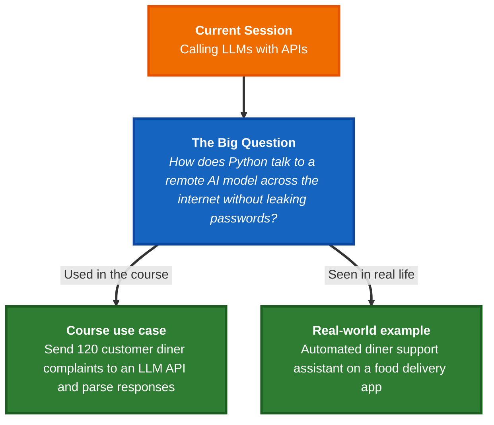

## <span style="color:#2F7DDE">Calling LLMs with APIs</span>

### <span style="color:#2F7DDE">Mental Map</span>



---

### <span style="color:#2F7DDE">What You'll Learn</span>

Have you ever wondered how software applications like travel planners or food ordering apps connect to advanced AI models behind the scenes without anyone opening a browser chat window?

By the end of this session, you will be able to:

- <span style="color:#D9660B">**Store**</span> sensitive API authentication keys securely inside operating system environment variables.
- <span style="color:#D9660B">**Construct**</span> valid chat completion payloads using system, user, and assistant roles.
- <span style="color:#D9660B">**Extract**</span> generated message text and token usage statistics from JSON responses.
- <span style="color:#D9660B">**Calculate**</span> financial billing costs across input and output token categories.
- <span style="color:#D9660B">**Implement**</span> exponential backoff delays to survive HTTP 429 rate limit errors automatically.

> <span style="color:#2F7DDE">**Topics you will meet:**</span> API keys and environment variables; System, user, and assistant roles; Parsing JSON response structures; Tracking token usage and costs; HTTP status codes; Exponential backoff retry handling.
>
> Join the session to learn each of these in detail.

---

### <span style="color:#2F7DDE">Why You Are Learning This Topic</span>

A diner orders dinner on a food delivery app at 8:30 PM.

The delivered bag is missing garlic bread and sauces.

The customer taps the help button and types a complaint into the chat box.

Your Python backend needs to forward this complaint to an AI language model and display an instant refund reply.

An <span style="color:#D9660B">**API (Application Programming Interface)**</span> means a standard doorway that lets one software program send requests and receive structured data from another program across the internet.

Writing secure API calls and handling server rate limits ensures your automated AI features run non-stop without crashing or exposing confidential company passwords.

> <span style="color:#2F7DDE">**Think about it:**</span> If your script sends 500 requests at the exact same second, why does the remote server reject them with an HTTP 429 error?

---

### <span style="color:#2F7DDE">The Diner Support API Puzzle</span>

A batch dispatch log records four customer complaints queued for automated resolution.

| Ticket ID | Customer ID | Issue Type | Prompt Tokens | HTTP Status |
|:---------:|:-----------:|:-----------|:-------------:|:-----------:|
| ZOM-1001 | CUST-5192 | Spilled food inside bag | 28 | 200 |
| ZOM-1002 | CUST-8314 | Missing item garlic bread | 34 | 200 |
| ZOM-1014 | CUST-9042 | Rider stationary at signal | 42 | 429 |
| ZOM-1027 | CUST-6110 | Refund not reflected | 22 | 401 |

<span style="color:#D9660B">**What you want to happen:**</span>

- Understand why ticket ZOM-1027 failed with status 401 (invalid or missing API credential).
- Catch the temporary HTTP 429 rate limit on ticket ZOM-1014 and retry after 2 seconds instead of terminating the program.
- Extract the completion text from ticket ZOM-1001 to credit the diner's wallet.

Here is how it might start. You do not need to understand it yet.

```python
import pandas as pd
df = pd.read_csv("data/zomato_customer_tickets.csv").head(4)
print(df[["ticket_id", "issue_type", "status_code"]])
```

> <span style="color:#D9660B">**Wonder about this:**</span>
>
> - Why do AI providers charge different prices for reading words versus generating words?
> - What happens when an automated script hardcodes a private API key into a file uploaded to public GitHub?

---

### <span style="color:#2F7DDE">Think It Through</span>

There is no wrong first try. Keep your guesses for the session.

**1. Why should you never write `API_KEY = "sk-..."` directly inside your Python code?**
Hint: Consider who has access to the codebase when you commit or share files.

**2. What is the key difference between the `system` role and the `user` role in an API message list?**
Hint: Think about which message defines the rules of behavior and which contains the customer's specific question.

**3. If an API call fails with status code 429 (Rate Limit Exceeded), should your program immediately quit or pause and try again?**
Hint: Rate limits are temporary speed bumps, not permanent rejections.

---

### <span style="color:#2F7DDE">One Question to Carry Into the Session</span>

> <span style="color:#2F7DDE">**How does a few lines of Python code securely communicate with a billion-parameter AI model across the world in under a second?**</span>
>
> How would you design a retry strategy that protects both your application and the remote API server?
