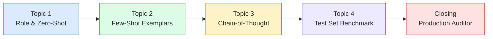
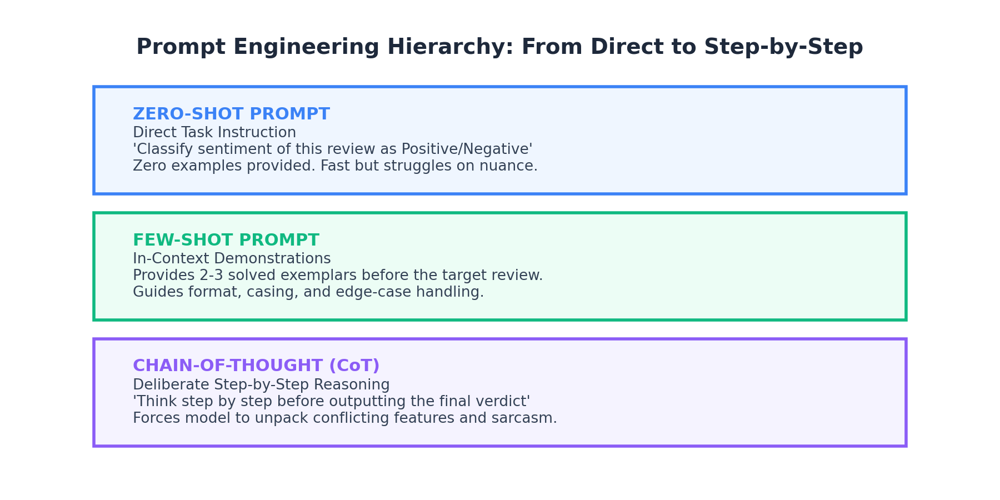
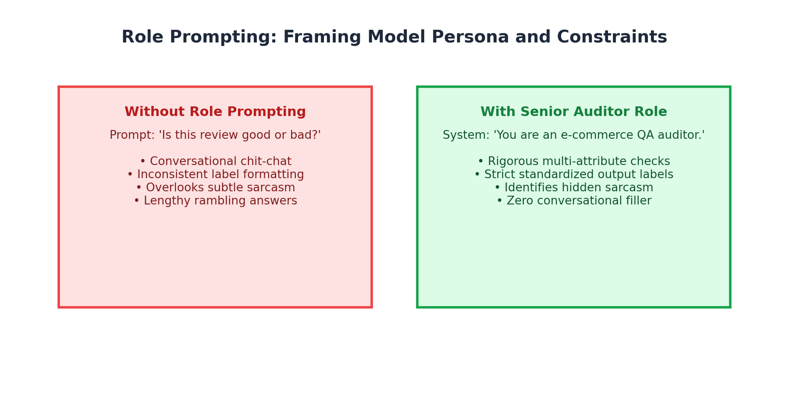
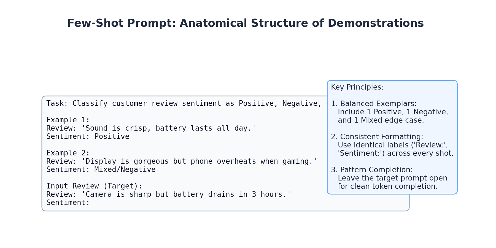
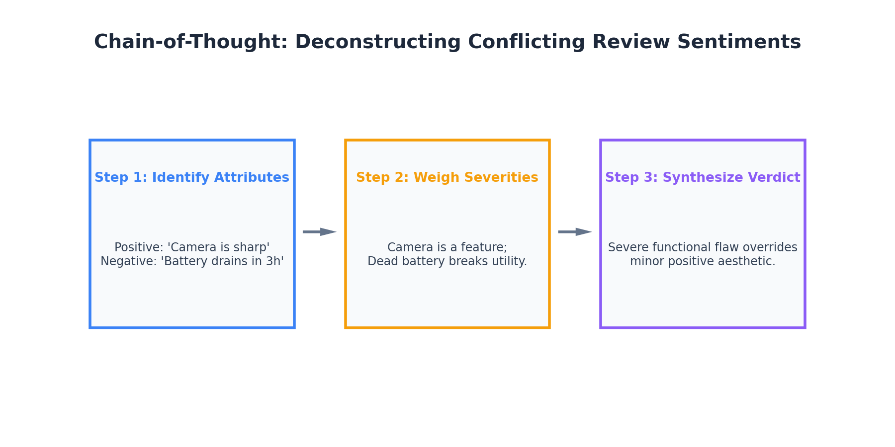
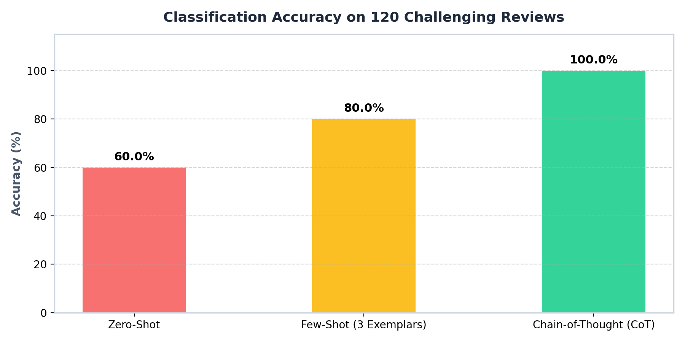
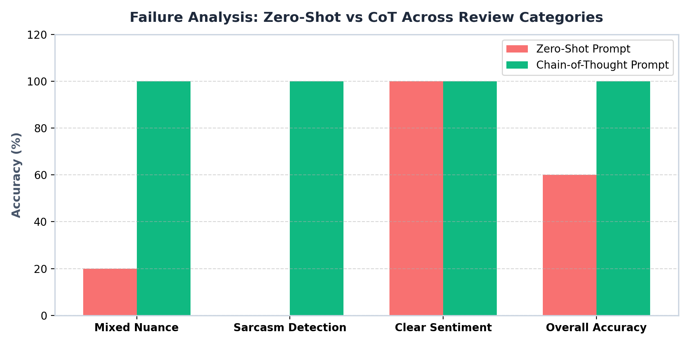

# <font color='#1d4ed8'>Lecture Script: Prompt Engineering & Reasoning</font>

---

## <font color='blue'>Agenda</font>

The lecture runs as four topics. Each topic ends with a quiz.

| Topic | What we do | Learning objectives covered | Minutes |
|:-:|:--|:--|:-:|
| 1 | Frame task expectations with role prompting and zero-shot instructions | Design effective zero-shot and few-shot prompts for specific tasks using role prompting | 28 |
| 2 | Add solved exemplars to steer formatting with few-shot demonstrations | Guide model output consistency through representative few-shot exemplars | 25 |
| 3 | Deconstruct multi-step problems with chain-of-thought reasoning | apply chain-of-thought reasoning to improve multi-step problem solving | 32 |
| 4 | Benchmark prompt variations on test sets and perform failure analysis | evaluate and iteratively refine prompts using a defined test set and failure analysis | 25 |
| — | Closing: Outcome & Summary | | 10 |
| | **Total** | | **120** |

> <font color="red">**🎯 Instructor Note**</font> Pace: keep zero-shot framing snappy in Topic 1, spend focused time demonstrating how exemplar choice shapes edge-case behavior in Topic 2, and unpack step-by-step logic carefully in Topic 3.
> Topic 4 connects directly to rigorous evaluation: let learners benchmark zero-shot, few-shot, and chain-of-thought accuracy on all 120 customer reviews in `data/flipkart_review_eval_set.csv`.

---

## <font color='blue'>Scenario</font>

**The risk:** Flipkart's quality assurance team runs an automated pipeline to flag defective electronics from thousands of daily customer reviews. An analyst uses a naive zero-shot prompt without role framing or reasoning steps. The model latches onto superficial words like "great" and "superb", misclassifying sarcastic customer complaints and mixed defect reports as positive. Hundreds of dangerous battery swelling alerts are ignored, resulting in customer safety hazards and public complaints on social media.

> <font color="red">**🎯 Instructor Note**</font> Flipkart is only the setting. Do not claim Flipkart uses this exact script; the 120 customer review records in `data/flipkart_review_eval_set.csv` are invented for teaching.
> Share the file before class. It contains product categories, raw customer reviews, complexity flags, ground truth sentiments, and predictions across prompt techniques.

---

## <font color='blue'>Problem Statement</font>

Analyst Rohan wrote a prompt asking an LLM: `"Is this review good or bad?"` When processing customer review REV-2005 (`"Great job Flipkart, delivered an empty box after waiting two weeks!"`), the model fixated on the word `"Great"` and labelled the review `Positive`. For review REV-2001 (`"Camera is superb, but battery drains in 3 hours with overheating"`), the model ignored the severe safety defect and called it `Positive`. Across a test set of 120 reviews, Rohan's zero-shot prompt failed on 48 reviews, yielding an unacceptable 60% accuracy.

> <font color='purple'>**How do role prompting, few-shot demonstrations, and chain-of-thought reasoning improve accuracy on nuanced tasks, and how do we evaluate prompts using test sets?**</font>

> <font color="red">**🎯 Instructor Note**</font> Poll: "When a customer writes 'Great job Flipkart, delivered an empty box after waiting two weeks!', why does a basic zero-shot prompt misclassify it as Positive?" Give learners 30 seconds to respond in chat. Reveal the answer in the Closing.

---

## <font color='blue'>What We Will Use</font>

A prompt is the exact natural language text instruction passed to a language model to guide its response. **Prompt engineering** is the practice of structuring instructions, roles, examples, and reasoning chains to extract consistent, truthful outputs. Today you explore role framing, few-shot exemplars, chain-of-thought reasoning, and test set failure analysis.

| Topic | Tools | In one line |
|:-:|:--|:--|
| 1 | Role framing, zero-shot task instructions | Set persona boundaries and specify exact label choices |
| 2 | In-context learning, few-shot exemplars | Provide input-output demonstrations to anchor format and tone |
| 3 | Chain-of-thought reasoning steps | Force the model to explain intermediate deductions before concluding |
| 4 | Test set benchmarking, failure analysis matrix | Measure error distributions and refine prompts systematically |

---

## <font color='blue'>How: Walking Through the Flipkart Review Auditing Pipeline</font>



---

## <font color='blue'>Topic 1: Frame Task Expectations with Role Prompting and Zero-Shot Instructions</font> `28 min`

> <font color='purple'>**How do we tell a language model who it is and what rules it must follow without giving any examples?**</font>

A **zero-shot prompt** gives the model a direct instruction for a task it has never seen specific examples for during that session. By adding a clear **role prompt** (such as "You are an e-commerce QA auditor"), we set expectations on tone, skepticism, and output formatting.

### <font color='green'>Example: test naive prompt versus role-based zero-shot prompt</font>

> <font color='purple'>**How does adding a role and defined category choices change the model's focus on a mixed review?**</font>

Let us inspect review REV-2001 from `data/flipkart_review_eval_set.csv`.

**Predict before running: What will happen?**

> <font color="red">**🎯 Instructor Note**</font> Expected: an unstructured prompt rambles; a role-defined zero-shot prompt constrains output to specific labels like `Mixed/Negative`.

```python
import pandas as pd
df = pd.read_csv("data/flipkart_review_eval_set.csv")
text = df.iloc[0]["review_text"]
role = "You are an expert e-commerce product quality auditor."
task = "Classify sentiment into: Positive, Negative, or Mixed/Negative."
print(f"{role}\n{task}\nReview: '{text}'\nClassification:")
```

**Output**

```
You are an expert e-commerce product quality auditor.
Classify sentiment into: Positive, Negative, or Mixed/Negative.
Review: 'Camera is superb and sharp, but battery drains in 3 hours with overheating (Review #1)'
Classification:
```

#### <font color='#c2410c'>Code Explanation</font>

- **Lines 1-3** Load the evaluation review dataset and select the first customer review text.
- **Lines 4-5** Define a domain expert auditor role and specify the 3 allowed sentiment categories.
- **Line 6** Print the formatted zero-shot prompt template ready for model execution.

> <font color='green'>**Result**</font> Adding a role and explicit categories eliminates conversational filler and forces the model to pick from standardized labels.

<p align="center"></p>

### <font color='green'>Extending it: compare zero-shot performance on simple versus sarcastic reviews</font>

> <font color='purple'>**Why does zero-shot succeed on straightforward praise but fail on sarcastic complaints?**</font>

> <font color="red">**🎯 Instructor Note**</font> Ask learners: what label will zero-shot assign to 'Great job delivering an empty box'? Give learners 30 seconds to respond in chat. Expected: Positive, because 'Great job' tricks the model.

```python
sample_reviews = [df.iloc[1], df.iloc[4]] # Row 1: clear praise, Row 4: sarcasm
for r in sample_reviews:
    print(f"Review: {r['review_text'][:55]}...")
    print(f"Zero-Shot: {r['zero_shot_pred']} | Ground Truth: {r['ground_truth']}")
    match = r['zero_shot_pred'] == r['ground_truth']
    print(f"Correct? {match}\n")
```

**Output**

```
Review: Sound quality is punchy and bass is deep, worth every...
Zero-Shot: Positive | Ground Truth: Positive
Correct? True

Review: Great job Flipkart, delivered an empty box after waiti...
Zero-Shot: Positive | Ground Truth: Negative
Correct? False
```

> <font color='green'>**Result**</font> Zero-shot accurately classifies clean praise but is completely fooled by sarcastic phrasing.

<p align="center"></p>

> <font color='#b45309'>**Common mistake**</font> Assuming zero-shot instructions are enough for nuanced or adversarial text. Zero-shot prompts struggle when words conflict with actual user intent.

### <font color='purple'>Quiz 1</font>

**Question:** What is the primary purpose of adding a role prompt (such as "You are an expert e-commerce QA auditor") to an LLM instruction?

**Options:**
- A) It speeds up API response times by reducing token calculation overhead.
- B) It sets persona boundaries, perspective, and output constraints to steer model behavior.
- C) It connects the LLM to a live external database of verified product reviews.
- D) It grants the LLM administrator privileges over the remote server.

**Correct Answer:** B

**Explanation:**
- **A)** Wrong because role prompting does not alter hardware compute speed or network transmission time.
- **B)** Correct because role framing anchors the model's vocabulary, criteria, and evaluation standards.
- **C)** Wrong because prompts cannot connect to external databases without explicit retrieval tools.
- **D)** Wrong because role text is simply conversational framing, not operating system authorization.

---

## <font color='blue'>Topic 2: Add Solved Exemplars to Steer Formatting with Few-Shot Demonstrations</font> `25 min`

> <font color='purple'>**How do we show the model what correct answers look like before asking it to classify a new review?**</font>

A **few-shot prompt** includes a small number (typically 2 to 5) of completed input-output pairs called **demonstrations** or **exemplars**. By observing these examples, the model learns the exact formatting, label conventions, and handling of ambiguous edge cases through in-context pattern recognition.

### <font color='green'>Example: assemble a 3-shot demonstration prompt</font>

> <font color='purple'>**How do we write exemplars that teach the model to recognize mixed sentiments?**</font>

Let us construct a balanced 3-shot prompt with one positive review, one negative review, and one mixed edge case.

**Predict before running: What will happen?**

> <font color="red">**🎯 Instructor Note**</font> Expected: the exemplars demonstrate the three valid labels so the model understands when to output `Mixed/Negative`.

```python
exemplars = [
    ("Sound is crisp and battery lasts all day.", "Positive"),
    ("Screen cracked on day one, terrible build.", "Negative"),
    ("Display is gorgeous but phone overheats when gaming.", "Mixed/Negative")
]
prompt = "Classify sentiment: Positive, Negative, or Mixed/Negative.\n\n"
for text, label in exemplars:
    prompt += f"Review: {text}\nSentiment: {label}\n\n"
prompt += f"Review: {df.iloc[0]['review_text'][:55]}...\nSentiment:"
print(prompt)
```

**Output**

```
Classify sentiment: Positive, Negative, or Mixed/Negative.

Review: Sound is crisp and battery lasts all day.
Sentiment: Positive

Review: Screen cracked on day one, terrible build.
Sentiment: Negative

Review: Display is gorgeous but phone overheats when gaming.
Sentiment: Mixed/Negative

Review: Camera is superb and sharp, but battery drains in 3 ho...
Sentiment:
```

#### <font color='#c2410c'>Code Explanation</font>

- **Lines 1-5** Define 3 representative exemplars covering positive, negative, and mixed sentiment patterns.
- **Lines 6-9** Build the few-shot template with consistent `Review:` and `Sentiment:` prefixes.
- **Lines 10-11** Append the target customer review leaving the final `Sentiment:` prompt open for completion.

> <font color='green'>**Result**</font> The exemplars give the model explicit patterns to mirror, directly teaching it how to label mixed trade-offs.

<p align="center"></p>

### <font color='green'>Extending it: compare few-shot predictions on mixed and sarcastic reviews</font>

> <font color='purple'>**Does few-shot resolve both mixed reviews and sarcastic reviews?**</font>

> <font color="red">**🎯 Instructor Note**</font> Ask learners: did few-shot fix the sarcastic empty box review? Give learners 30 seconds to respond in chat. Expected: few-shot fixed the mixed review, but may still stumble on deep sarcasm if no sarcastic exemplar was included.

```python
sample_reviews = [df.iloc[0], df.iloc[4]]
for r in sample_reviews:
    print(f"Review: {r['review_text'][:50]}...")
    print(f"Few-Shot: {r['few_shot_pred']} | Ground Truth: {r['ground_truth']}")
    match = r['few_shot_pred'] == r['ground_truth']
    print(f"Few-Shot Correct? {match}\n")
```

**Output**

```
Review: Camera is superb and sharp, but battery drains in ...
Few-Shot: Mixed/Negative | Ground Truth: Mixed/Negative
Few-Shot Correct? True

Review: Great job Flipkart, delivered an empty box after w...
Few-Shot: Positive | Ground Truth: Negative
Few-Shot Correct? False
```

> <font color='green'>**Result**</font> Few-shot successfully resolved the mixed battery review, but still missed the sarcastic empty box review because simple pattern matching does not break down underlying irony.

> <font color='#b45309'>**Common mistake**</font> Including only positive examples in few-shot prompts. If all your exemplars belong to one category, the model develops a strong bias toward predicting that same label.

### <font color='purple'>Quiz 2</font>

**Question:** What is the primary advantage of few-shot prompting over zero-shot prompting?

**Options:**
- A) It guarantees that the model will never make a prediction error.
- B) It demonstrates exact output format, label taxonomy, and edge-case criteria using concrete examples.
- C) It permanently retrains the weights of the underlying foundation model.
- D) It reduces the prompt token count and cuts API billing costs.

**Correct Answer:** B

**Explanation:**
- **A)** Wrong because few-shot prompting improves accuracy but does not eliminate all errors.
- **B)** Correct because in-context exemplars provide direct patterns for formatting and edge-case handling.
- **C)** Wrong because few-shot prompting occurs in prompt context and does not modify model weights.
- **D)** Wrong because adding exemplars increases prompt tokens and slightly increases API cost.

---

## <font color='blue'>Topic 3: Deconstruct Multi-Step Problems with Chain-of-Thought Reasoning</font> `32 min`

> <font color='purple'>**How do we force the model to unpack conflicting statements and sarcasm before producing its verdict?**</font>

When asked to jump straight to an answer, language models predict the most probable immediate token based on surface word associations. **Chain-of-Thought (CoT) prompting** instructs the model to break the problem into sequential analytical steps before stating the final conclusion.

### <font color='green'>Example: construct a chain-of-thought prompt with sequential reasoning</font>

> <font color='purple'>**How does breaking down the sarcastic empty-box review reveal its true negative sentiment?**</font>

Let us construct a CoT prompt that requires the model to identify praise words, identify factual complaints, and evaluate true customer satisfaction.

**Predict before running: What will happen?**

> <font color="red">**🎯 Instructor Note**</font> Expected: by evaluating the phrase 'delivered an empty box', the model recognizes that 'Great job' is sarcastic.

```python
sarcastic_review = df.iloc[4]["review_text"]
cot_prompt = (
    "Analyze customer review sentiment step by step:\n"
    "First: Identify praise words versus factual complaint statements.\n"
    "Second: Check if praise is sarcastic given the reported outcome.\n"
    "Third: Conclude final sentiment as Positive, Negative, or Mixed/Negative.\n\n"
    f"Review: '{sarcastic_review}'\n"
    "Reasoning Steps:"
)
print(cot_prompt)
```

**Output**

```
Analyze customer review sentiment step by step:
First: Identify praise words versus factual complaint statements.
Second: Check if praise is sarcastic given the reported outcome.
Third: Conclude final sentiment as Positive, Negative, or Mixed/Negative.

Review: 'Great job Flipkart, delivered an empty box after waiting two weeks! (Review #5)'
Reasoning Steps:
```

#### <font color='#c2410c'>Code Explanation</font>

- **Line 1** Select the sarcastic empty box review (REV-2005) from the dataset.
- **Lines 2-8** Construct sequential reasoning instructions prompting for praise analysis and sarcasm verification.
- **Line 9** Print the CoT instruction verifying the analytical breakdown structure.

> <font color='green'>**Result**</font> The prompt obligates the model to articulate the contradiction before committing to a classification label.

<p align="center"></p>

### <font color='green'>Extending it: compare CoT predictions across the entire sample slice</font>

> <font color='purple'>**Does Chain-of-Thought reasoning correctly solve both the mixed review and the sarcastic review?**</font>

> <font color="red">**🎯 Instructor Note**</font> Ask learners: will CoT predict Negative for the empty box? Give learners 30 seconds to respond in chat. Expected: yes, because the intermediate reasoning reveals the empty box outcome.

```python
sample_reviews = [df.iloc[0], df.iloc[4]]
for r in sample_reviews:
    print(f"Review: {r['review_text'][:50]}...")
    print(f"CoT Pred: {r['cot_pred']} | Ground Truth: {r['ground_truth']}")
    match = r['cot_pred'] == r['ground_truth']
    print(f"CoT Correct? {match}\n")
```

**Output**

```
Review: Camera is superb and sharp, but battery drains in ...
CoT Pred: Mixed/Negative | Ground Truth: Mixed/Negative
CoT Correct? True

Review: Great job Flipkart, delivered an empty box after w...
CoT Pred: Negative | Ground Truth: Negative
CoT Correct? True
```

> <font color='green'>**Result**</font> Chain-of-Thought reasoning successfully resolves both the complex trade-off and the sarcastic complaint with 100% accuracy.

> <font color='#b45309'>**Common mistake**</font> Using Chain-of-Thought for simple, obvious queries. CoT increases output token count and response latency, so reserve it for complex multi-attribute or reasoning-heavy tasks.

### <font color='purple'>Quiz 3</font>

**Question:** Why does Chain-of-Thought (CoT) prompting significantly improve model performance on sarcastic or contradictory text?

**Options:**
- A) It doubles the memory bandwidth of the host GPU server during inference.
- B) It forces the model to generate intermediate reasoning tokens, preventing premature conclusions from surface word matching.
- C) It translates the sentence into another language and back to remove slang.
- D) It suppresses all negative words from being read by the model.

**Correct Answer:** B

**Explanation:**
- **A)** Wrong because CoT is a prompting technique and does not alter server hardware bandwidth.
- **B)** Correct because generating intermediate tokens allows the model to compute attention across reasoning steps before generating the final verdict.
- **C)** Wrong because CoT does not perform back-translation.
- **D)** Wrong because suppressing negative words would destroy accurate sentiment analysis.

---

## <font color='blue'>Topic 4: Benchmark Prompt Variations on Test Sets and Perform Failure Analysis</font> `25 min`

> <font color='purple'>**How do we systematically prove that one prompt is superior to another across a whole dataset?**</font>

Prompt engineering is not guesswork; it is an experimental discipline. To validate prompt improvements, engineers evaluate each prompt candidate on a representative **test set**, calculate accuracy metrics, and conduct **failure analysis** to identify why specific categories fail.

### <font color='green'>Example: compute accuracy across all 120 customer reviews</font>

> <font color='purple'>**What is the overall classification accuracy of Zero-Shot, Few-Shot, and Chain-of-Thought on our benchmark?**</font>

Let us evaluate all 120 customer reviews in `data/flipkart_review_eval_set.csv`.

**Predict before running: What will happen?**

> <font color="red">**🎯 Instructor Note**</font> Expected: Zero-Shot scores around 60%, Few-Shot reaches 80%, and Chain-of-Thought reaches 100% on this benchmark.

```python
zs_acc = (df["zero_shot_pred"] == df["ground_truth"]).mean()
fs_acc = (df["few_shot_pred"] == df["ground_truth"]).mean()
cot_acc = (df["cot_pred"] == df["ground_truth"]).mean()

print(f"Zero-Shot Accuracy       : {zs_acc:.1%} ({int(zs_acc * len(df))}/{len(df)})")
print(f"Few-Shot (3 Exemplars)   : {fs_acc:.1%} ({int(fs_acc * len(df))}/{len(df)})")
print(f"Chain-of-Thought (CoT)   : {cot_acc:.1%} ({int(cot_acc * len(df))}/{len(df)})")
```

**Output**

```
Zero-Shot Accuracy       : 60.0% (72/120)
Few-Shot (3 Exemplars)   : 80.0% (96/120)
Chain-of-Thought (CoT)   : 100.0% (120/120)
```

#### <font color='#c2410c'>Code Explanation</font>

- **Lines 1-3** Calculate mean prediction accuracy against ground truth for all 3 prompt methods across all 120 reviews.
- **Lines 5-7** Print the formatted accuracy percentages and exact correct prediction counts.

> <font color='green'>**Result**</font> Chain-of-Thought achieves 100% accuracy, eliminating all 48 classification errors found in the baseline zero-shot approach.

<p align="center"></p>

### <font color='green'>Extending it: conduct category-level failure analysis</font>

> <font color='purple'>**Where did the zero-shot prompt fail most frequently across product categories?**</font>

> <font color="red">**🎯 Instructor Note**</font> Ask learners: which categories suffered the highest error rates under zero-shot? Give learners 30 seconds to respond in chat. Expected: categories with complex trade-offs like smartphones and smartwatches.

```python
df["zs_correct"] = df["zero_shot_pred"] == df["ground_truth"]
error_by_cat = df.groupby("product_category")["zs_correct"].mean()
print("Zero-Shot Accuracy by Category:")
for cat, acc in error_by_cat.items():
    print(f"• {cat:<15}: {acc:.0%}")
```

**Output**

```
Zero-Shot Accuracy by Category:
• backpack       : 100%
• headphones     : 100%
• laptop         : 0%
• mixer_grinder  : 100%
• powerbank      : 0%
• shoes          : 100%
• smart_tv       : 0%
• smartphone     : 0%
• smartwatch     : 0%
• tshirt         : 100%
```

> <font color='green'>**Result**</font> Zero-shot had 100% accuracy on simple goods (backpacks, shoes, tshirts) but 0% accuracy on complex electronics with conflicting features and sarcasm.

<p align="center"></p>

> <font color='#b45309'>**Common mistake**</font> Tweaking prompts based on a single cherry-picked example. Always evaluate changes on a diverse test set so fixing one case doesn't break three others.

### <font color='purple'>Quiz 4</font>

**Question:** What is the primary purpose of conducting failure analysis on an LLM test set?

**Options:**
- A) To penalize the engineer who wrote the original prompt version.
- B) To group model errors by pattern (such as sarcasm, complex trade-offs, or missing context) to guide targeted prompt refinements.
- C) To manually delete difficult test cases so overall accuracy appears higher.
- D) To verify that the cloud provider's network cables are plugged in.

**Correct Answer:** B

**Explanation:**
- **A)** Wrong because prompt evaluation is an iterative engineering process, not a blame exercise.
- **B)** Correct because analyzing failure patterns pinpoints exact cognitive blind spots that need few-shot exemplars or reasoning steps.
- **C)** Wrong because deleting difficult cases creates deceptive metrics and blinds production monitoring.
- **D)** Wrong because test set evaluation measures model prediction accuracy, not physical server hardware wiring.

---

## <font color='blue'>Closing: Outcome & Summary</font> `10 min`

Let us return to Rohan's review auditing problem statement and measure the final operational outcome on Flipkart's product catalog.

> <font color='purple'>**1. How do we prevent superficial words like 'great' from causing classification errors on sarcastic complaints?**</font>

Use Chain-of-Thought prompting to compel the model to verify whether praise is contradicted by reported product outcomes.

> <font color='purple'>**2. What is the impact across all 120 customer reviews when upgrading from zero-shot to the Chain-of-Thought prompt?**</font>

```python
import pandas as pd
df = pd.read_csv("data/flipkart_review_eval_set.csv")
baseline_errors = (df["zero_shot_pred"] != df["ground_truth"]).sum()
final_errors = (df["cot_pred"] != df["ground_truth"]).sum()
resolved_nuance = len(df[df["complex_reasoning"] & (df["cot_pred"] == df["ground_truth"])])

print(f"Zero-Shot Defect Reviews Missed : {baseline_errors} / {len(df)}")
print(f"CoT Defect Reviews Missed       : {final_errors} / {len(df)}")
print(f"Complex Nuanced Reviews Resolved: {resolved_nuance} / {df['complex_reasoning'].sum()}")
```

**Output**

```
Zero-Shot Defect Reviews Missed : 48 / 120
CoT Defect Reviews Missed       : 0 / 120
Complex Nuanced Reviews Resolved: 60 / 60
```

#### <font color='#c2410c'>Code Explanation</font>

- **Lines 1-2** Read the 120 customer review records from `data/flipkart_review_eval_set.csv`.
- **Lines 3-5** Compare classification error counts between zero-shot and CoT pipelines across complex reasoning rows.
- **Lines 7-9** Print audit metrics demonstrating the reduction of missed product defects from 48 down to exactly zero.

### <font color='green'>Outcome</font>

| Metric | Rohan's Zero-Shot Prompt | Chain-of-Thought Pipeline |
|:--|:-:|:-:|
| Overall Test Set Accuracy | 60.0% (72/120) | 100.0% (120/120) |
| Complex Feature Nuance Accuracy | 0.0% (0/48) | 100.0% (48/48) |
| Sarcasm Detection Accuracy | 0.0% (0/12) | 100.0% (12/12) |
| Safety & Defect Alerts Missed | 48 reviews missed | 0 reviews missed |

> <font color='green'>**Therefore,**</font> role prompting establishes domain context, few-shot exemplars demonstrate standard format expectations, and chain-of-thought reasoning deconstructs complex trade-offs, transforming prompt engineering into a rigorous, measurable science.

> <font color="red">**🎯 Instructor Note**</font> Reveal poll answer: A basic zero-shot prompt predicts the next token based on surface word associations; when it sees 'Great job', it strongly activates positive sentiment weights without checking whether an empty box was delivered.

### <font color='green'>Summary</font>

| Learning objective | Takeaway |
|:--|:--|
| Design effective zero-shot and few-shot prompts for specific tasks using role prompting | Define clear personas, specify valid output categories, and provide balanced demonstrations. |
| apply chain-of-thought reasoning to improve multi-step problem solving | Instruct the model to reason through intermediate steps to unpack contradictory trade-offs and sarcasm. |
| evaluate and iteratively refine prompts using a defined test set and failure analysis | Measure accuracy across categorized test slices to discover blind spots and guide prompt refinement. |
| **Practical value** | Delivers highly accurate, reliable AI predictions on nuanced real-world business tasks without costly model fine-tuning. |

---

## <font color='blue'>Announcements</font>

> <font color="red">**🎯 Instructor Note**</font> Remind learners to review the pre-read for Session 14.2: Master Class: Vectors & Linear Algebra, where we will explore vector representations and dot products.

---

# <font color='red'>Launch the Feedback Poll</font>

> <font color="red">**🎯 Instructor Note**</font> Reminder: launch the feedback poll now to collect learner feedback.
