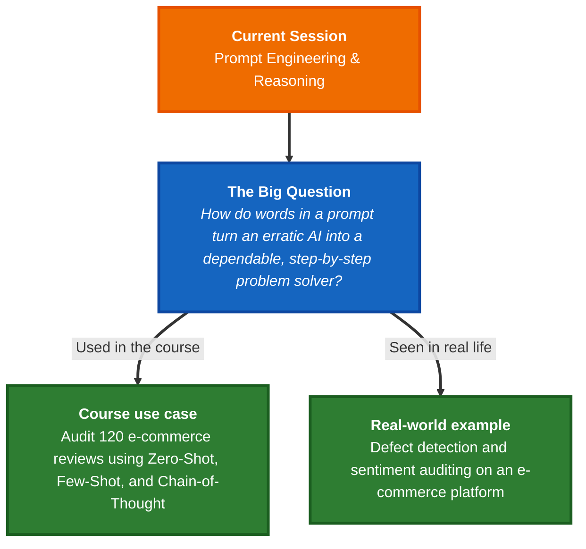

## <span style="color:#2F7DDE">Prompt Engineering & Reasoning</span>

### <span style="color:#2F7DDE">Mental Map</span>



---

### <span style="color:#2F7DDE">What You'll Learn</span>

Have you ever asked an AI a tricky question and received an answer that looked confident but was completely wrong because the model jumped to conclusions without thinking?

By the end of this session, you will be able to:

- <span style="color:#D9660B">**Frame**</span> task instructions using role prompting and standardized category definitions.
- <span style="color:#D9660B">**Assemble**</span> balanced few-shot demonstrations to teach output structure and edge cases.
- <span style="color:#D9660B">**Apply**</span> chain-of-thought reasoning to deconstruct conflicting statements and subtle sarcasm.
- <span style="color:#D9660B">**Evaluate**</span> candidate prompts on a curated test set using accuracy metrics.
- <span style="color:#D9660B">**Diagnose**</span> systemic failure modes through categorical error analysis.

> <span style="color:#2F7DDE">**Topics you will meet:**</span> Role prompting; Zero-shot instructions; Few-shot exemplars and in-context learning; Chain-of-Thought (CoT) reasoning; Test set benchmarking; Category failure analysis.
>
> Join the session to learn each of these in detail.

---

### <span style="color:#2F7DDE">Why You Are Learning This Topic</span>

A customer buys a smartphone online.

Three days later, the buyer leaves a review: *"Display is brilliant, but battery drains in 3 hours with dangerous heating."*

A simple automated scanner searches for positive words like "brilliant" and marks the product as healthy.

The seller never investigates the defective battery batch, and hundreds of customers face dangerous fire risks.

<span style="color:#D9660B">**Prompt engineering**</span> means the disciplined practice of designing instructions, examples, and reasoning steps to guide an AI model to accurate, consistent conclusions.

Mastering prompt engineering lets you solve complex, high-stakes business problems reliably without spending months fine-tuning heavy machine learning models.

> <span style="color:#2F7DDE">**Think about it:**</span> Why does asking an AI to "think step by step before answering" make it significantly smarter at solving hard puzzles?

---

### <span style="color:#2F7DDE">The Customer Review Audit Puzzle</span>

An audit test set contains four tricky product reviews requiring precise moderation.

| Review ID | Category | Review Text | Expected Label | Zero-Shot Guess |
|:---------:|:---------|:------------|:--------------:|:---------------:|
| REV-2001 | Smartphone | Camera is superb, but battery drains in 3 hours | Mixed/Negative | Positive |
| REV-2002 | Headphones | Sound quality is punchy, worth every rupee | Positive | Positive |
| REV-2005 | Smartwatch | Great job Flipkart, delivered an empty box! | Negative | Positive |
| REV-2007 | Powerbank | Charges fast, slightly heavy in pocket | Positive | Negative |

<span style="color:#D9660B">**What you want to happen:**</span>

- Stop the model from being tricked by "Great job" when an empty box was delivered.
- Recognize that a dying battery in REV-2001 is a critical defect, overriding cosmetic camera praise.
- Standardize labels across all reviews so internal dashboards show accurate product safety metrics.

Here is how it might start. You do not need to understand it yet.

```python
import pandas as pd
df = pd.read_csv("data/flipkart_review_eval_set.csv").head(4)
print(df[["review_id", "product_category", "zero_shot_pred", "ground_truth"]])
```

> <span style="color:#D9660B">**Wonder about this:**</span>
>
> - Why does a language model latch onto individual praise words instead of reading the whole complaint?
> - What happens when you provide three solved examples before giving the model a new review to classify?

---

### <span style="color:#2F7DDE">Think It Through</span>

There is no wrong first try. Keep your guesses for the session.

**1. If a customer writes "Thanks a lot for breaking my order into pieces", how can you instruct an AI not to mark it as positive despite the words "Thanks a lot"?**
Hint: Ask the model to compare the emotional tone with the physical condition of the product.

**2. What happens if all three of your few-shot examples are 5-star positive reviews?**
Hint: Consider what pattern the model will assume is normal for every future input.

**3. Why is it dangerous to change your prompt based on just one review that went wrong?**
Hint: Think about what might happen to the other 99 reviews in your test set when you tweak the instructions.

---

### <span style="color:#2F7DDE">One Question to Carry Into the Session</span>

> <span style="color:#2F7DDE">**How can changing the framing of a question completely transform an AI's ability to reason through difficult trade-offs?**</span>
>
> How would you build a test set to prove that your new prompt is genuinely better than the old one?
