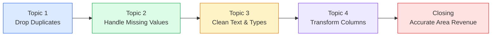

# <font color='#1d4ed8'>Lecture Script: Cleaning Data with Pandas</font>

---

## <font color='blue'>Agenda</font>

The lecture runs as four topics. Each topic ends with a quiz.

| Topic | What we do | Learning objectives covered | Minutes |
|:-:|:--|:--|:-:|
| 1 | Finding and removing duplicate records | Handle missing values and duplicates in pandas | 25 |
| 2 | Detecting and handling missing data | Clean data using pandas | 25 |
| 3 | Modifying and standardizing column values | Modify columns and values | 25 |
| 4 | Transforming columns and calculating metrics | Perform simple transformations on datasets | 25 |
| — | Closing: Outcome & Summary | | 20 |
| | **Total** | | **120** |

> <font color="red">**🎯 Instructor Note**</font> Pace: Spend ample time on missing values and string transformations as beginners often struggle with missing value arithmetic and whitespace.
> Keep deduplication fast and visual to build early momentum.

---

## <font color='blue'>Scenario</font>

At Blinkit's quick-commerce operations hub in Bengaluru, analysts review morning grocery deliveries across three major dark stores: Indiranagar, Koramangala, and Whitefield. When app servers record orders during peak breakfast rush, network glitches and customer inputs create noisy logs:

| Order ID | Area | Items | Item Total (₹) | Delivery Fee (₹) | Issue Present |
|:--------:|:-----|:-----:|:--------------:|:----------------:|:--------------|
| 101 | Indiranagar | 3 | 450 | 30.0 | Clean record |
| 102 | &nbsp;Koramangala&nbsp; | 2 | 280 | 25.0 | Extra spaces in area name |
| 103 | Whitefield | *missing* | 150 | 30.0 | Missing item count |
| 104 | Indiranagar | 1 | 120 | *missing* | Network retry duplicate, missing fee |
| 104 | Indiranagar | 1 | 120 | *missing* | Identical duplicate row |
| 105 | koramangala | 4 | 600 | 25.0 | Lowercase area name |
| 106 | Whitefield | 2 | 310 | 30.0 | Clean record |

> <font color="red">**🎯 Instructor Note**</font> Blinkit is used only as an illustrative industry setting. All order logs and amounts are created for this lesson.

---

## <font color='blue'>Problem Statement</font>

An operations analyst generated a morning revenue report directly from the raw order table without checking data quality. Because order 104 was logged twice, order revenue was overcounted. Worse, because order 104 had a missing delivery fee, an arithmetic calculation turned the entire order total into a blank missing value. Simultaneously, because Koramangala was recorded with extra spaces in one row and lowercase letters in another, the dark store's sales were split across two separate categories, making it appear understaffed and failing.

> <font color='purple'>**How can we clean and transform raw order data in pandas to ensure every order is counted accurately?**</font>

> <font color="red">**🎯 Instructor Note**</font> Poll: "What happens when you add a number to a missing (NaN) value in pandas: does it ignore the missing value or return NaN?" Give learners 30 seconds to respond in chat. Reveal the answer in the Closing.

---

## <font color='blue'>What We Will Use</font>

We will clean and transform the order log using four focused tools in pandas:

| Topic | Tools | In one line |
|:-:|:--|:--|
| 1 | `df.duplicated()`, `df.drop_duplicates()` | Find and remove repeated rows |
| 2 | `df.isna()`, `df.dropna()`, `df.fillna()` | Detect, remove, or replace missing values |
| 3 | `.str.strip()`, `.str.title()`, `.astype()` | Clean text whitespace, standardize casing, and convert types |
| 4 | Column arithmetic (`+`), `df.rename()` | Compute derived columns and rename headers for clear reporting |

---

## <font color='blue'>How: Walking Through the Blinkit Order Cleanup</font>



---

## <font color='blue'>Topic 1: Finding and Removing Duplicate Records</font> `25 min`

> <font color='purple'>**How do we spot and remove repeated orders when network hiccups record the same transaction twice?**</font>

### <font color='green'>Example: Identifying duplicate rows in the order table</font>

> <font color='purple'>**Which rows in our delivery table are exact duplicates of an earlier row?**</font>

**Predict before running: What will happen?**

> <font color="red">**🎯 Instructor Note**</font> Learners usually spot the second order 104. Confirm that df.duplicated() returns True only for subsequent identical copies.

```python
import pandas as pd
import numpy as np

data = {'order_id': [101, 102, 103, 104, 104, 105, 106],
        'area': ['Indiranagar', ' Koramangala ', 'Whitefield', 'Indiranagar', 'Indiranagar', 'koramangala', 'Whitefield'],
        'items': [3, 2, np.nan, 1, 1, 4, 2],
        'item_total': [450, 280, 150, 120, 120, 600, 310],
        'delivery_fee': [30.0, 25.0, 30.0, np.nan, np.nan, 25.0, 30.0]}
df = pd.DataFrame(data)
print(df.duplicated())
```

**Output**

```
0    False
1    False
2    False
3    False
4     True
5    False
6    False
dtype: bool
```

#### <font color='#c2410c'>Code Explanation</font>

- **Lines 4-9** Create the sample order DataFrame with 7 rows reflecting our delivery logs.
- **Line 10** `df.duplicated()` inspects every row, marking row index 4 as `True` because it is identical to row index 3.

> <font color='green'>**Result**</font> Row 4 is identified as a duplicate order that will cause double-counting if kept in the dataset.

### <font color='green'>Extending it: Removing duplicate rows while keeping the original record</font>

> <font color='purple'>**How do we drop the duplicate row and retain only unique orders?**</font>

> <font color="red">**🎯 Instructor Note**</font> Ask learners how many rows should remain after dropping duplicates (6 rows).

```python
df = df.drop_duplicates()
print(df[['order_id', 'area', 'item_total']])
```

**Output**

```
   order_id           area  item_total
0       101    Indiranagar         450
1       102   Koramangala          280
2       103     Whitefield         150
3       104    Indiranagar         120
5       105    koramangala         600
6       106     Whitefield         310
```

> <font color='green'>**Result**</font> The DataFrame is reduced from 7 rows to 6 unique transactions, preserving the first instance of order 104.

> <font color='#b45309'>**Common mistake**</font> Calling `df.drop_duplicates()` without reassigning it back to `df` leaves the original DataFrame unchanged.

### <font color='purple'>Quiz 1</font>

**Question:** What does `df.drop_duplicates()` do by default when it encounters identical rows in a DataFrame?

**Options:**
- A) It removes all rows that have duplicate data, leaving none of them.
- B) It keeps the first occurrence of each unique row and removes subsequent duplicate rows.
- C) It replaces duplicate rows with blank values.
- D) It merges all duplicate rows by adding their numerical values together.

**Correct Answer:** B

**Explanation:**
- **A)** It preserves the first record and only discards repeated copies.
- **B)** By default, pandas keeps the first appearance and drops any row identical to an earlier one.
- **C)** It removes the entire duplicate row rather than inserting blank values.
- **D)** Dropping duplicates performs row filtering, not numerical aggregation or merging.

---

## <font color='blue'>Topic 2: Detecting and Handling Missing Data</font> `25 min`

> <font color='purple'>**Now that repeated orders are removed, how do we spot and handle empty fields in our remaining rows?**</font>

### <font color='green'>Example: Detecting missing values across columns</font>

> <font color='purple'>**Which columns contain blank or unrecorded entries?**</font>

**Predict before running: What will happen?**

> <font color="red">**🎯 Instructor Note**</font> Learners usually notice items and delivery_fee have missing entries. Confirm that isna().sum() counts them per column.

```python
print(df.isna().sum())
```

**Output**

```
order_id        0
area            0
items           1
item_total      0
delivery_fee    1
dtype: int64
```

#### <font color='#c2410c'>Code Explanation</font>

- **Line 1** `df.isna()` checks every cell for missing entries, and `.sum()` counts how many missing values appear in each column.

> <font color='green'>**Result**</font> We see that items and delivery_fee each contain exactly one missing value that needs handling.

### <font color='green'>Extending it: Filling missing values with business defaults</font>

> <font color='purple'>**How can we fill missing fees and item counts so math calculations work without dropping real orders?**</font>

> <font color="red">**🎯 Instructor Note**</font> Ask learners why dropping row 104 would be bad (we would lose a valid ₹120 sale). Explain that 0.0 reflects a free delivery promo.

```python
df['delivery_fee'] = df['delivery_fee'].fillna(0.0)
df['items'] = df['items'].fillna(1.0)
print(df[['order_id', 'items', 'delivery_fee']])
```

**Output**

```
   order_id  items  delivery_fee
0       101    3.0          30.0
1       102    2.0          25.0
2       103    1.0          30.0
3       104    1.0           0.0
5       105    4.0          25.0
6       106    2.0          30.0
```

> <font color='green'>**Result**</font> Both columns now have complete numerical values with zero missing cells across all 6 orders.

> <font color='#b45309'>**Common mistake**</font> Using `dropna()` hastily will delete valid transactions when only an optional fee was blank.

### <font color='purple'>Quiz 2</font>

**Question:** When should an analyst use `fillna(0)` instead of `dropna()` on a missing fee column?

**Options:**
- A) When a missing value represents a waived or zero-cost charge and the rest of the order is valid.
- B) Only when the column contains text instead of numbers.
- C) When every column in that row is completely blank.
- D) Whenever you want to automatically double the revenue.

**Correct Answer:** A

**Explanation:**
- **A)** Filling with 0 keeps the valid transaction while correctly recording that no delivery fee was paid.
- **B)** `fillna(0)` is used on numeric columns, not for text values.
- **C)** If an entire row is blank, dropping it with `dropna()` is typically preferred.
- **D)** Filling missing values with zero records a baseline value without artificially inflating revenue.

---

## <font color='blue'>Topic 3: Modifying and Standardizing Column Values</font> `25 min`

> <font color='purple'>**With no duplicate rows and no missing values, how do we clean up inconsistent area text and fix column data types?**</font>

### <font color='green'>Example: Cleaning text whitespace and standardizing casing</font>

> <font color='purple'>**How can we ensure " Koramangala " and "koramangala" are recognized as the exact same location?**</font>

**Predict before running: What will happen?**

> <font color="red">**🎯 Instructor Note**</font> Show learners that string methods in pandas require the .str accessor. Expected answer: all variants become 'Koramangala'.

```python
df['area'] = df['area'].str.strip().str.title()
print(df['area'].unique())
```

**Output**

```
['Indiranagar' 'Koramangala' 'Whitefield']
```

#### <font color='#c2410c'>Code Explanation</font>

- **Line 1** `.str.strip()` removes accidental spaces at the start and end, and `.str.title()` capitalizes each word consistently.
- **Line 2** `.unique()` prints the distinct area names, verifying that all entries now map cleanly to three locations.

> <font color='green'>**Result**</font> The area column is standardized into three clean categories without accidental duplicates caused by spaces or casing.

### <font color='green'>Extending it: Converting columns to proper integer data types</font>

> <font color='purple'>**How do we convert item counts from decimal floats to clean whole numbers?**</font>

> <font color="red">**🎯 Instructor Note**</font> Explain that pandas automatically converts columns with missing values to float. Now that gaps are filled, we cast to int.

```python
df['items'] = df['items'].astype(int)
print(df[['order_id', 'items']].dtypes)
```

**Output**

```
order_id    int64
items       int64
dtype: object
```

> <font color='green'>**Result**</font> The items column is now stored cleanly as an integer type.

> <font color='#b45309'>**Common mistake**</font> Trying to convert a column with missing values directly to int will fail, because standard integer types cannot hold missing values before they are filled.

### <font color='purple'>Quiz 3</font>

**Question:** Why does `" Koramangala "` not match `"Koramangala"` when grouping data in pandas?

**Options:**
- A) Pandas automatically deletes any string containing spaces.
- B) Python string comparison checks exact characters, including whitespace and letter case.
- C) Grouping operations only work on numeric columns.
- D) String columns cannot be compared in pandas without a SQL database.

**Correct Answer:** B

**Explanation:**
- **A)** Pandas preserves strings with spaces and does not automatically delete them.
- **B)** Python evaluates character by character, so extra spaces and lowercase letters make strings distinct.
- **C)** Grouping works across both categorical text columns and numeric columns.
- **D)** Pandas performs string matching and grouping natively without requiring an external database.

---

## <font color='blue'>Topic 4: Transforming Columns and Calculating Metrics</font> `25 min`

> <font color='purple'>**Now that our columns are tidy and standardized, how do we transform them into actionable business numbers?**</font>

### <font color='green'>Example: Calculating total order bill through row-by-row arithmetic</font>

> <font color='purple'>**How do we compute the total amount paid by adding the item total and delivery fee for each order?**</font>

**Predict before running: What will happen?**

> <font color="red">**🎯 Instructor Note**</font> Remind learners that column arithmetic in pandas adds matching rows automatically. Expected bill for order 101: 450 + 30 = 480.

```python
df['final_bill'] = df['item_total'] + df['delivery_fee']
print(df[['order_id', 'item_total', 'delivery_fee', 'final_bill']])
```

**Output**

```
   order_id  item_total  delivery_fee  final_bill
0       101         450          30.0       480.0
1       102         280          25.0       305.0
2       103         150          30.0       180.0
3       104         120           0.0       120.0
5       105         600          25.0       625.0
6       106         310          30.0       340.0
```

#### <font color='#c2410c'>Code Explanation</font>

- **Line 1** `df['final_bill']` creates a new column by adding `item_total` and `delivery_fee` across each row.
- **Line 2** Displays the original amounts alongside the newly computed final bill.

> <font color='green'>**Result**</font> Every order now has an accurate total bill calculated directly from its cleaned components.

### <font color='green'>Extending it: Renaming columns for clear reporting</font>

> <font color='purple'>**How can we rename column headers to make our table easy for stakeholders to understand?**</font>

> <font color="red">**🎯 Instructor Note**</font> Ask learners why explicit column names like delivery_area are better than generic names like area.

```python
df = df.rename(columns={'area': 'delivery_area'})
print(df.columns.tolist())
```

**Output**

```
['order_id', 'delivery_area', 'items', 'item_total', 'delivery_fee', 'final_bill']
```

> <font color='green'>**Result**</font> The column name is updated from area to delivery_area, clarifying what the data represents.

> <font color='#b45309'>**Common mistake**</font> Passing a list instead of a dictionary to `df.rename()` will cause an error, because rename requires mapping old names to new names.

### <font color='purple'>Quiz 4</font>

**Question:** How does pandas calculate a new column when you write `df['total'] = df['price'] * df['qty']`?

**Options:**
- A) It multiplies the first row only and leaves the rest empty.
- B) It multiplies corresponding values row by row across the entire DataFrame.
- C) It calculates the sum of price multiplied by the average quantity.
- D) It creates a separate spreadsheet file on your computer.

**Correct Answer:** B

**Explanation:**
- **A)** Pandas performs vectorized arithmetic across all rows simultaneously, not just the first row.
- **B)** Column operations apply row by row to matching index positions in the DataFrame.
- **C)** Direct column multiplication multiplies individual row pairs, not aggregate sums or averages.
- **D)** It creates a new column in memory inside the existing DataFrame rather than saving a new file.

---

## <font color='blue'>Closing: Outcome & Summary</font> `20 min`

> <font color='purple'>**1. What happens if we summarize revenue without cleaning duplicate rows and messy area text first?**</font>

If an analyst summarizes the raw table without cleaning, order 104 gets counted twice, and order 104's total bill evaluates to NaN because adding a number to a missing value results in NaN. Furthermore, Koramangala gets fragmented into two separate rows of ₹305 and ₹625, hiding its status as the highest-performing dark store.

> <font color='purple'>**2. How does our cleaned DataFrame produce accurate total revenue across delivery areas?**</font>

```python
revenue_by_area = df.groupby('delivery_area')['final_bill'].sum()
print(revenue_by_area)
```

**Output**

```
delivery_area
Indiranagar    600.0
Koramangala    930.0
Whitefield     520.0
Name: final_bill, dtype: float64
```

#### <font color='#c2410c'>Code Explanation</font>

- **Line 1** Groups the cleaned records by `delivery_area` and sums `final_bill` to calculate total revenue per area.
- **Line 2** Prints the revenue per hub, showing Koramangala generated ₹930.0, Indiranagar ₹600.0, and Whitefield ₹520.0.

### <font color='green'>Outcome</font>

| Metric | Dirty Raw Data | Cleaned Data |
|:--|:-:|:-:|
| Total Recorded Rows | 7 | 6 (duplicate removed) |
| Koramangala Revenue | Split into ₹305 & ₹625 | Unified ₹930.0 |
| Indiranagar Revenue | ₹720.0 (overcounted) | ₹600.0 (accurate) |
| Missing Value Errors | ₹120 bill became NaN | ₹120.0 bill preserved |

> <font color='green'>**Therefore,**</font> cleaning data before analysis protects business decisions from false alarms, double counting, and lost revenue records.

> <font color="red">**🎯 Instructor Note**</font> Reveal poll answer: Adding a number to a missing value in pandas returns NaN. Filling missing values with zero was required to prevent order totals from disappearing.

### <font color='green'>Summary</font>

| Learning objective | Takeaway |
|:--|:--|
| Handle missing values and duplicates in pandas | Remove duplicate rows with `drop_duplicates()` and fill or drop missing cells with `fillna()` or `dropna()`. |
| Clean data using pandas | Identify dirty entries and apply consistent cleanup steps across entire tables at once. |
| Modify columns and values | Standardize text with `.str.strip()` and `.str.title()`, and enforce correct data types with `.astype()`. |
| Perform simple transformations on datasets | Compute derived columns with row-by-row arithmetic and rename headers using `rename()`. |
| **Practical value** | Delivers accurate reports that leadership can trust for inventory, staffing, and revenue decisions. |

---

# <font color='red'>Launch the Feedback Poll</font>

> <font color="red">**🎯 Instructor Note**</font> Reminder: launch the feedback poll now to collect learner feedback.
