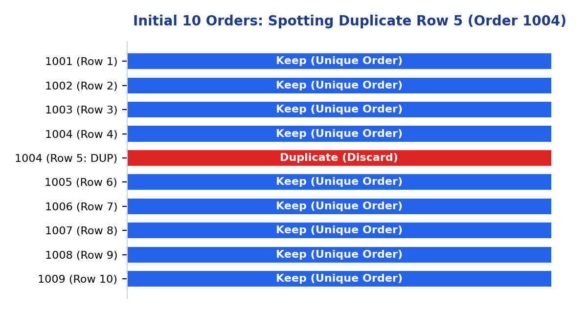
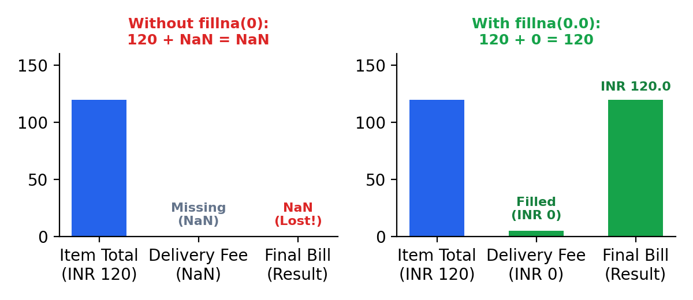
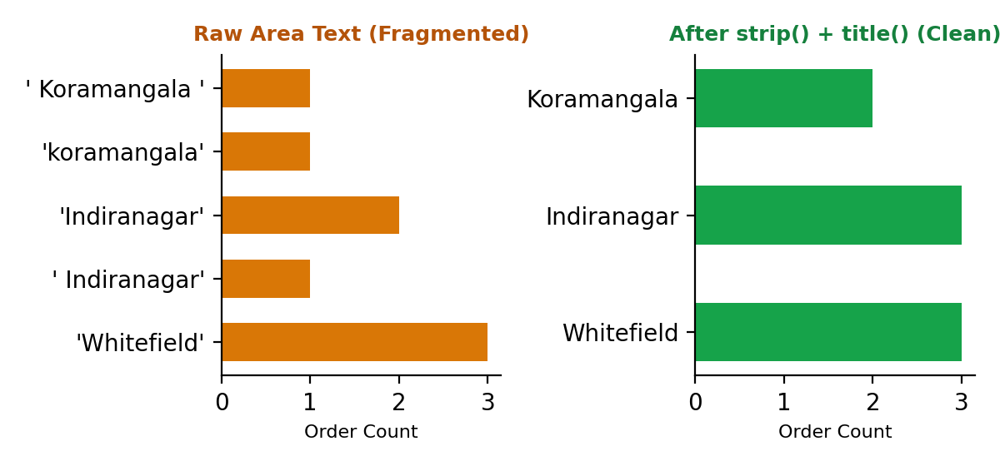
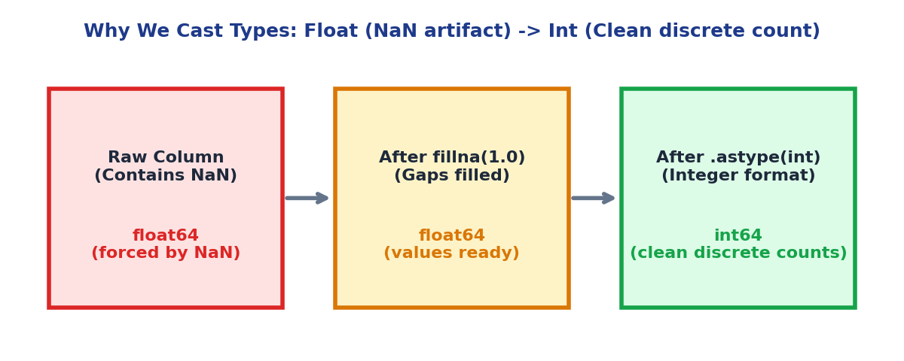
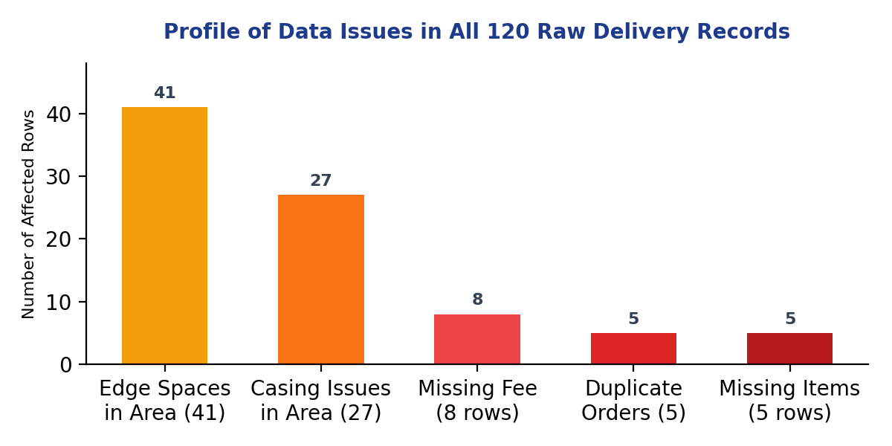
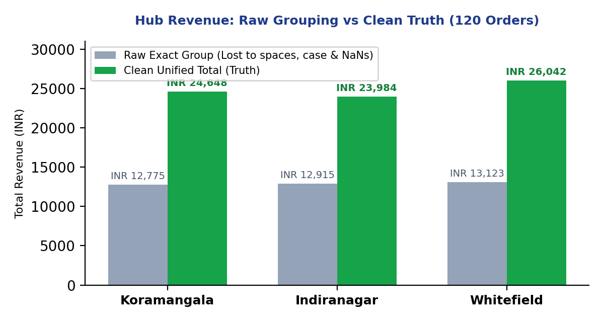

# <font color='#1d4ed8'>Lecture Script: Cleaning Data with Pandas</font>

---

## <font color='blue'>Agenda</font>

The lecture runs as four topics. Each topic ends with a quiz.

| Topic | What we do | Learning objectives covered | Minutes |
|:-:|:--|:--|:-:|
| 1 | Find and remove duplicate order rows | Handle missing values and duplicates in pandas | 25 |
| 2 | Find and fill missing order values | Clean data using pandas | 25 |
| 3 | Clean area text and fix column data types | Modify columns and values | 25 |
| 4 | Calculate final order totals and rename columns | Perform simple transformations on datasets | 25 |
| — | Closing: Outcome & Summary | | 20 |
| | **Total** | | **120** |

> <font color="red">**🎯 Instructor Note**</font> Pace: keep duplicate dropping quick and visual in Topic 1, and spend the time on NaN propagation in Topic 2 and string methods in Topic 3.
> Topic 4 is the hands-on capstone: let learners run the full cleaning pipeline across all 120 delivery rows in `data/blinkit_order_logs.csv`.

---

## <font color='blue'>Scenario</font>

**The risk:** a quick-delivery grocery app like Blinkit lets store managers review morning order logs in a notebook before sending sales numbers to leadership. One duplicate row, one missing fee, or one badly typed area name, and the store appears understaffed or loses thousands of rupees in reported sales.

> <font color="red">**🎯 Instructor Note**</font> Blinkit is only the setting. Do not claim Blinkit uses this data; the 120 order rows in `data/blinkit_order_logs.csv` are invented for teaching.
> Share the file before class. It has duplicate orders, missing delivery fees, missing item counts, tied totals, and areas typed with extra spaces or lowercase letters.

---

## <font color='blue'>Problem Statement</font>

Manager MGR-104 loaded the morning orders into one table. During the breakfast rush, network hiccups logged duplicate orders, and free-delivery orders had no fee entered. When she added item totals and delivery fees, every free-delivery order became a blank missing value because adding a number to NaN returns NaN. Several area names were also typed with extra spaces, such as `" Koramangala "`. Half the store's morning sales vanished from the report.

> <font color='purple'>**How do we turn a store's messy order logs into one clean, reliable table that leadership accepts?**</font>

> <font color="red">**🎯 Instructor Note**</font> Poll: "What happens when you add a number to a missing (NaN) value in pandas: does it ignore the missing value, add zero, or return NaN?" Give learners 30 seconds to respond in chat. Reveal the answer in the Closing.

---

## <font color='blue'>What We Will Use</font>

A DataFrame holds rows and columns of data under one name. A **clean dataset** is a table where duplicate records are removed, blank fields are filled, and text entries follow an orderly format. Today you spot duplicate rows, handle missing cells, clean text, and calculate new columns.

| Topic | Tools | In one line |
|:-:|:--|:--|
| 1 | `duplicated(subset=)`, `drop_duplicates(subset=)` | Spot and remove repeated order rows |
| 2 | `isna()`, `fillna()`, `dropna()` | Find blank cells and fill them with business defaults |
| 3 | `.str.strip()`, `.str.title()`, `.astype(int)` | Remove extra spaces, fix casing, and convert types |
| 4 | Column addition (`+`), `rename(columns=)` | Calculate total order amounts and rename headers |

---

## <font color='blue'>How: Walking Through the Order Cleanup</font>


---

## <font color='blue'>Topic 1: Find and Remove Duplicate Order Rows</font> `25 min`

> <font color='purple'>**Manager MGR-104 has ten orders on screen. How do we spot an order logged twice by mistake, and how do we remove the extra copy?**</font>

In Getting Started with Python Data you loaded tables and inspected rows with `head` and `info`. A table stores one row per record, but network retries can paste the exact same transaction into your dataset twice.

### <font color='green'>Example: check for duplicate orders in the first ten rows</font>

> <font color='purple'>**Which row in our delivery table is an exact duplicate of an earlier order?**</font>

`df.duplicated(subset=['order_id'])` checks every row from top to bottom. It returns `False` for the first time an order appears, and `True` whenever that same ID appears again.

**Predict before running: What will happen?**

> <font color="red">**🎯 Instructor Note**</font> Expected: row 4 is True (order 1004 repeated). Common wrong guess: both row 3 and row 4 are marked True.

```python
import pandas as pd

orders = pd.read_csv("data/blinkit_order_logs.csv").head(10)
print(orders.duplicated(subset=['order_id']))
```

**Output**

```
0    False
1    False
2    False
3    False
4     True
5    False
6    False
7    False
8    False
9    False
dtype: bool
```

#### <font color='#c2410c'>Code Explanation</font>

- **Lines 1 to 3** `read_csv` loads `data/blinkit_order_logs.csv`, and `.head(10)` selects the first ten rows for our starting view.
- **Line 4** `duplicated(subset=['order_id'])` inspects order IDs. Position 4 is `True` because order 1004 already appeared at position 3.

> <font color='green'>**Result**</font> Position 4 is identified as a duplicate copy of order 1004. Keeping it would double-count that ₹120 sale.

<p align="center"></p>

### <font color='green'>Extending it: drop duplicate rows and keep the original</font>

> <font color='purple'>**How do we remove the duplicate copy so each order appears exactly once?**</font>

> <font color="red">**🎯 Instructor Note**</font> Ask learners how many orders should remain after dropping duplicates. Give learners 30 seconds to respond in chat. Expected: 9 orders.

```python
orders = orders.drop_duplicates(subset=['order_id'])
print(len(orders))
print(orders[['order_id', 'area_raw', 'item_total_inr']])
```

**Output**

```
9
   order_id       area_raw  item_total_inr
0      1001    Indiranagar             450
1      1002   Koramangala              280
2      1003     Whitefield             150
3      1004    Indiranagar             120
5      1005    koramangala             600
6      1006     Whitefield             310
7      1007     Whitefield             520
8      1008    Indiranagar             290
9      1009    Koramangala             750
```

> <font color='green'>**Result**</font> `drop_duplicates` removed row 4 and kept row 3. The table now holds 9 unique orders.

> <font color='#b45309'>**Common mistake**</font> Running `orders.drop_duplicates()` without assigning it back to `orders`. Without assignment, the table remains unchanged.

### <font color='purple'>Quiz 1</font>

**Question:** What does `orders.drop_duplicates(subset=['order_id'])` do by default when it meets duplicate order IDs?

**Options:**
- A) It deletes every row that has that order ID, leaving zero copies.
- B) It keeps the first copy and discards any later copy with that same ID.
- C) It replaces duplicate rows with empty rows.
- D) It adds the prices of the duplicate rows together.

**Correct Answer:** B

**Explanation:**
- **A)** Wrong: it preserves the first transaction and removes only the duplicate copies.
- **B)** Correct: pandas keeps the first appearance by default and removes subsequent matching rows.
- **C)** Wrong: it removes the entire row from the DataFrame rather than leaving blank spaces.
- **D)** Wrong: dropping duplicates filters rows; it does not aggregate or add numbers.

---

## <font color='blue'>Topic 2: Find and Fill Missing Order Values</font> `25 min`

> <font color='purple'>**The duplicate row is gone. In our nine orders, some cells are completely blank. How do we find them and fill them safely?**</font>

In Python Fundamentals you saw variables that hold numbers or text. When an app does not record a value, pandas marks that cell as `NaN`, which means "Not a Number".

### <font color='green'>Example: count missing values in each column</font>

> <font color='purple'>**Which columns have blank cells, and how many are missing?**</font>

`df.isna()` marks every empty cell as `True`. Adding `.sum()` counts the missing values in each column.

**Predict before running: What will happen?**

> <font color="red">**🎯 Instructor Note**</font> Expected: 1 missing item count and 1 missing delivery fee. Common wrong guess: 0, because learners assume empty cells are read as zero.

```python
print(orders.isna().sum())
```

**Output**

```
row_id              0
order_id            0
area_raw            0
item_count          1
item_total_inr      0
delivery_fee_inr    1
dtype: int64
```

#### <font color='#c2410c'>Code Explanation</font>

- **Line 1** `orders.isna()` checks every cell in the table, and `.sum()` counts the `True` values for each column name.

> <font color='green'>**Result**</font> `item_count` has 1 missing cell (order 1003), and `delivery_fee_inr` has 1 missing cell (order 1004).

### <font color='green'>Extending it: fill missing fees with zero</font>

> <font color='purple'>**Why is `fillna(0.0)` better than deleting the row with `dropna()`?**</font>

> <font color="red">**🎯 Instructor Note**</font> Ask learners what happens if we delete row 1004 with dropna(). Give learners 30 seconds to respond in chat. Expected: we lose a real customer and ₹120 in sales.

```python
orders['delivery_fee_inr'] = orders['delivery_fee_inr'].fillna(0.0)
orders['item_count'] = orders['item_count'].fillna(1.0)
print(orders[['order_id', 'item_count', 'delivery_fee_inr']])
```

**Output**

```
   order_id  item_count  delivery_fee_inr
0      1001         3.0              30.0
1      1002         2.0              25.0
2      1003         1.0              30.0
3      1004         1.0               0.0
5      1005         4.0              25.0
6      1006         2.0              30.0
7      1007         3.0              25.0
8      1008         2.0              30.0
9      1009         5.0              25.0
```

> <font color='green'>**Result**</font> Filling missing delivery fees with `0.0` reflects a free delivery promo without deleting the customer's ₹120 grocery order.

> <font color='#b45309'>**Common mistake**</font> Using `dropna()` when only an optional fee was blank. Deleting the whole row deletes real sales numbers.

<p align="center"></p>

### <font color='purple'>Quiz 2</font>

**Question:** What happens in pandas if you add a normal number to an empty cell: `120 + np.nan`?

**Options:**
- A) It returns `120`, ignoring the empty cell.
- B) It returns `NaN`, because any arithmetic with a missing value produces a missing value.
- C) It stops the program with an error.
- D) It replaces the missing cell with 100 automatically.

**Correct Answer:** B

**Explanation:**
- **A)** Wrong: pandas does not treat a missing cell as 0 unless you call `fillna(0)` first.
- **B)** Correct: any mathematical calculation involving `NaN` evaluates to `NaN`.
- **C)** Wrong: pandas does not crash; it silently returns `NaN`, which can hide missing totals.
- **D)** Wrong: pandas never invents arbitrary values like 100.

---

## <font color='blue'>Topic 3: Clean Area Text and Fix Column Data Types</font> `25 min`

> <font color='purple'>**Our numbers are complete. But look at the area names: one says `" Koramangala "`, another says `"koramangala"`. How do we clean text so all rows match?**</font>

In Python Fundamentals you stored strings. In pandas, text columns have a special `.str` toolbox that lets you clean thousands of text entries in one line.

### <font color='green'>Example: strip extra spaces and fix letter casing</font>

> <font color='purple'>**How do we make `" Koramangala "` and `"koramangala"` match as `"Koramangala"`?**</font>

`.str.strip()` removes spaces at the start and end. `.str.title()` capitalizes the first letter of each word and makes the rest lowercase.

**Predict before running: What will happen?**

> <font color="red">**🎯 Instructor Note**</font> Expected: all area variations collapse into exactly three clean names: Indiranagar, Koramangala, and Whitefield.

```python
orders['area_raw'] = orders['area_raw'].str.strip().str.title()
print(orders['area_raw'].unique())
```

**Output**

```
['Indiranagar' 'Koramangala' 'Whitefield']
```

#### <font color='#c2410c'>Code Explanation</font>

- **Line 1** `.str.strip()` cuts off leading and trailing spaces, and `.str.title()` turns mixed case into clean title words.
- **Line 2** `.unique()` lists the distinct area names left in the column.

> <font color='green'>**Result**</font> Six messy text variations are unified into three clean dark store areas.

<p align="center"></p>

### <font color='green'>Extending it: cast item counts back to clean integers</font>

> <font color='purple'>**Why does `item_count` show `3.0` instead of `3`, and how do we fix it?**</font>

> <font color="red">**🎯 Instructor Note**</font> Explain that pandas converts integer columns to float whenever a missing value enters. Now that blanks are filled, we cast to int.

```python
orders['item_count'] = orders['item_count'].astype(int)
print(orders[['order_id', 'item_count']].dtypes)
```

**Output**

```
order_id      int64
item_count    int64
dtype: object
```

> <font color='green'>**Result**</font> `.astype(int)` converts item counts from decimal floats into clean whole numbers (`int64`).

> <font color='#b45309'>**Common mistake**</font> Calling `.astype(int)` before filling missing values. Integer columns cannot hold `NaN`, so Python will raise an error.

<p align="center"></p>

### <font color='purple'>Quiz 3</font>

**Question:** Why does `" Koramangala "` not match `"Koramangala"` when grouping rows in pandas?

**Options:**
- A) Pandas does not allow spaces in any column.
- B) Python string comparison checks every exact character, including leading spaces.
- C) Text columns cannot be grouped in pandas.
- D) Pandas automatically turns all text into numbers.

**Correct Answer:** B

**Explanation:**
- **A)** Wrong: pandas supports strings with spaces; it simply preserves them as typed.
- **B)** Correct: spaces are characters, so `" Koramangala "` is treated as a separate category.
- **C)** Wrong: text columns are grouped all the time in pandas reports.
- **D)** Wrong: pandas preserves text columns as object strings.

---

## <font color='blue'>Topic 4: Calculate Final Order Totals and Rename Columns</font> `25 min`

> <font color='purple'>**Our rows are unique, complete, and tidy. How do we calculate the total amount the customer paid, and how do we clean the table across all 120 rows?**</font>

In Spreadsheets you created new columns with formulas like `=D2+E2`. In pandas, column math runs across every row at the same time.

### <font color='green'>Example: calculate final bill and rename the area column</font>

> <font color='purple'>**How do we compute the total bill and give our column a clear name?**</font>

Adding two columns adds matching rows together. `rename(columns=)` replaces confusing column headers with clear business names.

**Predict before running: What will happen?**

> <font color="red">**🎯 Instructor Note**</font> Expected: final_bill_inr equals item_total plus delivery_fee for each order. For order 1004: 120 + 0 = 120.0.

```python
orders['final_bill_inr'] = orders['item_total_inr'] + orders['delivery_fee_inr']
orders = orders.rename(columns={'area_raw': 'delivery_area'})
print(orders[['order_id', 'delivery_area', 'final_bill_inr']])
```

**Output**

```
   order_id delivery_area  final_bill_inr
0      1001   Indiranagar           480.0
1      1002   Koramangala           305.0
2      1003    Whitefield           180.0
3      1004   Indiranagar           120.0
5      1005   Koramangala           625.0
6      1006    Whitefield           340.0
7      1007    Whitefield           545.0
8      1008   Indiranagar           320.0
9      1009   Koramangala           775.0
```

#### <font color='#c2410c'>Code Explanation</font>

- **Line 1** `orders['item_total_inr'] + orders['delivery_fee_inr']` adds items and fees row by row into a new column called `final_bill_inr`.
- **Line 2** `rename(columns={'area_raw': 'delivery_area'})` replaces the raw name with a clear title.
- **Line 3** Displays the order ID, clean area name, and calculated total bill.

> <font color='green'>**Result**</font> Every order has an exact total bill, and the table headers are ready for business reporting.

### <font color='green'>Extending it: how messy are all 120 delivery rows?</font>

> <font color='purple'>**How many duplicate orders, missing fees, and space issues hide across all 120 rows of our dataset?**</font>

> <font color="red">**🎯 Instructor Note**</font> Ask learners for a guess out of 120. Give learners 30 seconds to respond in chat. Reveal the counts after running.

```python
full_df = pd.read_csv('data/blinkit_order_logs.csv')
dups = full_df.duplicated(subset=['order_id']).sum()
null_fees = full_df['delivery_fee_inr'].isna().sum()
spaces = (full_df['area_raw'] != full_df['area_raw'].str.strip()).sum()
print(len(full_df), dups, null_fees, spaces)
```

**Output**

```
120 5 8 41
```

> <font color='green'>**Result**</font> Across all 120 rows, there are 5 duplicate orders, 8 missing delivery fees, and 41 rows with extra spaces in the area text.

<p align="center"></p>

### <font color='purple'>Quiz 4</font>

**Question:** How does pandas calculate a new column when you write `df['total'] = df['price'] * df['qty']`?

**Options:**
- A) It multiplies only the first row and leaves the rest blank.
- B) It multiplies matching values row by row across all rows simultaneously.
- C) It multiplies the sum of prices by the average quantity.
- D) It saves a new spreadsheet file on your computer hard drive.

**Correct Answer:** B

**Explanation:**
- **A)** Wrong: pandas performs row-by-row arithmetic across every row in the DataFrame.
- **B)** Correct: column arithmetic runs on matching index positions across all rows at once.
- **C)** Wrong: this is column math, not summary aggregation.
- **D)** Wrong: it creates a new column in memory inside the existing DataFrame.

---

## <font color='blue'>Closing: Outcome & Summary</font> `20 min`

Back to Manager MGR-104 and our opening question: how do we turn messy order logs into one clean, reliable table that leadership accepts?

> <font color='purple'>**1. Did we drop duplicate rows and protect valid orders? (Topic 1 and Topic 2)**</font>

Yes. We used `drop_duplicates(subset=['order_id'])` to remove repeated orders, and `fillna(0.0)` to keep free-delivery orders without losing real sales numbers.

> <font color='purple'>**2. Did we clean area names and fix column math? (Topic 3 and Topic 4)**</font>

Yes. `.str.strip().str.title()` unified fragmented areas into three clean hubs, and adding columns row by row gave every order an accurate total bill.

> <font color='purple'>**3. What does the clean summary look like across all 120 delivery rows?**</font>

```python
clean_all = full_df.drop_duplicates(subset=['order_id']).copy()
clean_all['delivery_fee_inr'] = clean_all['delivery_fee_inr'].fillna(0.0)
clean_all['delivery_area'] = clean_all['area_raw'].str.strip().str.title()
clean_all['final_bill_inr'] = clean_all['item_total_inr'] + clean_all['delivery_fee_inr']
print(clean_all.groupby('delivery_area')['final_bill_inr'].sum())
```

**Output**

```
delivery_area
Indiranagar    23984.0
Koramangala    24648.0
Whitefield     26042.0
Name: final_bill_inr, dtype: float64
```

#### <font color='#c2410c'>Code Explanation</font>

- **Lines 1 to 4** Combine the cleaning steps: drop duplicate IDs, fill missing delivery fees with zero, clean area text, and compute `final_bill_inr`.
- **Line 5** Groups by `delivery_area` and sums the final bills, showing Whitefield at ₹26,042, Koramangala at ₹24,648, and Indiranagar at ₹23,984.

<p align="center"></p>

### <font color='green'>Outcome</font>

| | Raw morning log | After today's fixes |
|:--|:-:|:-:|
| Recorded order rows | 120 rows (5 duplicate rows) | 115 unique orders |
| Missing delivery fee rows | 8 rows (would turn total bill into NaN) | 0 missing (filled with ₹0.0) |
| Distinct area categories | 16 messy variations | 3 clean dark store hubs |
| Indiranagar reported sales | ₹12,915 (exact text match only) | ₹23,984.0 (accurate total) |
| Koramangala reported sales | ₹12,775 (exact text match only) | ₹24,648.0 (accurate total) |
| Whitefield reported sales | ₹13,123 (exact text match only) | ₹26,042.0 (accurate total) |

> <font color='green'>**Therefore,**</font> drop duplicate orders before counting, fill missing fees with zero before computing totals, and strip and title-case area names before grouping. The order table is then unique, complete, and trustworthy for leadership decisions.

> <font color="red">**🎯 Instructor Note**</font> Poll reveal: adding a number to a missing value in pandas returns NaN. That is why filling missing fees with zero was required to prevent entire order bills from vanishing.

### <font color='green'>Summary</font>

| Learning objective | Takeaway |
|:--|:--|
| Handle missing values and duplicates in pandas | `drop_duplicates` removes repeat rows; `isna` spots blanks; `fillna` fills gaps with defaults |
| Clean data using pandas | Spot data issues in raw files and apply repeatable cleaning steps in code |
| Modify columns and values | `.str.strip` and `.str.title` fix spaces and case; `.astype` sets clean data types |
| Perform simple transformations on datasets | Row-by-row math creates derived columns; `rename` makes column titles clear |
| **Practical value** | Clean data prevents wrong revenue reports, inventory shortages, and misinformed management decisions |

---

# <font color='red'>Launch the Feedback Poll</font>

> <font color="red">**🎯 Instructor Note**</font> Reminder: launch the feedback poll now to collect learner feedback.
