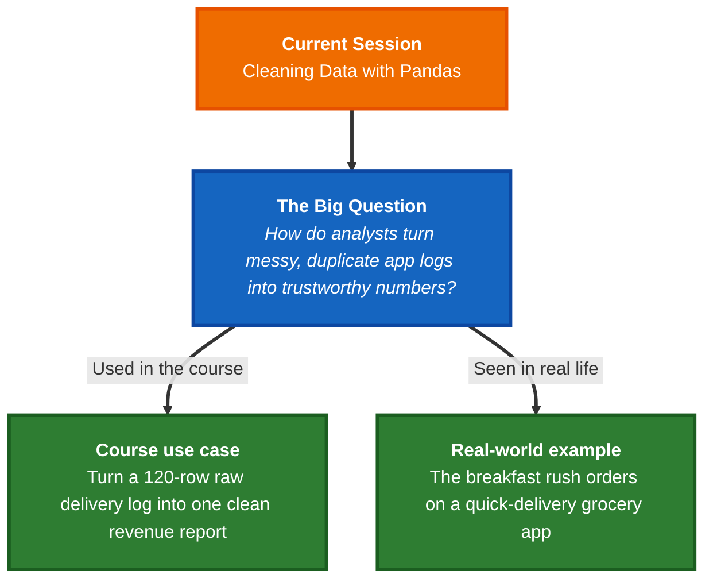

## <span style="color:#2F7DDE">Cleaning Data with Pandas</span>

### <span style="color:#2F7DDE">Mental Map</span>



---

### <span style="color:#2F7DDE">What You'll Learn</span>

Have you ever wondered how grocery delivery apps track thousands of morning orders without double-counting when a customer taps the place order button twice?

By the end of this session, you will be able to:

- <span style="color:#D9660B">**Identify**</span> duplicate order entries and drop them to protect accurate store sales.
- <span style="color:#D9660B">**Locate**</span> blank cells in delivery records using simple checks.
- <span style="color:#D9660B">**Fill**</span> missing delivery fees with zero so calculations run without errors.
- <span style="color:#D9660B">**Trim**</span> stray spaces from area names like ` Koramangala ` for clean matching.
- <span style="color:#D9660B">**Convert**</span> item counts from decimal numbers into clean whole numbers.
- <span style="color:#D9660B">**Calculate**</span> the final bill by adding items and fees row by row across the table.

> <span style="color:#2F7DDE">**Topics you will meet:**</span> Spotting duplicate rows; Dropping duplicates; Finding missing values; Filling missing cells; Cleaning text spaces and casing; Changing data types; Creating calculated columns.
>
> Join the session to learn each of these in detail.

---

### <span style="color:#2F7DDE">Why You Are Learning This Topic</span>

You order milk and bread at 7:00 AM on a delivery app.

A momentary network delay makes your phone send the order request twice.

The store app logs two identical rows for the same bag of groceries.

Another customer gets free delivery through a coupon, so the delivery fee box is left completely blank.

A driver types ` koramangala ` with extra spaces and lowercase letters.

A **clean dataset** means a table where duplicate rows are removed, blank fields are filled, and text entries follow an orderly format so calculations produce reliable numbers.

You will clean data in Python whenever you prepare raw records for a dashboard or a leadership report.

> <span style="color:#2F7DDE">**Think about it:**</span> What happens if an app adds ₹120 to a blank fee box and the entire order total vanishes?

---

### <span style="color:#2F7DDE">The Quick-Delivery Order Puzzle</span>

The morning log holds five order slots recorded at the Indiranagar dark store.

| Order ID | Area | Items | Item Total (₹) | Delivery Fee (₹) |
|:--------:|:-----|:-----:|:--------------:|:----------------:|
| 1001 | Indiranagar | 3 | 450 | 30 |
| 1002 | &nbsp;Koramangala&nbsp; | 2 | 280 | 25 |
| 1003 | Whitefield | *blank* | 150 | 30 |
| 1004 | Indiranagar | 1 | 120 | *blank* |
| 1004 | Indiranagar | 1 | 120 | *blank* |

<span style="color:#D9660B">**What you want to happen:**</span>

- Keep only one copy of order 1004 so sales are not counted twice.
- Treat the blank delivery fee for order 1004 as ₹0 so the final bill adds up to ₹120.
- Trim spaces around ` Koramangala ` so it groups together with other Koramangala orders.

Here is how it might start. You do not need to understand it yet.

```python
import pandas as pd
orders = pd.read_csv("data/blinkit_order_logs.csv").head(5)
print(orders.duplicated(subset=['order_id']))
```

> <span style="color:#D9660B">**Wonder about this:**</span>
>
> - Why does Python turn a whole calculation into `NaN` when you add a number to an empty cell?
> - Why do computers treat `" Koramangala "` and `"Koramangala"` as two completely different places?

---

### <span style="color:#2F7DDE">Think It Through</span>

There is no wrong first try. Keep your guesses for the session.

**1. If an order appears twice with the exact same ID, what is the safest way to fix it without deleting both records?**
Hint: You want to keep the first record and discard only the second copy.

**2. If an order has no delivery fee because of a free delivery coupon, should you delete the whole order or put 0 in that box?**
Hint: The customer still ordered groceries and paid for the food items.

**3. If one customer writes "Indiranagar" and another writes "indiranagar", how does a summary table view them before you clean the text?**
Hint: Computers check exact characters, where uppercase and lowercase letters do not match.

---

### <span style="color:#2F7DDE">One Question to Carry Into the Session</span>

> <span style="color:#2F7DDE">**How can one clean table feed accurate revenue numbers without double counting or missing order totals?**</span>
>
> What is the smallest cleaning fix you would run first on a messy delivery log?
