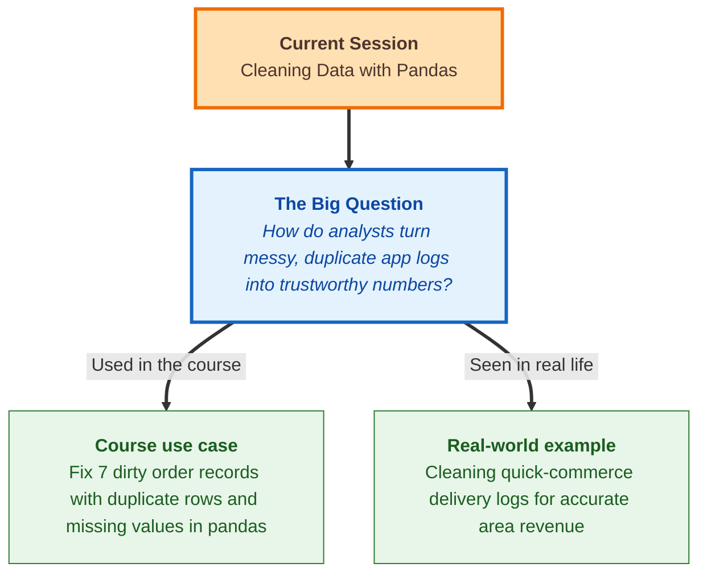

## <span style="color:#2F7DDE">Cleaning Data with Pandas</span>

### <span style="color:#2F7DDE">Mental Map</span>



---

### <span style="color:#2F7DDE">What You'll Learn</span>

Have you ever wondered how delivery apps track thousands of orders every minute without double-counting when a customer taps the checkout button twice?

By the end of this session, you will be able to:

- <span style="color:#D9660B">**Identify**</span> duplicate order entries and remove them to protect accurate totals.
- <span style="color:#D9660B">**Locate**</span> missing values in delivery records and fill or drop them safely.
- <span style="color:#D9660B">**Standardize**</span> messy area names and convert column types for consistent grouping.
- <span style="color:#D9660B">**Calculate**</span> new columns such as final bill amount using row-by-row arithmetic.

> <span style="color:#2F7DDE">**Topics you will meet:**</span> Finding Duplicates, Handling Missing Values, Cleaning Column Values, Simple Transformations.
>
> Join the session to learn each of these in detail.

---

### <span style="color:#2F7DDE">Why You Are Learning This Topic</span>

When you place a grocery order online, your phone sends messages across cellular networks. Sometimes a quick network glitch makes the server log the exact same order twice. A customer might skip entering an optional tip, leaving that box blank. Another person types an address with extra spaces or lowercase letters. In this session, you will clean raw records using Python's pandas library so every calculation gives honest answers.

A <span style="color:#D9660B">**clean dataset**</span> means a table where duplicate records are removed, blank fields are handled, and text entries follow an orderly format so calculations produce reliable numbers.

In this course, clean tables are the foundation for every accurate report and business decision you will produce.

> <span style="color:#2F7DDE">**Think about it:**</span> If an order is logged twice, who pays the price if leadership makes supply decisions based on inflated numbers?

---

### <span style="color:#2F7DDE">Blinkit Order Log Puzzle</span>

Here is a sample of 4 raw orders from a delivery hub in Bengaluru:

| Order ID | Delivery Area | Item Count | Item Total (₹) | Delivery Fee (₹) |
|:--------:|:-------------:|:----------:|:--------------:|:----------------:|
| 101 | Indiranagar | 3 | 450 | 30 |
| 102 | &nbsp;Koramangala&nbsp; | 2 | 280 | 25 |
| 104 | Indiranagar | 1 | 120 | *blank* |
| 104 | Indiranagar | 1 | 120 | *blank* |

<span style="color:#D9660B">**What you want to happen:**</span>

- Order 104 should only be counted once instead of twice.
- The blank delivery fee for order 104 should be treated as 0 instead of breaking total bill math.
- Extra spaces around "Koramangala" should be trimmed so it groups together with other Koramangala orders.

Here is how it might start. You do not need to understand it yet:

```python
clean_df = raw_df.drop_duplicates()
clean_df['delivery_fee'] = clean_df['delivery_fee'].fillna(0)
```

> <span style="color:#D9660B">**Wonder about this:**</span>
>
> - What happens when a computer tries to add a regular number like ₹120 to a blank cell?
> - Why do computers treat `" Koramangala "` and `"Koramangala"` as two completely different places?

---

### <span style="color:#2F7DDE">Think It Through</span>

There is no wrong first try. Keep your guesses for the session.

**1. If an order record appears twice with identical details, what is the safest way to correct it without losing the real transaction?**
Hint: Think about keeping the first copy and discarding the second copy.

**2. If an order has no delivery fee recorded because of a free delivery coupon, should you delete the entire order row or fill that blank cell?**
Hint: The customer still ordered groceries and paid for the items.

**3. If one customer writes "Indiranagar" and another writes "indiranagar", how does a summary table view them before you clean the text?**
Hint: Computers look at exact character codes, where uppercase and lowercase letters do not match.

---

### <span style="color:#2F7DDE">One Question to Carry Into the Session</span>

> <span style="color:#2F7DDE">**How much time should an analyst spend verifying data quality before running any calculations?**</span>
>
> Does clean data happen automatically, or is building repeatable cleaning steps an essential skill for every data professional?
