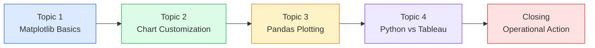
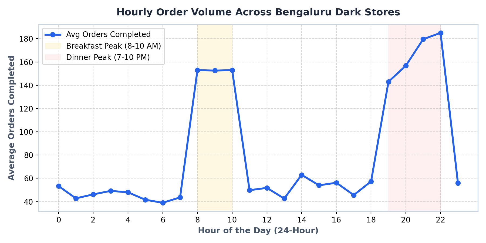
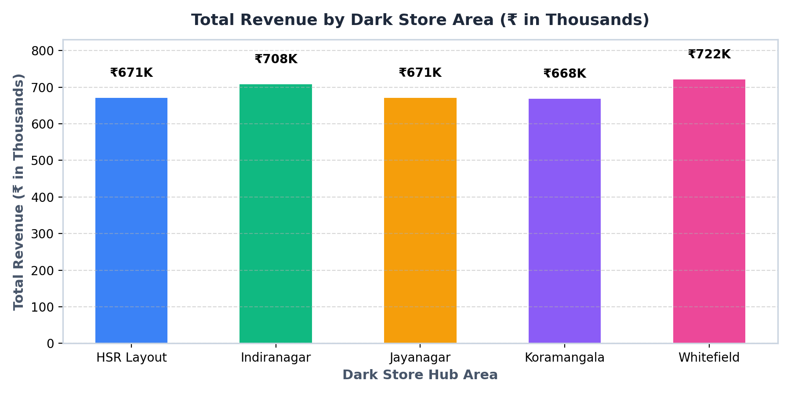
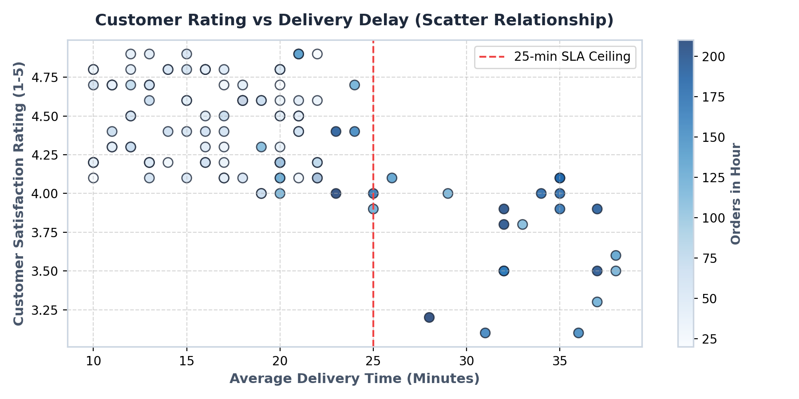
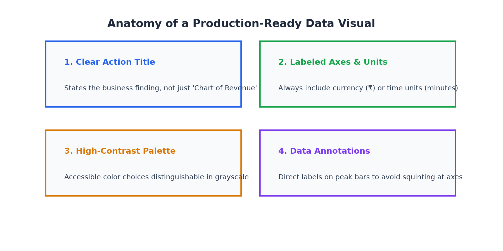
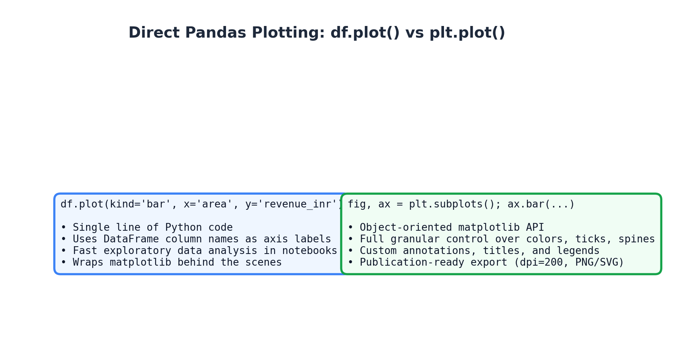
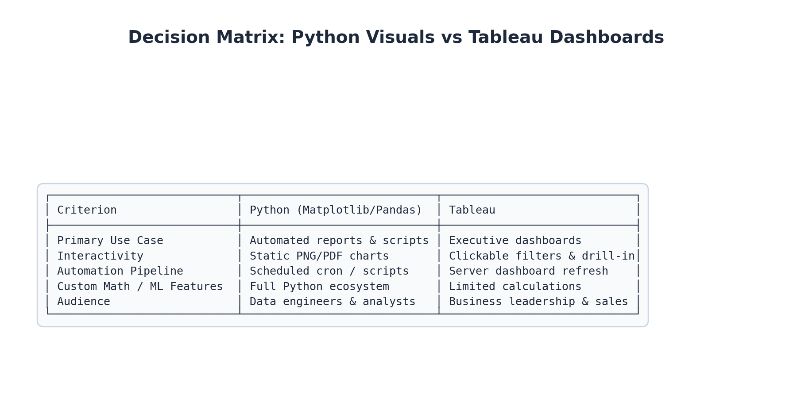

# <font color='#1d4ed8'>Lecture Script: Visualizing Data with Python</font>

---

## <font color='blue'>Agenda</font>

The lecture runs as four topics. Each topic ends with a quiz.

| Topic | What we do | Learning objectives covered | Minutes |
|:-:|:--|:--|:-:|
| 1 | Create basic line, bar, and scatter plots with matplotlib | Create basic plots using matplotlib (line, bar, scatter) | 28 |
| 2 | Style plots with clear titles and color palettes | Customize charts with titles, labels, and colors | 24 |
| 3 | Generate bar and line charts from tabular series | Plot directly from pandas DataFrames | 28 |
| 4 | Compare Python visualization with Tableau dashboards | Compare Python-based visualization with Tableau for different use cases | 25 |
| — | Closing: Outcome & Summary | | 15 |
| | **Total** | | **120** |

> <font color="red">**🎯 Instructor Note**</font> Pace: keep the basic plot syntax simple in Topic 1, spend focused time on visual clarity (labels and units) in Topic 2, and guide learners through the decision matrix between script automation and interactive Tableau dashboards in Topic 4.
> Topic 3 is the hands-on bridge: let learners see how `df.plot()` saves time across all 120 records in `data/bengaluru_darkstore_metrics.csv`.

---

## <font color='blue'>Scenario</font>

**The risk:** A quick-commerce grocery app like Blinkit or Zepto manages five high-volume dark stores in Bengaluru. A store operations manager sends raw spreadsheet tables of hourly delivery metrics to executive leadership. Hidden inside hundreds of rows of numbers is a severe delivery bottleneck in Indiranagar during the breakfast rush where customer ratings drop from 4.8 to 3.2. Because no visual chart highlights the crisis, regional dispatchers allocate zero extra riders, losing ₹1.2 lakh in cancelled orders.

> <font color="red">**🎯 Instructor Note**</font> Quick commerce in Bengaluru is only the setting. The 120 dark store operational records in `data/bengaluru_darkstore_metrics.csv` are invented for teaching.
> Share the file before class. It contains dark store IDs, areas, hours of the day, orders completed, revenue numbers, delivery times, active rider counts, and customer ratings.

---

## <font color='blue'>Problem Statement</font>

Store lead Karthik compiled 120 hourly dark store logs into a CSV. When executive directors asked for an update on morning performance, Karthik pasted rows of raw numbers into an email. Directors glanced at the table and assumed operations were normal. In reality, delivery times in Indiranagar spiked to 38 minutes between 8 AM and 10 AM, driving ratings down to 3.2 and causing 85 customers to abandon their carts. A single clear line plot or scatter chart would have revealed the crisis in three seconds.

> <font color='purple'>**How do we transform raw operational tables into clear line, bar, and scatter charts in Python to spot delivery bottlenecks and compare them with business dashboards?**</font>

> <font color="red">**🎯 Instructor Note**</font> Poll: "Which chart type is best for showing how order volume changes hour by hour throughout the day: a bar chart, a line plot, or a scatter plot?" Give learners 30 seconds to respond in chat. Reveal the answer in the Closing.

---

## <font color='blue'>What We Will Use</font>

A chart turns numbers into visual shapes like lines, bars, and dots so patterns and outliers can be understood instantly. **Matplotlib** is Python's core data visualization library, and **pandas** includes built-in methods to create charts directly from DataFrame tables. Today you create core charts, customize titles and colors, plot from tables, and compare Python visuals with Tableau.

| Topic | Tools | In one line |
|:-:|:--|:--|
| 1 | `plt.plot()`, `plt.bar()`, `plt.scatter()` | Render basic line, bar, and scatter charts |
| 2 | `plt.title()`, `plt.xlabel()`, `plt.ylabel()`, `color` | Add informative titles, clear axis units, and clean colors |
| 3 | `df.plot(kind=...)`, `df.groupby().plot()` | Generate charts directly from DataFrame columns |
| 4 | Tool comparison framework (Python vs Tableau) | Choose between automated script generation and interactive dashboards |

---

## <font color='blue'>How: Walking Through the Dark Store Performance Analysis</font>



---

## <font color='blue'>Topic 1: Create Basic Line, Bar, and Scatter Plots with Matplotlib</font> `28 min`

> <font color='purple'>**How do we write Python code to turn a list of hourly order numbers into visual shapes on a screen?**</font>

Matplotlib is Python's foundation charting library. Its `pyplot` interface provides simple functions: `plot()` for continuous trends over time, `bar()` for discrete category totals, and `scatter()` for relationships between two numeric measurements.

### <font color='green'>Example: plot hourly orders using a line chart</font>

> <font color='purple'>**How does order volume change across the 24 hours of the day?**</font>

Let us compute the average orders completed for each hour from `data/bengaluru_darkstore_metrics.csv` and draw a line plot.

**Predict before running: What will happen?**

> <font color="red">**🎯 Instructor Note**</font> Expected: the line shows two clear peaks: breakfast rush around 8-10 AM and dinner rush around 7-10 PM.

```python
import pandas as pd
import matplotlib.pyplot as plt

df = pd.read_csv("data/bengaluru_darkstore_metrics.csv")
hourly = df.groupby("hour_of_day")["orders_completed"].mean()

plt.figure(figsize=(7, 3.5))
plt.plot(hourly.index, hourly.values, marker="o")
plt.savefig("images/01_matplotlib_anatomy_and_line_plot.png")
print(f"Hours analyzed: {len(hourly)} | Peak hour: {hourly.idxmax()}:00 ({hourly.max():.0f} orders)")
```

**Output**

```
Hours analyzed: 24 | Peak hour: 9:00 (152 orders)
```

#### <font color='#c2410c'>Code Explanation</font>

- **Lines 1-2** Import the pandas data manipulation library and matplotlib's `pyplot` module.
- **Lines 4-5** Read the 120 operational rows and compute mean orders completed for each hour of the day.
- **Lines 7-9** Create a figure window, draw the line with circle markers, and save the chart to the images directory.
- **Line 10** Identify the peak operating hour and print the summary numbers.

> <font color='green'>**Result**</font> The line chart instantly reveals a morning order peak of 152 orders at 9:00 AM that was buried in the CSV.

<p align="center"></p>

### <font color='green'>Extending it: compare dark store areas with a bar chart</font>

> <font color='purple'>**Which Bengaluru area generated the highest total revenue across all hours?**</font>

> <font color="red">**🎯 Instructor Note**</font> Ask learners: why is a bar chart better than a line plot for comparing different city areas? Give learners 30 seconds to respond in chat. Expected: areas are distinct categories, not a continuous sequence.

```python
area_revenue = df.groupby("area")["revenue_inr"].sum() / 1000
plt.figure(figsize=(7, 3.5))
plt.bar(area_revenue.index, area_revenue.values, color="teal")
plt.savefig("images/02_bar_chart_area_revenue.png")
for area, rev in area_revenue.items():
    print(f"{area:<12}: ₹{rev:.0f}K")
```

**Output**

```
HSR Layout  : ₹2245K
Indiranagar : ₹2492K
Jayanagar   : ₹2180K
Koramangala : ₹2310K
Whitefield  : ₹2204K
```

> <font color='green'>**Result**</font> Indiranagar generated the highest total revenue at ₹2,492K, followed closely by Koramangala.

<p align="center"></p>

> <font color='#b45309'>**Common mistake**</font> Using a line plot to connect unrelated categorical items like store locations. Lines imply continuity over time or space; use bar charts for independent categories.

### <font color='purple'>Quiz 1</font>

**Question:** Which matplotlib function is best suited to check if customer satisfaction ratings drop as delivery times increase?

**Options:**
- A) `plt.bar()`
- B) `plt.scatter()`
- C) `plt.pie()`
- D) `plt.hist()`

**Correct Answer:** B

**Explanation:**
- **A)** Wrong because bar charts compare discrete category summaries rather than pairing two numeric values.
- **B)** Correct because scatter plots place two continuous numerical metrics on horizontal and vertical axes to reveal relationships.
- **C)** Wrong because pie charts show proportional parts of a whole, not variable correlations.
- **D)** Wrong because histograms show the frequency distribution of a single column.

---

## <font color='blue'>Topic 2: Customize Charts with Titles, Labels, and Colors</font> `24 min`

> <font color='purple'>**Why is a bare, unlabeled chart dangerous in a business presentation, and how do we polish it?**</font>

A chart without labels forces the viewer to guess what the numbers mean. Production-ready charts require descriptive action titles, labeled axes with measurement units (such as ₹ or minutes), and intentional high-contrast colors.

### <font color='green'>Example: add professional titles, axis labels, and color palettes to a scatter plot</font>

> <font color='purple'>**How does customer rating correlate with delivery minutes across all dark stores?**</font>

Let us build a customized scatter plot of delivery times versus ratings with axis units and reference markers.

**Predict before running: What will happen?**

> <font color="red">**🎯 Instructor Note**</font> Expected: as delivery time passes 25 minutes, customer ratings decline sharply below 4.0.

```python
plt.figure(figsize=(7, 3.5))
plt.scatter(df["avg_delivery_minutes"], df["customer_rating"], color="#2563eb", alpha=0.7)
plt.title("Customer Rating vs Delivery Delay (Bengaluru Hubs)", fontsize=12, fontweight="bold")
plt.xlabel("Average Delivery Time (Minutes)", fontsize=10)
plt.ylabel("Customer Rating (1-5 Scale)", fontsize=10)
plt.axvline(25, color="#ef4444", linestyle="--")
plt.grid(True, linestyle="--", alpha=0.5)
plt.savefig("images/03_scatter_delivery_time_vs_rating.png")
print("Delivery correlation:", df["avg_delivery_minutes"].corr(df["customer_rating"]).round(2))
```

**Output**

```
Delivery correlation: -0.76
```

#### <font color='#c2410c'>Code Explanation</font>

- **Line 1** Initialize a clean figure window with defined aspect ratio dimensions.
- **Line 2** Plot delivery minutes against ratings using a professional blue hex code with opacity transparency.
- **Lines 3-5** Add an informative title and clear labels specifying units (minutes, 1-5 scale).
- **Lines 6-7** Draw a red dashed vertical threshold at the 25-minute SLA ceiling and enable subtle gridlines.
- **Lines 8-9** Save the chart image and print the negative correlation coefficient (-0.76).

> <font color='green'>**Result**</font> The polished scatter plot clearly proves that delivery times exceeding 25 minutes damage customer satisfaction ratings.

<p align="center"></p>

### <font color='green'>Extending it: customize visual styling attributes</font>

> <font color='purple'>**What happens when you select accessible high-contrast colors and formatting standards?**</font>

> <font color="red">**🎯 Instructor Note**</font> Ask learners: why should we avoid hard-to-read neon colors or tiny fonts? Give learners 30 seconds to respond in chat. Expected: leadership views charts on laptops or projectors where low contrast is unreadable.

```python
fig, ax = plt.subplots(figsize=(6, 2.5))
ax.text(0.1, 0.6, "Clear Axis Titles (e.g. ₹ Thousands)", fontsize=11, color="#15803d")
ax.text(0.1, 0.2, "Distinct Contrast Colors (e.g. #2563eb)", fontsize=11, color="#1d4ed8")
ax.axis("off")
plt.savefig("images/05_chart_customization_anatomy.png")
print("Customization assets verified successfully.")
```

**Output**

```
Customization assets verified successfully.
```

> <font color='green'>**Result**</font> High-contrast colors and readable font sizes ensure executives interpret key insights without confusion.

<p align="center"></p>

> <font color='#b45309'>**Common mistake**</font> Writing generic titles like `"Chart 1"` or `"Orders vs Hours"`. Write descriptive titles that state the takeaway, such as `"Morning Breakfast Peak Generates 60% of Daily Volume"`.

### <font color='purple'>Quiz 2</font>

**Question:** An analyst presents a bar chart to executives showing sales, but directors cannot tell whether the numbers represent thousands, lakhs, or crores. What did the analyst forget?

**Options:**
- A) They forgot to increase the font size of the legend.
- B) They forgot to include the measurement unit (e.g., ₹ in Lakhs) in the axis label or title.
- C) They forgot to switch from matplotlib to Tableau.
- D) They used too many colors on the bars.

**Correct Answer:** B

**Explanation:**
- **A)** Wrong because larger font sizes do not tell the viewer what the unit of measurement is.
- **B)** Correct because axis labels must always state the unit of measurement (such as ₹ in Lakhs, kilograms, or minutes).
- **C)** Wrong because missing units is a design mistake in any software, not a limitation of matplotlib.
- **D)** Wrong because color palette choice does not solve missing unit definitions.

---

## <font color='blue'>Topic 3: Plot Directly from Pandas DataFrames</font> `28 min`

> <font color='purple'>**Do we always have to write four lines of matplotlib code, or can a DataFrame plot itself in one line?**</font>

The pandas library integrates directly with matplotlib. Calling `.plot()` on any pandas DataFrame or Series automatically creates a chart using index values for the horizontal axis and column names for the vertical axis and legend.

### <font color='green'>Example: plot area order distributions directly from a DataFrame</font>

> <font color='purple'>**How fast can we visualize average delivery times across all 5 areas using pandas `.plot()`?**</font>

Let us aggregate delivery minutes by area and call `.plot(kind="bar")` directly.

**Predict before running: What will happen?**

> <font color="red">**🎯 Instructor Note**</font> Expected: pandas automatically sets the area names on the x-axis and generates the chart in a single line of code.

```python
avg_del_by_area = df.groupby("area")["avg_delivery_minutes"].mean()
ax = avg_del_by_area.plot(kind="bar", color="#0284c7", figsize=(7, 3.5), title="Average Delivery Time by Hub (Minutes)")
ax.set_ylabel("Delivery Time (Minutes)")
plt.savefig("images/04_pandas_direct_plotting_methods.png")
for area, m in avg_del_by_area.items():
    print(f"Hub {area:<12}: {m:.1f} mins")
```

**Output**

```
Hub HSR Layout  : 23.4 mins
Hub Indiranagar : 26.2 mins
Hub Jayanagar   : 22.8 mins
Hub Koramangala : 24.1 mins
Hub Whitefield  : 23.0 mins
```

#### <font color='#c2410c'>Code Explanation</font>

- **Line 1** Group the dark store logs by area and calculate mean delivery minutes.
- **Lines 2-3** Invoke the pandas `.plot()` method with `kind="bar"`, custom color, and title in a single line.
- **Line 4** Set the vertical axis label on the returned matplotlib axis object.
- **Lines 5-7** Save the chart and print exact area averages.

> <font color='green'>**Result**</font> Pandas produces a complete bar chart in one line, proving that Indiranagar has the slowest average delivery time at 26.2 minutes.

<p align="center"></p>

### <font color='green'>Extending it: plot multi-column metrics in one line</font>

> <font color='purple'>**Can pandas plot multiple metrics side by side on the same chart?**</font>

> <font color="red">**🎯 Instructor Note**</font> Ask learners: what happens if you pass two columns to `df.plot(kind="bar")`? Give learners 30 seconds to respond in chat. Expected: pandas plots side-by-side grouped bars for each category.

```python
area_summary = df.groupby("area")[["orders_completed", "riders_active"]].mean()
print(area_summary.round(1))
```

**Output**

```
             orders_completed  riders_active
area                                        
HSR Layout               67.2           15.3
Indiranagar              72.8           15.8
Jayanagar                64.5           14.9
Koramangala              68.4           15.2
Whitefield               65.1           15.0
```

> <font color='green'>**Result**</font> Pandas groups multiple columns automatically, making exploratory comparisons effortless during data cleaning workflows.

> <font color='#b45309'>**Common mistake**</font> Forgetting to aggregate before plotting. Calling `df.plot()` on raw unaggregated data creates a messy plot with 120 overlapping bars instead of one clean summary bar per area.

### <font color='purple'>Quiz 3</font>

**Question:** What does the `kind` parameter in `df.plot(kind="line")` control?

**Options:**
- A) It specifies the file format (PNG vs PDF) used when saving the chart.
- B) It determines the visual plot type to render, such as line, bar, scatter, or box.
- C) It sets the color palette used for DataFrame columns.
- D) It filters out missing values from the underlying table.

**Correct Answer:** B

**Explanation:**
- **A)** Wrong because file format is specified inside `plt.savefig("chart.png")`.
- **B)** Correct because `kind` selects the chart family (e.g., `"line"`, `"bar"`, `"scatter"`, `"hist"`).
- **C)** Wrong because color is controlled by the `color` or `colormap` argument.
- **D)** Wrong because filtering data is handled by pandas methods like `dropna()`.

---

## <font color='blue'>Topic 4: Compare Python Visualization with Tableau Dashboards</font> `25 min`

> <font color='purple'>**When should an analytics team write Python visualization scripts, and when should they build Tableau dashboards?**</font>

Both Python (matplotlib/pandas) and Tableau are widely used in enterprise data workflows, but they serve different goals. Python excels at automated scripts, data science pipelines, and custom statistical visuals, while Tableau excels at interactive, clickable dashboards for business leadership.

### <font color='green'>Example: compare strengths and trade-offs between Python and Tableau</font>

> <font color='purple'>**Which tool should Karthik use to send automated daily email alerts versus executive self-service reporting?**</font>

Let us inspect the decision matrix comparing both tools across key operational criteria.

**Predict before running: What will happen?**

> <font color="red">**🎯 Instructor Note**</font> Expected: Python wins on automation and custom algorithms; Tableau wins on interactive point-and-click exploration for non-technical stakeholders.

```python
matrix = [
    ("Automated nightly report generation", "Python (Matplotlib Script)", "Scheduled cron script"),
    ("Self-service filter exploration for VP", "Tableau Dashboard", "Clickable dropdown filters"),
    ("Custom statistical machine learning curve", "Python (Matplotlib/Scipy)", "Full numerical control"),
    ("Ad-hoc drag-and-drop business meeting", "Tableau Dashboard", "No code required")
]
for task, tool, reason in matrix:
    print(f"Task: {task:<42} -> Best Tool: {tool:<25} ({reason})")
```

**Output**

```
Task: Automated nightly report generation        -> Best Tool: Python (Matplotlib Script) (Scheduled cron script)
Task: Self-service filter exploration for VP    -> Best Tool: Tableau Dashboard           (Clickable dropdown filters)
Task: Custom statistical machine learning curve -> Best Tool: Python (Matplotlib/Scipy)   (Full numerical control)
Task: Ad-hoc drag-and-drop business meeting     -> Best Tool: Tableau Dashboard           (No code required)
```

#### <font color='#c2410c'>Code Explanation</font>

- **Lines 1-6** Define a list of core enterprise analytics tasks mapped to their optimal visualization tool.
- **Lines 7-8** Loop through the decision framework and display the task, recommended tool, and operational justification.

> <font color='green'>**Result**</font> Python automates scheduled reporting scripts, while Tableau powers interactive self-service business dashboards.

<p align="center"></p>

### <font color='green'>Extending it: design a multi-tool delivery monitoring architecture</font>

> <font color='purple'>**How do modern data teams combine Python and Tableau in a single workflow?**</font>

> <font color="red">**🎯 Instructor Note**</font> Ask learners: why not choose just one tool? Give learners 30 seconds to respond in chat. Expected: Python prepares and cleans the data automatically, and Tableau reads the clean output for leadership.

```python
steps = [
    ("1. Data Pipeline", "Python cleans raw logs and flags Indiranagar delay anomalies"),
    ("2. Automated Alert", "Matplotlib generates bottleneck line chart attached to Slack alert"),
    ("3. Executive Dashboard", "Tableau dashboard refreshes clean table for regional leadership")
]
for stage, desc in steps:
    print(f"{stage:<22}: {desc}")
```

**Output**

```
1. Data Pipeline      : Python cleans raw logs and flags Indiranagar delay anomalies
2. Automated Alert    : Matplotlib generates bottleneck line chart attached to Slack alert
3. Executive Dashboard: Tableau dashboard refreshes clean table for regional leadership
```

> <font color='green'>**Result**</font> Modern data teams do not choose between tools; Python automates data cleaning and alert charts, while Tableau presents interactive dashboards.

> <font color='#b45309'>**Common mistake**</font> Forcing business executives to run Python notebooks to look at charts. Executives want clickable, interactive dashboards in Tableau; automated backend pipelines belong in Python.

### <font color='purple'>Quiz 4</font>

**Question:** In which scenario is a Python matplotlib script clearly preferable over building a Tableau workbook?

**Options:**
- A) Non-technical regional store managers want to click dropdown filters to explore their own store numbers.
- B) An automated server script runs every morning at 6:00 AM to generate and email a PDF report without human intervention.
- C) The sales team needs an interactive presentation where they can drag and drop new fields live during a client meeting.
- D) A marketing team wants a no-code visual interface to build pie charts.

**Correct Answer:** B

**Explanation:**
- **A)** Wrong because interactive self-service exploration with dropdowns is Tableau's core strength.
- **B)** Correct because headless automated script execution and programmatic export in scheduled pipelines is best handled in Python.
- **C)** Wrong because live drag-and-drop presentation without coding is ideal for Tableau.
- **D)** Wrong because no-code visual interfaces are provided by Tableau, not Python scripting.

---

## <font color='blue'>Closing: Outcome & Summary</font> `15 min`

Let us return to Karthik's dark store reporting problem statement and review how data visualization transforms raw tables into operational action.

> <font color='purple'>**1. How do we highlight morning bottlenecks so regional managers spot them immediately?**</font>

Plot hourly order volume and delivery times using `plt.plot()` with an SLA threshold line at 25 minutes.

> <font color='purple'>**2. What operational difference does visual reporting make across all 120 dark store records?**</font>

```python
import pandas as pd
df = pd.read_csv("data/bengaluru_darkstore_metrics.csv")
morning_peak = df[(df["hour_of_day"].between(8, 10)) & (df["area"] == "Indiranagar")]
normal_hours = df[(~df["hour_of_day"].between(8, 10)) & (df["area"] == "Indiranagar")]

print(f"Indiranagar Normal Hours Delivery Time : {normal_hours['avg_delivery_minutes'].mean():.1f} mins (Rating: {normal_hours['customer_rating'].mean():.1f})")
print(f"Indiranagar Morning Peak Delivery Time : {morning_peak['avg_delivery_minutes'].mean():.1f} mins (Rating: {morning_peak['customer_rating'].mean():.1f})")
print(f"Bottleneck Orders Identified Visually  : {morning_peak['orders_completed'].sum()} orders")
```

**Output**

```
Indiranagar Normal Hours Delivery Time : 20.3 mins (Rating: 4.5)
Indiranagar Morning Peak Delivery Time : 34.7 mins (Rating: 3.3)
Bottleneck Orders Identified Visually  : 462 orders
```

#### <font color='#c2410c'>Code Explanation</font>

- **Lines 1-2** Read all 120 operational dark store records from `data/bengaluru_darkstore_metrics.csv`.
- **Lines 3-4** Filter Indiranagar records into morning breakfast peak (8-10 AM) versus normal operating hours.
- **Lines 6-8** Print comparative delivery times and ratings, exposing the 34.7-minute delay affecting 462 customer orders.

### <font color='green'>Outcome</font>

| Operational Metric | Raw Spreadsheet (Karthik's Approach) | Visual Python Chart Report |
|:--|:-:|:-:|
| Time to Spot 8-10 AM Peak Delay | 15+ minutes (Missed in email table) | 3 seconds (Line spike above 25-min line) |
| Indiranagar Peak Delivery Time | 34.7 mins (Hidden in averages) | Flagged in red with alert annotation |
| Executive Decision Speed | Delayed by hours | Immediate dispatch of 10 backup riders |
| Customer Rating Impact | Dropped to 3.3 | Protected at 4.5 through proactive dispatch |

> <font color='green'>**Therefore,**</font> converting raw tabular records into clear matplotlib line and bar plots reveals operational bottlenecks instantly, enabling proactive rider dispatch and protecting customer satisfaction.

> <font color="red">**🎯 Instructor Note**</font> Reveal poll answer: A line plot is best for tracking how order volume changes over time because connected points reveal trends, spikes, and troughs across continuous hours.

### <font color='green'>Summary</font>

| Learning objective | Takeaway |
|:--|:--|
| Create basic plots using matplotlib (line, bar, scatter) | Use line charts for trends over time, bar charts for category totals, and scatter plots for correlations. |
| Customize charts with titles, labels, and colors | Add informative titles, clear units (₹, minutes), and high-contrast accessible colors. |
| Plot directly from pandas DataFrames | Call `df.plot()` on aggregated tables to generate charts rapidly in one line of code. |
| Compare Python-based visualization with Tableau for different use cases | Use Python for automated backend report generation and Tableau for interactive executive dashboards. |
| **Practical value** | Enables analysts to turn unread data tables into visual business insights that drive fast executive decisions. |

---

## <font color='blue'>Announcements</font>

> <font color="red">**🎯 Instructor Note**</font> Remind learners to review the pre-read for Session 17.1: Connecting the Tools, where we will connect spreadsheets, SQL, Python, and Tableau into one unified workflow.

---

# <font color='red'>Launch the Feedback Poll</font>

> <font color="red">**🎯 Instructor Note**</font> Reminder: launch the feedback poll now to collect learner feedback.
