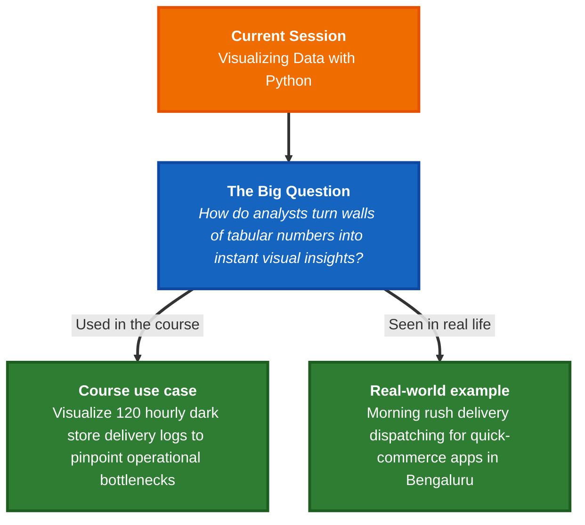

## <span style="color:#2F7DDE">Visualizing Data with Python</span>

### <span style="color:#2F7DDE">Mental Map</span>



---

### <span style="color:#2F7DDE">What You'll Learn</span>

Have you ever stared at a spreadsheet filled with hundreds of rows of numbers and found your eyes glazing over, unable to tell if sales are growing or falling?

By the end of this session, you will be able to:

- <span style="color:#D9660B">**Create**</span> line plots, bar charts, and scatter plots using matplotlib functions.
- <span style="color:#D9660B">**Customize**</span> charts with action titles, clear units (₹ and minutes), and accessible colors.
- <span style="color:#D9660B">**Generate**</span> visual plots directly from pandas DataFrame columns in a single line.
- <span style="color:#D9660B">**Compare**</span> automated Python charting scripts with interactive Tableau dashboards.

> <span style="color:#2F7DDE">**Topics you will meet:**</span> Matplotlib plot types; Line plots for hourly trends; Bar charts for category revenue; Scatter plots for correlation; Titles, labels, and color palettes; Direct pandas plotting; Python versus Tableau use cases.
>
> Join the session to learn each of these in detail.

---

### <span style="color:#2F7DDE">Why You Are Learning This Topic</span>

A quick-commerce grocery dark store in Indiranagar processes 150 orders every morning.

At 8:30 AM, road traffic delays riders, pushing delivery times from 15 minutes to 38 minutes.

Customer satisfaction ratings plummet from 4.8 down to 3.2.

If this data remains trapped in a 500-row spreadsheet, store managers miss the bottleneck until angry customer complaints flood customer support.

A <span style="color:#D9660B">**chart**</span> means a visual display that translates raw numbers into lines, bars, or coordinates so human brains can spot trends, spikes, and outliers in seconds.

Learning to build clear charts in Python lets you automate visual daily reports and alert leadership to operational issues before revenue is lost.

> <span style="color:#2F7DDE">**Think about it:**</span> Why does a simple line spiking upward communicate an emergency faster than a table of 24 numbers?

---

### <span style="color:#2F7DDE">The Dark Store Delivery Puzzle</span>

An operations log records hourly performance across four dark store locations in Bengaluru.

| Hub Area | Hour | Orders Completed | Avg Delivery (mins) | Customer Rating |
|:---------|:----:|:----------------:|:-------------------:|:---------------:|
| Indiranagar | 9 AM | 152 | 35 | 3.2 |
| Koramangala | 9 AM | 140 | 22 | 4.6 |
| Whitefield | 9 AM | 95 | 20 | 4.7 |
| HSR Layout | 9 AM | 110 | 23 | 4.5 |

<span style="color:#D9660B">**What you want to happen:**</span>

- Draw a line chart showing order peaks across all 24 hours of the day.
- Create a scatter plot to confirm that delivery times over 25 minutes drag ratings below 4.0.
- Decide whether to automate daily alert charts in Python or build interactive Tableau dashboards for store leads.

Here is how it might start. You do not need to understand it yet.

```python
import pandas as pd
import matplotlib.pyplot as plt

df = pd.read_csv("data/bengaluru_darkstore_metrics.csv")
df.groupby("area")["revenue_inr"].sum().plot(kind="bar")
```

> <span style="color:#D9660B">**Wonder about this:**</span>
>
> - Why do we use line charts for hours of the day but bar charts for city areas?
> - When would you choose a Python script over a Tableau dashboard to present sales numbers?

---

### <span style="color:#2F7DDE">Think It Through</span>

There is no wrong first try. Keep your guesses for the session.

**1. If you want to show how a company's sales change continuously month by month over a full year, which chart type should you choose?**
Hint: Think about connecting sequential points across time.

**2. Why should an axis label never just say "Revenue" without specifying units like "₹ in Thousands"?**
Hint: A number like 500 could mean 500 rupees, 500 thousand, or 500 crore.

**3. If an executive wants to click on a map and filter sales by individual pincodes live during a meeting, is Python or Tableau better?**
Hint: Consider which tool is designed for interactive, no-code click-and-drag exploration.

---

### <span style="color:#2F7DDE">One Question to Carry Into the Session</span>

> <span style="color:#2F7DDE">**How can a single visual chart change an executive's operational decisions in three seconds when a 100-row table failed to do so?**</span>
>
> What makes a data visual trustworthy rather than misleading?
