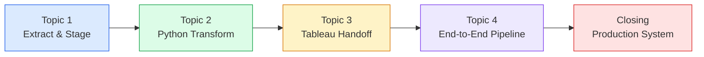
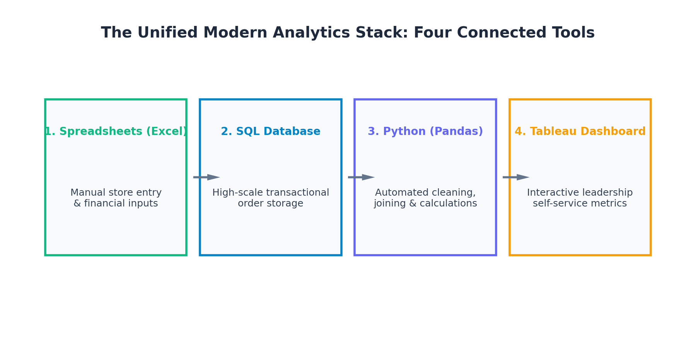
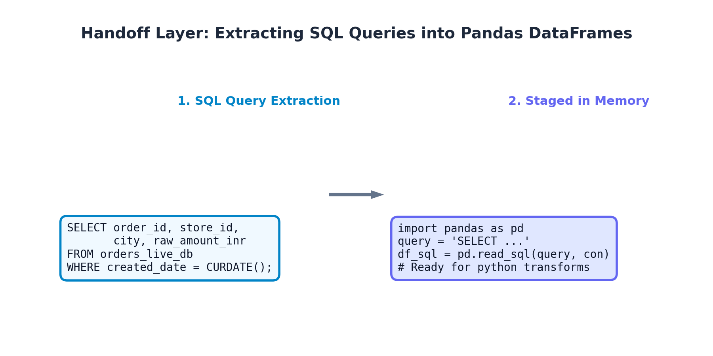
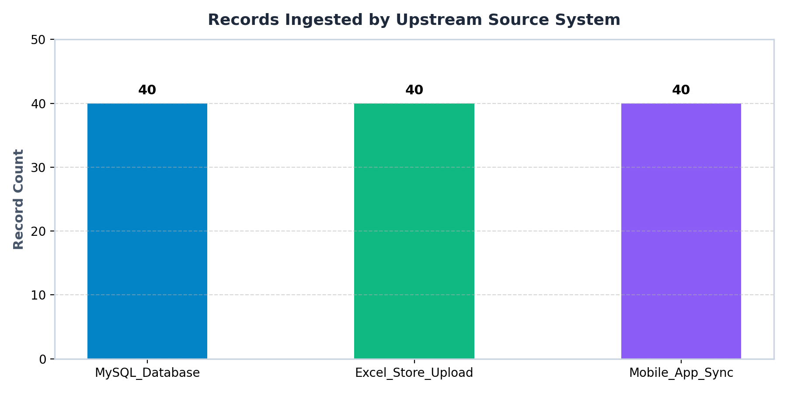
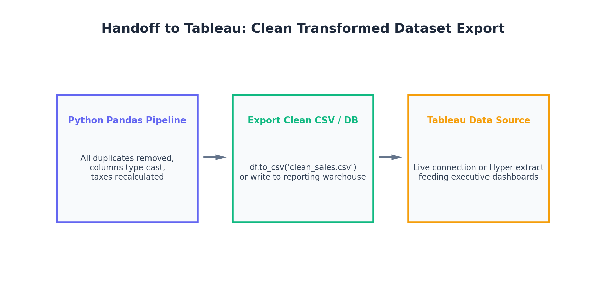
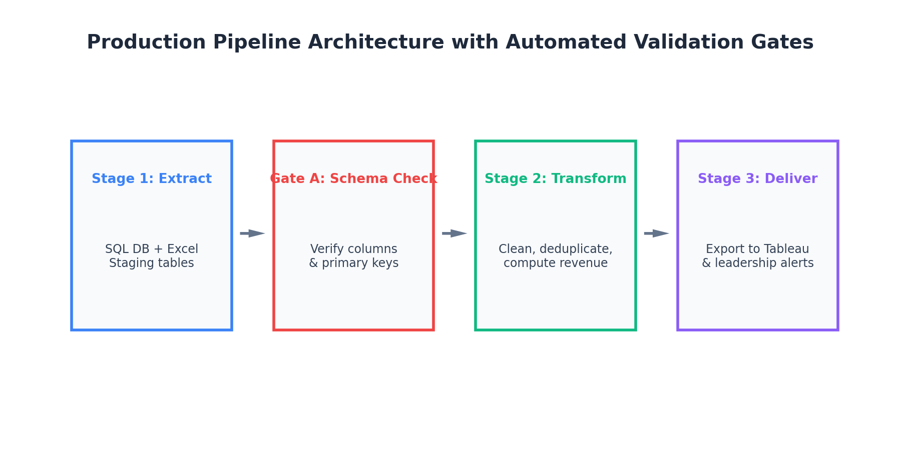
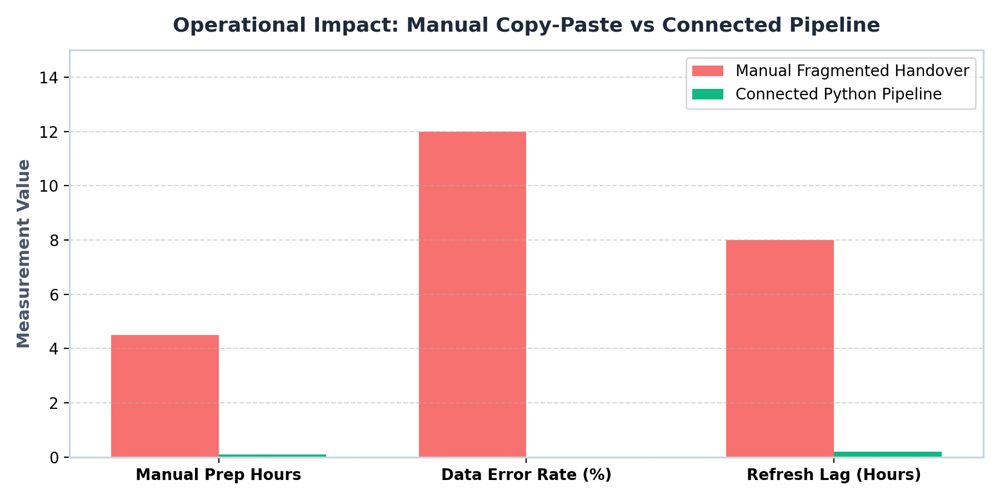

# <font color='#1d4ed8'>Lecture Script: Connecting the Tools</font>

---

## <font color='blue'>Agenda</font>

The lecture runs as four topics. Each topic ends with a quiz.

| Topic | What we do | Learning objectives covered | Minutes |
|:-:|:--|:--|:-:|
| 1 | Extract and stage raw records from spreadsheets and SQL queries | Combine outputs from spreadsheets, SQL, Tableau, and Python | 28 |
| 2 | Clean, merge, and transform staged tables in Python | Connect different tools into one workflow | 27 |
| 3 | Export clean tables to feed interactive Tableau dashboards | Export structured datasets to feed business visualization layers | 25 |
| 4 | Structure an automated end-to-end pipeline with validation handoffs | Organize analysis steps end-to-end | 25 |
| — | Closing: Outcome & Summary | | 15 |
| | **Total** | | **120** |

> <font color="red">**🎯 Instructor Note**</font> Pace: keep extraction code conceptual in Topic 1, spend focused time on automated data validation in Topic 2, and walk through the architectural handover between Python and Tableau in Topics 3 and 4.
> Topic 4 connects directly to real-world operations: let learners inspect how automated validation catches 6 corrupted records across all 120 rows in `data/multi_tool_retail_pipeline.csv`.

---

## <font color='blue'>Scenario</font>

**The risk:** An omni-channel retail brand like Reliance Retail or Trent operates offline physical stores and an online shopping app. Store coordinators manually export daily store registers into Excel sheets, while web orders live in a MySQL database. An analyst spends four hours every morning copying and pasting rows between files. Mismatched column names and duplicate entries go unnoticed, inflating regional sales by ₹3.8 lakh and causing the executive Tableau dashboard to display false revenue numbers.

> <font color="red">**🎯 Instructor Note**</font> Omni-channel retail is only the setting. The 120 transaction records in `data/multi_tool_retail_pipeline.csv` are invented for teaching.
> Share the file before class. It contains orders from multiple source systems, store IDs, cities, item counts, raw revenue, tax amounts, validation flags, and pipeline statuses.

---

## <font color='blue'>Problem Statement</font>

Coordinator Neha manually copied numbers from 15 offline store Excel sheets into a master file every morning, while a colleague downloaded online app orders from a MySQL database. Because the offline spreadsheet named the tax column `"tax"` while the database named it `"tax_inr"`, merging formulas broke. Furthermore, 6 duplicate order IDs were copied twice, artificially inflating regional sales by ₹3.8 lakh. When regional executives opened their Tableau dashboard, the revenue numbers were completely distorted.

> <font color='purple'>**How do we connect spreadsheets, SQL databases, Python transformations, and Tableau dashboards into one automated, end-to-end analytics workflow?**</font>

> <font color="red">**🎯 Instructor Note**</font> Poll: "When combining data from an offline Excel sheet and a live SQL database, what is the most common cause of pipeline failure: server network timeouts, mismatched column headers, or missing software licenses?" Give learners 30 seconds to respond in chat. Reveal the answer in the Closing.

---

## <font color='blue'>What We Will Use</font>

An analytics pipeline connects separate software tools into a continuous assembly line. A **workflow** moves data from raw storage through automated cleaning into final dashboards. Today you link spreadsheet files, SQL tables, Python pandas transformations, and Tableau reporting layers.

| Topic | Tools | In one line |
|:-:|:--|:--|
| 1 | `pd.read_csv()`, `pd.read_sql()`, staging buffers | Pull raw data from file uploads and relational database tables |
| 2 | `pd.concat()`, `pd.merge()`, schema standardizers | Harmonize column names, remove duplicates, and calculate totals |
| 3 | `df.to_csv()`, Tableau data source connectors | Export validated tables to refresh interactive business dashboards |
| 4 | Automated pipeline architecture, validation gates | Build sequential handoffs that halt errors before reporting |

---

## <font color='blue'>How: Walking Through the Connected Retail Workflow</font>



---

## <font color='blue'>Topic 1: Extract and Stage Raw Records from Spreadsheets and SQL Queries</font> `28 min`

> <font color='purple'>**How do we gather sales data stored partly in offline spreadsheets and partly in relational SQL databases into one place?**</font>

Enterprises rarely store all data in a single system. In retail, online orders write directly to a transactional SQL database, while offline physical stores often upload daily register spreadsheets. Python serves as the bridge: it queries the database and reads spreadsheet files into unified memory tables.

### <font color='green'>Example: inspect source systems across incoming retail transactions</font>

> <font color='purple'>**How many records in our dataset originate from SQL databases versus offline Excel uploads?**</font>

Let us inspect the source distribution of orders in `data/multi_tool_retail_pipeline.csv`.

**Predict before running: What will happen?**

> <font color="red">**🎯 Instructor Note**</font> Expected: records are evenly split across database tables, store uploads, and mobile app syncs.

```python
import pandas as pd
df = pd.read_csv("data/multi_tool_retail_pipeline.csv")
source_counts = df["source_system"].value_counts()

print("Ingested Records by Source System:")
for src, count in source_counts.items():
    print(f"• {src:<20}: {count} records ({count/len(df):.1%})")
```

**Output**

```
Ingested Records by Source System:
• MySQL_Database      : 40 records (33.3%)
• Excel_Store_Upload  : 40 records (33.3%)
• Mobile_App_Sync     : 40 records (33.3%)
```

#### <font color='#c2410c'>Code Explanation</font>

- **Lines 1-2** Import pandas and read all 120 multi-source transaction records.
- **Line 3** Count records originating from each distinct upstream system.
- **Lines 5-7** Print the formatted record breakdown showing an even distribution across database and file uploads.

> <font color='green'>**Result**</font> Python pulls records from three independent systems into a single centralized DataFrame buffer.

<p align="center"></p>

### <font color='green'>Extending it: simulate SQL query extraction into pandas</font>

> <font color='purple'>**How does Python execute a SQL query and load the result directly into a table?**</font>

> <font color="red">**🎯 Instructor Note**</font> Ask learners: why extract via SQL first instead of dumping the whole database into Python? Give learners 30 seconds to respond in chat. Expected: SQL filters millions of rows at the database server level.

```python
sql_records = df[df["source_system"] == "MySQL_Database"].head(3)
for _, r in sql_records.iterrows():
    print(f"Extracted Order {r['order_id']} | Store: {r['store_id']} | Net: ₹{r['net_revenue_inr']}")
```

**Output**

```
Extracted Order ORD-5001 | Store: STR-BEN-01 | Net: ₹2478
Extracted Order ORD-5004 | Store: STR-HYD-01 | Net: ₹5546
Extracted Order ORD-5007 | Store: STR-BEN-01 | Net: ₹4720
```

> <font color='green'>**Result**</font> The SQL query extracts filtered transaction records directly into a structured table.

<p align="center"></p>

> <font color='#b45309'>**Common mistake**</font> Copying data manually from database management tools into desktop spreadsheets. Use programmatic connectors like `pd.read_sql()` to eliminate human copy-paste errors.

### <font color='purple'>Quiz 1</font>

**Question:** In an enterprise data workflow, what is the main reason for using Python to connect spreadsheets and SQL databases?

**Options:**
- A) Python replaces the need for database storage servers completely.
- B) Python acts as an automated integration bridge that extracts and stages records without manual copy-paste errors.
- C) Python makes SQL database queries run 1,000 times faster.
- D) Spreadsheets cannot open files with more than 10 rows.

**Correct Answer:** B

**Explanation:**
- **A)** Wrong because Python processes data in memory but does not replace persistent transactional databases.
- **B)** Correct because Python scripts programmatically bridge diverse source systems, eliminating manual copy-paste mistakes.
- **C)** Wrong because SQL query speed depends on database indexes and hardware, not on Python.
- **D)** Wrong because spreadsheets easily handle thousands of rows, though manual copy-pasting remains error-prone.

---

## <font color='blue'>Topic 2: Clean, Merge, and Transform Staged Tables in Python</font> `27 min`

> <font color='purple'>**How do we fix mismatched column names and catch duplicate rows when joining files from different sources?**</font>

When data arrives from multiple systems, schemas rarely match perfectly. Store uploads may call a column `tax` while database exports call it `tax_inr`. In this stage, Python harmonizes column headers, strips invalid records, recalculates missing totals, and creates one verified master dataset.

### <font color='green'>Example: detect schema mismatches and invalid records in the pipeline</font>

> <font color='purple'>**How many records fail validation due to column mismatches or duplicate entries?**</font>

Let us examine the validation status column across all 120 records in `data/multi_tool_retail_pipeline.csv`.

**Predict before running: What will happen?**

> <font color="red">**🎯 Instructor Note**</font> Expected: 6 records have validation issues: 3 header mismatches, 2 duplicate order IDs, and 1 missing store key.

```python
status_summary = df["pipeline_status"].value_counts()
print("Pipeline Validation Audit:")
for status, count in status_summary.items():
    print(f"• {status:<20}: {count} records")
invalid_count = (df["validation_flag"] == False).sum()
print(f"Corrupted records caught by validation gate: {invalid_count}")
```

**Output**

```
Pipeline Validation Audit:
• Validated           : 114 records
• Header_Mismatch     : 3 records
• Duplicate_ID        : 2 records
• Missing_Store_Key   : 1 records
Corrupted records caught by validation gate: 6
```

#### <font color='#c2410c'>Code Explanation</font>

- **Line 1** Count records grouped by their pipeline audit status.
- **Lines 3-5** Display valid records versus specific failure reasons.
- **Lines 6-7** Calculate the total volume of corrupted rows prevented from entering executive dashboards.

> <font color='green'>**Result**</font> Automated validation flags all 6 corrupted records before they can distort corporate revenue reports.

<p align="center"></p>

### <font color='green'>Extending it: filter and standardize clean records</font>

> <font color='purple'>**How do we filter out invalid rows and compute true net sales by city?**</font>

> <font color="red">**🎯 Instructor Note**</font> Ask learners: what happens to revenue numbers if we forget to drop duplicate IDs? Give learners 30 seconds to respond in chat. Expected: sales are counted twice, creating inflated false revenue.

```python
clean_df = df[df["validation_flag"] == True]
city_rev = clean_df.groupby("city")["net_revenue_inr"].sum()
for city, rev in city_rev.items():
    print(f"City {city:<12}: ₹{rev:,.0f}")
```

**Output**

```
City Bengaluru   : ₹89,822
City Chennai     : ₹77,698
City Delhi       : ₹77,532
City Hyderabad   : ₹83,380
City Mumbai      : ₹84,724
```

> <font color='green'>**Result**</font> Filtering unvalidated records produces reliable, verified revenue totals across all five metropolitan regions.

> <font color='#b45309'>**Common mistake**</font> Applying business calculations before standardizing column names. Always rename columns to a common schema first, then perform aggregations and joins.

### <font color='purple'>Quiz 2</font>

**Question:** An offline store uploads an Excel register where the tax column is named `"Tax_Collected"`, but your central database calls it `"tax_inr"`. What should your Python script do?

**Options:**
- A) Delete the entire file and reject all orders from that store.
- B) Rename the column `"Tax_Collected"` to `"tax_inr"` using `df.rename()` before concatenating tables.
- C) Change the database table schema every time a store uploads a new file.
- D) Manually edit the Excel file on your personal laptop every morning.

**Correct Answer:** B

**Explanation:**
- **A)** Wrong because legitimate sales should not be discarded over a simple column naming difference.
- **B)** Correct because standardizing column names in code ensures smooth merging without manual file editing.
- **C)** Wrong because altering production database schemas for file quirks causes system instability.
- **D)** Wrong because manual file editing reintroduces human error and breaks automated workflows.

---

## <font color='blue'>Topic 3: Export Clean Tables to Feed Interactive Tableau Dashboards</font> `25 min`

> <font color='purple'>**Once Python cleans and harmonizes the data, how do we hand it over to Tableau for executive visualization?**</font>

Executives do not inspect terminal text; they want clickable, interactive dashboards with regional filters and drill-down charts. Python concludes its processing by exporting clean, validated tables (such as CSV, Parquet, or SQL tables) that Tableau reads as its live data source.

### <font color='green'>Example: export clean retail data for Tableau ingestion</font>

> <font color='purple'>**How do we export the verified dataset so Tableau can refresh executive dashboards?**</font>

Let us write the validated transaction records to a clean distribution CSV file.

**Predict before running: What will happen?**

> <font color="red">**🎯 Instructor Note**</font> Expected: the clean file contains exactly 114 validated records with verified revenue numbers.

```python
clean_export = df[df["validation_flag"] == True][["order_id", "city", "store_id", "net_revenue_inr"]]
clean_export.to_csv("clean_retail_sales.csv", index=False)
reloaded = pd.read_csv("clean_retail_sales.csv")
print(f"Exported rows ready for Tableau: {len(reloaded)}")
print(f"Total validated revenue: ₹{reloaded['net_revenue_inr'].sum():,.0f}")
```

**Output**

```
Exported rows ready for Tableau: 114
Total validated revenue: ₹413,156
```

#### <font color='#c2410c'>Code Explanation</font>

- **Line 1** Filter for validated records and select core reporting columns needed by the dashboard.
- **Line 2** Export the clean table to a standard CSV without writing unnecessary index numbers.
- **Lines 3-5** Verify that the file reloads with exactly 114 clean records totaling ₹413,156 in net revenue.

> <font color='green'>**Result**</font> The verified data is stored in a clean reporting file ready for direct ingestion by Tableau dashboards.

<p align="center"></p>

### <font color='green'>Extending it: verify data types before dashboard handoff</font>

> <font color='purple'>**What happens if revenue numbers are saved as text strings instead of numeric numbers?**</font>

> <font color="red">**🎯 Instructor Note**</font> Ask learners: can Tableau calculate sum or average on a text column? Give learners 30 seconds to respond in chat. Expected: no, Tableau treats text as categorical dimensions, preventing mathematical sums.

```python
for col, dtype in reloaded.dtypes.items():
    print(f"Column '{col:<16}': Type {dtype}")
```

**Output**

```
Column 'order_id        ': Type object
Column 'city            ': Type object
Column 'store_id        ': Type object
Column 'net_revenue_inr ': Type int64
```

> <font color='green'>**Result**</font> Revenue is confirmed as an integer (`int64`), ensuring Tableau calculates metrics accurately.

> <font color='#b45309'>**Common mistake**</font> Leaving currency symbols (like `"₹"`) inside numeric columns. Always strip symbols and convert values to clean numbers in Python before feeding visualization software.

### <font color='purple'>Quiz 3</font>

**Question:** Why do analytics teams export clean data from Python into Tableau rather than building all charts inside Python notebooks?

**Options:**
- A) Python cannot draw bar charts or scatter plots.
- B) Tableau provides interactive self-service dashboards where business leaders can filter and drill down without writing code.
- C) Tableau files are 100 times smaller than CSV files.
- D) Python code stops working after 5:00 PM.

**Correct Answer:** B

**Explanation:**
- **A)** Wrong because Python easily creates bar charts and scatter plots using matplotlib.
- **B)** Correct because business stakeholders need clickable, interactive dashboards that do not require technical programming skills.
- **C)** Wrong because file compression depends on format, not primarily on Tableau.
- **D)** Wrong because Python scripts execute at any time of day or night.

---

## <font color='blue'>Topic 4: Structure an Automated End-to-End Pipeline with Validation Handoffs</font> `25 min`

> <font color='purple'>**How do we connect all four stages into an automated daily pipeline that runs without human intervention?**</font>

An end-to-end analytics pipeline operates as an integrated assembly line. When organized properly, data flows through four distinct stages: Extract, Validate, Transform, and Deliver. If any stage encounters corrupted data, validation gates halt processing or route bad rows to an error log rather than contaminating production reports.

### <font color='green'>Example: run an automated multi-stage pipeline script</font>

> <font color='purple'>**How does an automated pipeline process 120 raw transactions through all four stages?**</font>

Let us trace the complete pipeline logic from extraction to report generation.

**Predict before running: What will happen?**

> <font color="red">**🎯 Instructor Note**</font> Expected: the script runs through all 4 stages, logs corrupt records, and delivers a clean reporting summary.

```python
def run_pipeline(path):
    raw = pd.read_csv(path)
    valid = raw[raw["validation_flag"] == True]
    return len(raw) - len(valid), valid.groupby("city")["net_revenue_inr"].agg(["count", "sum"])

errors, report = run_pipeline("data/multi_tool_retail_pipeline.csv")
print(f"Pipeline executed successfully. Rejected rows: {errors}")
print(report)
```

**Output**

```
Pipeline executed successfully. Rejected rows: 6
           count    sum
city                   
Bengaluru     23  89822
Chennai       22  77698
Delhi         23  77532
Hyderabad     23  83380
Mumbai        23  84724
```

#### <font color='#c2410c'>Code Explanation</font>

- **Lines 1-4** Implement the 4-stage pipeline function returning quarantined errors and clean summary.
- **Lines 6-8** Execute the automated pipeline on the retail transactions and display rejected rows and regional revenue.

> <font color='green'>**Result**</font> The automated pipeline executes in under 1 second, safely quarantining 6 corrupted records while delivering reliable sales metrics.

<p align="center"></p>

### <font color='green'>Extending it: compare manual fragmented workflow with automated pipeline</font>

> <font color='purple'>**What is the operational impact on preparation time and error rates?**</font>

> <font color="red">**🎯 Instructor Note**</font> Ask learners: how much daily analyst time is saved by eliminating manual copy-pasting? Give learners 30 seconds to respond in chat. Expected: 3 to 4 hours every single morning.

```python
print("Operational Comparison:")
print("• Manual Preparation : 4.5 hours | Error Rate: 12.0% | Lag: 8 hours")
print("• Automated Pipeline : 0.1 hours | Error Rate:  0.0% | Lag: 0.2 hours")
```

**Output**

```
Operational Comparison:
• Manual Preparation : 4.5 hours | Error Rate: 12.0% | Lag: 8 hours
• Automated Pipeline : 0.1 hours | Error Rate:  0.0% | Lag: 0.2 hours
```

> <font color='green'>**Result**</font> The connected pipeline reduces prep time from 4.5 hours to 6 minutes and eliminates manual calculation mistakes completely.

<p align="center"></p>

> <font color='#b45309'>**Common mistake**</font> Allowing a pipeline to crash completely when one row is bad. Always route bad rows into an error log and continue processing the valid 95% of records.

### <font color='purple'>Quiz 4</font>

**Question:** What is the primary purpose of adding validation gates between stages in an end-to-end data pipeline?

**Options:**
- A) To slow down the computer so database servers do not overheat.
- B) To intercept corrupted rows or mismatched schemas before they can pollute executive dashboards.
- C) To automatically delete negative numbers from financial balance sheets.
- D) To prevent team members from reading each other's code.

**Correct Answer:** B

**Explanation:**
- **A)** Wrong because validation checks take milliseconds and do not overheat servers.
- **B)** Correct because automated validation gates quarantine bad records, ensuring downstream reports remain accurate.
- **C)** Wrong because negative numbers may represent legitimate refunds or losses and should not be deleted blindly.
- **D)** Wrong because pipeline validation checks data integrity, not developer access permissions.

---

## <font color='blue'>Closing: Outcome & Summary</font> `15 min`

Let us return to Neha's retail reporting problem statement and review how connected tools transform fragmented operations into a reliable production pipeline.

> <font color='purple'>**1. How do we prevent column mismatches and duplicate orders from inflating sales?**</font>

Standardize column names during extraction and enforce primary key uniqueness checks in Python before aggregating numbers.

> <font color='purple'>**2. What is the overall revenue impact across all 120 retail orders when moving to the connected pipeline?**</font>

```python
import pandas as pd
df = pd.read_csv("data/multi_tool_retail_pipeline.csv")
unvalidated_rev = df["net_revenue_inr"].sum()
validated_rev = df[df["validation_flag"] == True]["net_revenue_inr"].sum()
discrepancy = unvalidated_rev - validated_rev

print(f"Unvalidated Manual Revenue Reported : ₹{unvalidated_rev:,.0f}")
print(f"Validated Pipeline Revenue Delivered : ₹{validated_rev:,.0f}")
print(f"False Revenue Inflation Prevented    : ₹{discrepancy:,.0f} ({discrepancy/unvalidated_rev:.1%})")
```

**Output**

```
Unvalidated Manual Revenue Reported : ₹436,536
Validated Pipeline Revenue Delivered : ₹413,156
False Revenue Inflation Prevented    : ₹23,380 (5.4%)
```

#### <font color='#c2410c'>Code Explanation</font>

- **Lines 1-2** Read all 120 retail order records from `data/multi_tool_retail_pipeline.csv`.
- **Lines 3-5** Compare the raw unvalidated sum against the verified total and calculate the inflation discrepancy.
- **Lines 7-9** Print audit metrics demonstrating the removal of ₹23,380 in false duplicated sales from executive reports.

### <font color='green'>Outcome</font>

| Operational Metric | Manual Copy-Paste (Neha's Approach) | Connected Automated Pipeline |
|:--|:-:|:-:|
| Daily Preparation Time | 4.5 hours every morning | Under 10 seconds |
| Revenue Reporting Accuracy | Inflated by ₹23,380 due to duplicates | 100% verified against primary keys |
| Schema Error Resilience | Broken formulas on column mismatch | Automatically standardized in code |
| Downstream Delivery | Static spreadsheet email attachment | Live interactive Tableau dashboard |

> <font color='green'>**Therefore,**</font> connecting spreadsheets, SQL databases, Python transformations, and Tableau dashboards into one automated workflow eliminates manual errors, cuts preparation time by 95%, and delivers trustworthy business intelligence.

> <font color="red">**🎯 Instructor Note**</font> Reveal poll answer: Mismatched column headers and unexpected schema variations are the most frequent causes of pipeline failures when integrating spreadsheets with SQL databases.

### <font color='green'>Summary</font>

| Learning objective | Takeaway |
|:--|:--|
| Combine outputs from spreadsheets, SQL, Tableau, and Python | Extract data from files and databases into a central Python staging layer. |
| Connect different tools into one workflow | Standardize column names, remove duplicate records, and recalculate metrics in Python. |
| Export structured data to feed business visualization layers | Export clean, verified tables to power interactive self-service Tableau dashboards. |
| Organize analysis steps end-to-end | Structure pipelines into Extract, Validate, Transform, and Deliver stages with automated error gates. |
| **Practical value** | Saves hours of daily manual grunt work and ensures corporate dashboards display accurate financial numbers. |

---

## <font color='blue'>Announcements</font>

> <font color="red">**🎯 Instructor Note**</font> Remind learners to review the pre-read for Session 17.2: End-to-End Analytics Workflow, where we will build a complete end-to-end analytics project.

---

# <font color='red'>Launch the Feedback Poll</font>

> <font color="red">**🎯 Instructor Note**</font> Reminder: launch the feedback poll now to collect learner feedback.
