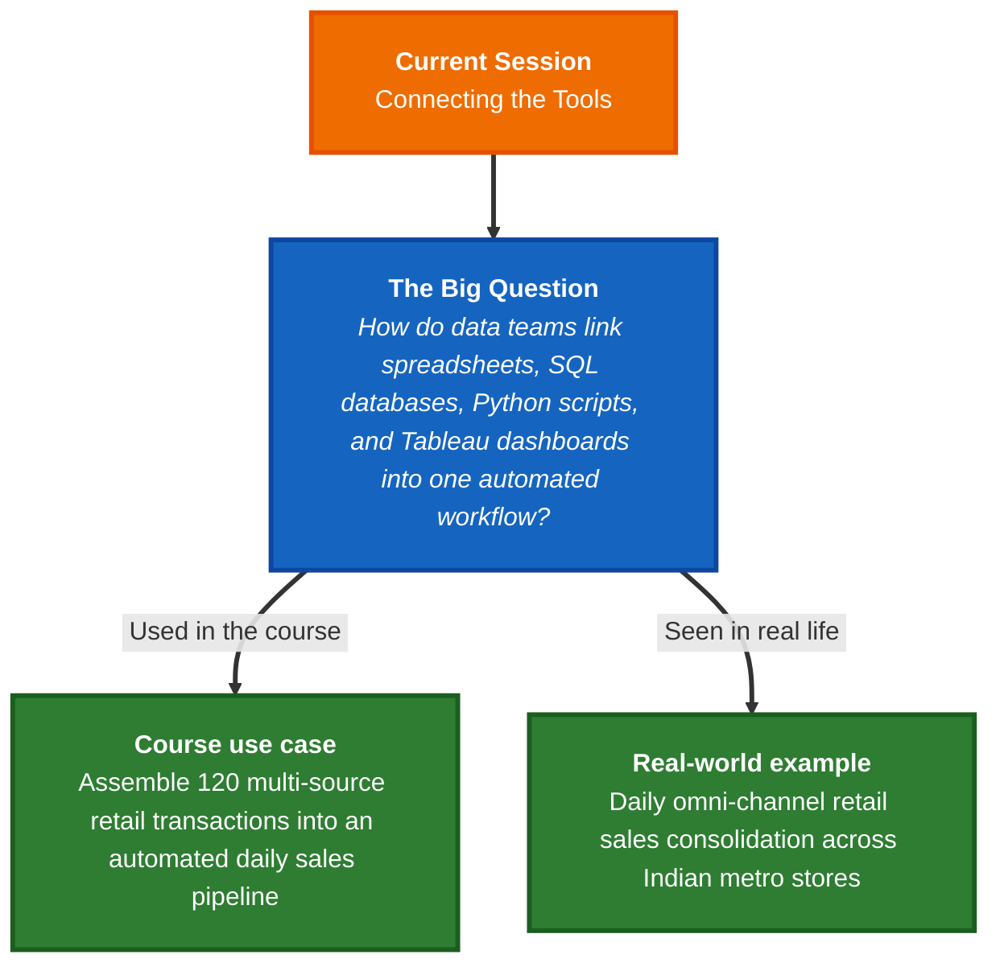

## <span style="color:#2F7DDE">Connecting the Tools</span>

### <span style="color:#2F7DDE">Mental Map</span>



---

### <span style="color:#2F7DDE">What You'll Learn</span>

Have you ever wondered how retail chains with hundreds of stores combine daily registers, online web orders, and warehouse tables without losing hours to manual spreadsheet copying?

By the end of this session, you will be able to:

- <span style="color:#D9660B">**Extract**</span> sales data from both offline spreadsheet files and SQL database queries.
- <span style="color:#D9660B">**Harmonize**</span> mismatched column names and schemas using Python pandas methods.
- <span style="color:#D9660B">**Filter**</span> duplicate transaction IDs and invalid records with automated validation gates.
- <span style="color:#D9660B">**Export**</span> clean, structured tables to refresh interactive Tableau dashboards.
- <span style="color:#D9660B">**Organize**</span> an automated four-stage pipeline (Extract, Validate, Transform, Deliver) end-to-end.

> <span style="color:#2F7DDE">**Topics you will meet:**</span> Multi-source data ingestion; SQL and Excel staging; Schema harmonization; Automated validation gates; Tableau data exports; End-to-end analytics pipelines.
>
> Join the session to learn each of these in detail.

---

### <span style="color:#2F7DDE">Why You Are Learning This Topic</span>

A retail chain sells clothing in 15 physical mall stores and on an online mobile app.

Every evening, offline stores email daily cash register spreadsheets, while app orders log into a live MySQL database.

An analyst spends four hours every morning copying numbers across files.

A mismatched tax column name and 6 duplicated rows accidentally inflate daily sales by ₹3.8 lakh.

Executives make incorrect stock replenishment decisions based on distorted numbers.

A <span style="color:#D9660B">**pipeline**</span> means an automated software workflow that extracts raw records, checks data validity, executes calculations, and delivers clean tables directly to executive dashboards.

Connecting these tools ensures corporate reports are 100% accurate, refreshing in seconds instead of requiring half a day of manual grunt work.

> <span style="color:#2F7DDE">**Think about it:**</span> What happens when an automated script intercepts a corrupted transaction before it enters a leadership presentation?

---

### <span style="color:#2F7DDE">The Omni-Channel Retail Pipeline Puzzle</span>

A consolidated morning staging log captures transactions from multiple source channels.

| Order ID | Source System | City | Raw Amount (₹) | Tax (₹) | Status |
|:--------:|:--------------|:-----|:--------------:|:-------:|:------:|
| ORD-5001 | MySQL_Database | Bengaluru | 2,100 | 378 | Validated |
| ORD-5002 | Excel_Store_Upload | Mumbai | 1,850 | 333 | Validated |
| ORD-5011 | Excel_Store_Upload | Delhi | 3,200 | *blank* | Header_Mismatch |
| ORD-5022 | Mobile_App_Sync | Hyderabad | 4,100 | 738 | Duplicate_ID |

<span style="color:#D9660B">**What you want to happen:**</span>

- Ingest orders from both SQL database connections and Excel uploads into one staging table.
- Rename the mismatched offline column header automatically so tax calculations do not fail.
- Isolate duplicate order ORD-5022 into an error log while safely passing the valid orders to Tableau.

Here is how it might start. You do not need to understand it yet.

```python
import pandas as pd
df = pd.read_csv("data/multi_tool_retail_pipeline.csv").head(4)
print(df[["order_id", "source_system", "validation_flag", "net_revenue_inr"]])
```

> <span style="color:#D9660B">**Wonder about this:**</span>
>
> - Why do enterprises use both SQL databases and spreadsheets instead of choosing only one?
> - How do validation gates protect executive dashboards from bad inputs?

---

### <span style="color:#2F7DDE">Think It Through</span>

There is no wrong first try. Keep your guesses for the session.

**1. If an offline store uploads a sheet with column header "Tax" while the central database uses "tax_inr", how does Python fix this without manual editing?**
Hint: Consider functions that rename column dictionary keys in a DataFrame.

**2. Why should an automated pipeline isolate bad rows into an error log instead of crashing the entire script?**
Hint: Think about whether the other 95% of valid store orders should still be processed and reported on time.

**3. What is the role of Tableau in this connected workflow compared to Python?**
Hint: Think about which tool performs data cleaning transformations and which provides interactive clickable dashboards for business leaders.

---

### <span style="color:#2F7DDE">One Question to Carry Into the Session</span>

> <span style="color:#2F7DDE">**How does linking separate tools into an automated pipeline eliminate four hours of daily manual grunt work?**</span>
>
> What is the single most critical checkpoint in an end-to-end data pipeline?
