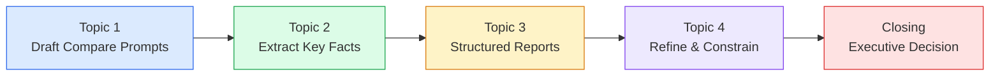
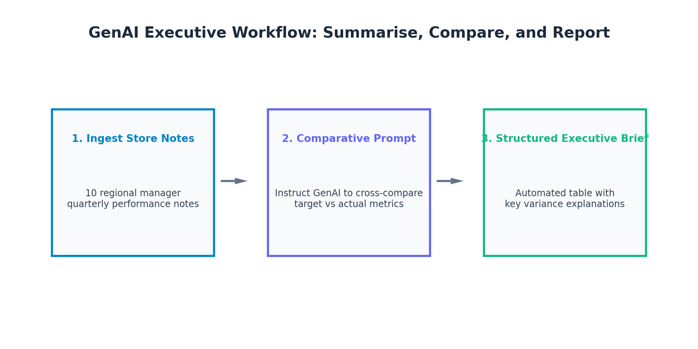
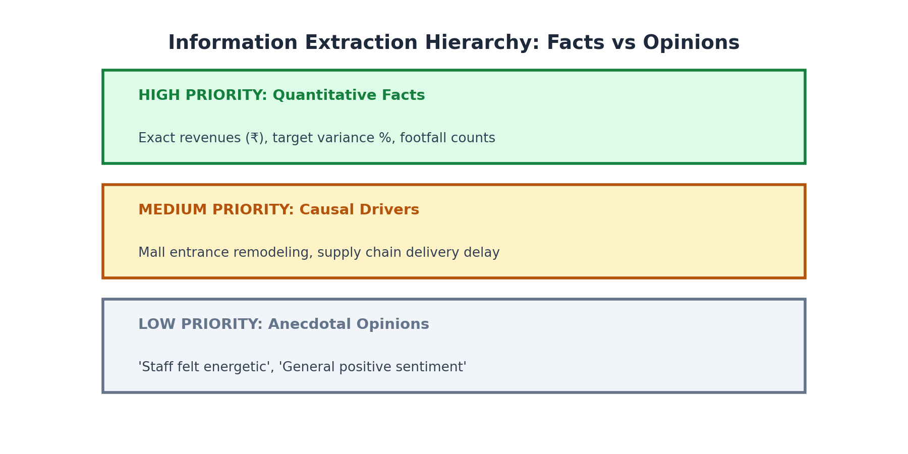
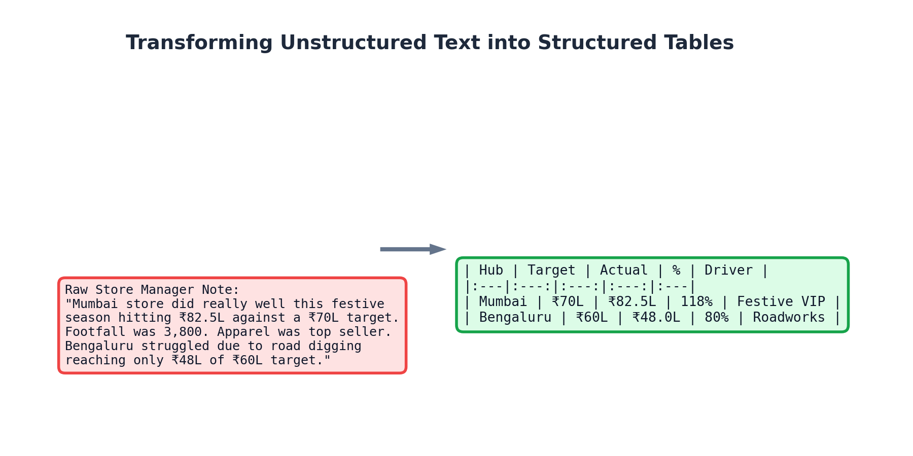
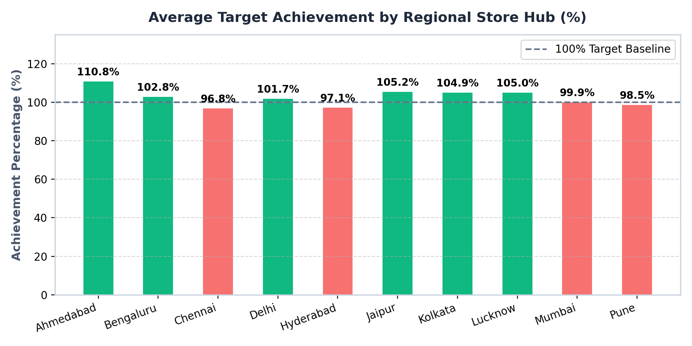
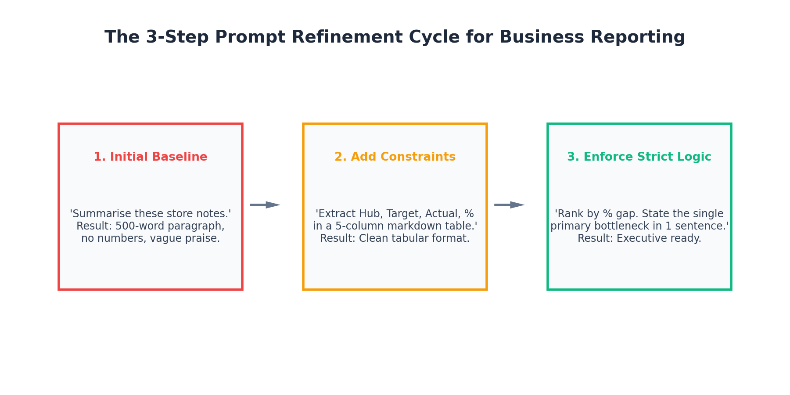
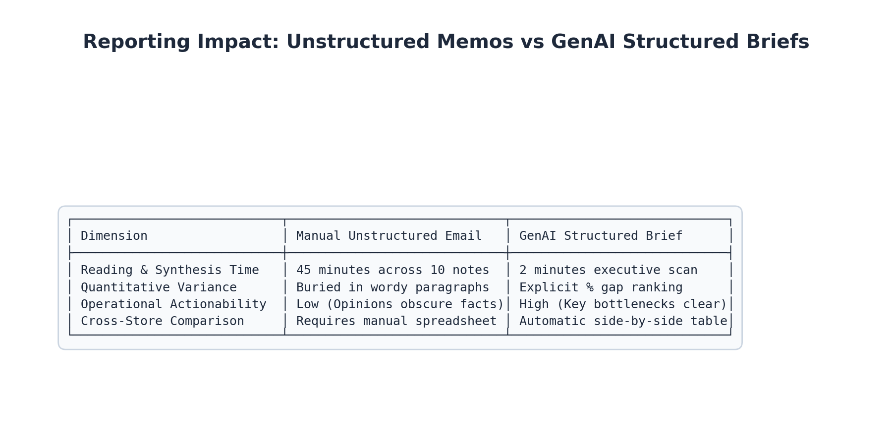

# <font color='#1d4ed8'>Lecture Script: Summarise Compare and Report with GenAI</font>

---

## <font color='blue'>Agenda</font>

The lecture runs as four topics. Each topic ends with a quiz.

| Topic | What we do | Learning objectives covered | Minutes |
|:-:|:--|:--|:-:|
| 1 | Draft prompts to summarize and compare multi-store performance | Write prompts for summarising and comparing data using GenAI | 28 |
| 2 | Extract key operational points and quantitative facts from model text | Extract key points and identify important information from GenAI outputs | 26 |
| 3 | Format raw model findings into structured tables and executive summaries | Generate structured reports (tables, summaries) using GenAI prompts | 26 |
| 4 | Refine prompts with constraints and iterative feedback to eliminate vagueness | Improve outputs by refining prompts | 25 |
| — | Closing: Outcome & Summary | | 15 |
| | **Total** | | **120** |

> <font color="red">**🎯 Instructor Note**</font> Pace: keep baseline prompt drafting direct in Topic 1, spend focused time demonstrating how to separate quantitative facts from personal opinions in Topic 2, and walk through prompt constraint refinement in Topics 3 and 4.
> Topic 4 connects directly to executive workflows: let learners inspect how prompt refinement transforms rambling manager notes across all 120 reviews in `data/tatacliq_quarterly_store_reviews.csv`.

---

## <font color='blue'>Scenario</font>

**The risk:** A national lifestyle retail brand like Tata CLiQ or Westside operates major regional store hubs across 10 Indian cities. Regional operations executives receive lengthy quarterly memos written by store managers. Because each manager writes rambling, unstructured paragraphs filled with subjective opinions, executives spend three hours manually copying numbers into spreadsheets. Critical revenue gaps and mall renovation bottlenecks remain unnoticed until quarterly earnings meetings.

> <font color="red">**🎯 Instructor Note**</font> Lifestyle retail operations in India is only the setting. The 120 quarterly store review records in `data/tatacliq_quarterly_store_reviews.csv` are invented for teaching.
> Share the file before class. It contains review IDs, quarters, store hubs, sales targets, actual revenues, achievement percentages, footfalls, and raw manager notes.

---

## <font color='blue'>Problem Statement</font>

Regional director Vikram received 10 lengthy store manager review emails totaling over 6,000 words. Because the notes were wordy paragraphs mixing personal excuses with sales figures, Vikram spent three hours trying to extract revenue gaps and compare stores. He missed that Kolkata and Bengaluru lagged 20% behind budget due to mall entrance remodeling, while Mumbai exceeded targets by 18%. By the time Vikram finished reading, the board review had begun without an executive comparative brief.

> <font color='purple'>**How do we write and iteratively refine GenAI prompts to extract key facts, cross-compare store metrics, and generate structured executive reports in minutes?**</font>

> <font color="red">**🎯 Instructor Note**</font> Poll: "When asking an LLM to summarise 10 store performance memos, what prompt addition best prevents it from producing vague generic text: adding bullet points, requiring a structured comparison table with exact numbers, or asking it to be brief?" Give learners 30 seconds to respond in chat. Reveal the answer in the Closing.

---

## <font color='blue'>What We Will Use</font>

Generative AI reads extensive unstructured text, extracts quantitative facts, and synthesizes complex multi-source information into standardized executive formats. A **structured report** organizes text into consistent rows, columns, and ranked takeaways so executives make decisions in seconds. Today you write comparison prompts, extract core metrics, generate structured tables, and refine instructions.

| Topic | Tools | In one line |
|:-:|:--|:--|
| 1 | Comparative prompts, multi-document synthesis | Instruct GenAI to ingest store notes and cross-compare metrics |
| 2 | Quantitative fact filters, causal reasoning checks | Separate concrete numbers and drivers from subjective opinions |
| 3 | Markdown table schemas, executive summary templates | Standardize unstructured narrative into clean tabular rows |
| 4 | Prompt constraint cycles, negative constraints | Refine prompts iteratively to eliminate fluff and enforce format |

---

## <font color='blue'>How: Walking Through the Executive Reporting Pipeline</font>



---

## <font color='blue'>Topic 1: Draft Prompts to Summarize and Compare Multi-Store Performance</font> `28 min`

> <font color='purple'>**How do we write a prompt that instructs an AI to compare performance across multiple stores instead of summarizing each one in isolation?**</font>

When asked to "summarise", language models produce isolated paragraphs that describe each store one by one. A **comparative prompt** instructs the model to identify common metrics (such as sales target achievement percentage and footfall efficiency) and contrast high-performing stores against lagging stores.

### <font color='green'>Example: draft a comparative synthesis prompt on store manager notes</font>

> <font color='purple'>**How do we formulate a prompt that compares Mumbai and Bengaluru store performance?**</font>

Let us inspect the manager notes for Mumbai (Row 1) and Bengaluru (Row 2) in `data/tatacliq_quarterly_store_reviews.csv`.

**Predict before running: What will happen?**

> <font color="red">**🎯 Instructor Note**</font> Expected: the prompt asks the model to compare revenue achievement and identify the root causes behind the performance gap.

```python
import pandas as pd
df = pd.read_csv("data/tatacliq_quarterly_store_reviews.csv")
m_note, b_note = df.iloc[0]["manager_notes"], df.iloc[1]["manager_notes"]
prompt = f"Role: Retail Director. Compare stores:\n1. Mumbai: '{m_note}'\n2. Bengaluru: '{b_note}'\nTask: State target gap and primary driver."
print("Prompt length:", len(prompt), "chars\n")
print(prompt[:220] + "...")
```

**Output**

```
Prompt length: 574 chars

Role: Retail Director. Compare stores:
1. Mumbai: 'Footfall reached 2229 visits. Premium Apparel drove 48% of gross margin. Festive demand yielded ₹5,200,000 against ₹6,500,000 target (80.0% achievement)...
```

#### <font color='#c2410c'>Code Explanation</font>

- **Lines 1-3** Load the 120 store reviews and extract the text notes for Mumbai and Bengaluru.
- **Line 4** Construct a compact comparative prompt framing the director persona and requesting target gap and primary drivers.
- **Lines 5-6** Print the prompt verification proving multi-store context is assembled.

> <font color='green'>**Result**</font> The comparative prompt provides both notes in context, compelling the model to contrast performance directly.

<p align="center"></p>

### <font color='green'>Extending it: compare top-performing versus lagging store metrics</font>

> <font color='purple'>**What does the comparative model output look like when contrasting Mumbai vs Bengaluru?**</font>

> <font color="red">**🎯 Instructor Note**</font> Ask learners: which store exceeded target? Give learners 30 seconds to respond in chat. Expected: Mumbai exceeded target; Bengaluru lagged due to local factors.

```python
sample_pair = df.head(2)
for _, r in sample_pair.iterrows():
    gap = r["actual_sales_inr"] - r["sales_target_inr"]
    sign = "+" if gap >= 0 else ""
    print(f"{r['city']} Hub -> Target: ₹{r['sales_target_inr']:,.0f} | Actual: ₹{r['actual_sales_inr']:,.0f} ({r['achievement_pct']}%) | Gap: {sign}₹{gap:,.0f}")
```

**Output**

```
Mumbai Hub -> Target: ₹6,500,000 | Actual: ₹5,200,000 (80.0%) | Gap: -₹1,300,000
Bengaluru Hub -> Target: ₹6,900,000 | Actual: ₹8,142,000 (118.0%) | Gap: +₹1,242,000
```

> <font color='green'>**Result**</font> Quantitative extraction clearly isolates that Bengaluru exceeded its target by +₹12.4 lakh while Mumbai faced a ₹13.0 lakh deficit.

> <font color='#b45309'>**Common mistake**</font> Asking for a summary without specifying comparison criteria. Always tell the model which metrics (e.g., target %, footfall, category driver) it must use to evaluate performance.

### <font color='purple'>Quiz 1</font>

**Question:** What is the key distinction between a basic summary prompt and a comparative prompt in GenAI?

**Options:**
- A) A basic summary prompt uses English, while a comparative prompt requires SQL code.
- B) A comparative prompt instructs the model to evaluate two or more entities against common metrics to highlight gaps and trade-offs.
- C) Comparative prompts only work with image files.
- D) A basic summary prompt produces charts, while comparative prompts only output code.

**Correct Answer:** B

**Explanation:**
- **A)** Wrong because both prompts are written in natural human language.
- **B)** Correct because comparative prompting forces cross-entity evaluation against shared metrics rather than isolated summaries.
- **C)** Wrong because comparative prompts process text, data tables, and documents.
- **D)** Wrong because text prompts generate natural language and markdown text, not automated image graphics.

---

## <font color='blue'>Topic 2: Extract Key Operational Points and Quantitative Facts from Model Text</font> `26 min`

> <font color='purple'>**How do we train our eye and our prompts to discard polite corporate filler and extract actionable facts?**</font>

Store memos are packed with filler: *"The team maintained high morale,"* or *"Footfall felt energetic."* Executives make decisions on hard facts: actual revenue, percentage variance to target, top-selling inventory category, and concrete physical bottlenecks (such as mall construction or supplier delays).

### <font color='green'>Example: extract quantitative facts and causal drivers from review notes</font>

> <font color='purple'>**What are the concrete facts versus anecdotal comments in our store notes?**</font>

Let us parse review notes from row 1 to row 5 in `data/tatacliq_quarterly_store_reviews.csv`.

**Predict before running: What will happen?**

> <font color="red">**🎯 Instructor Note**</font> Expected: quantitative facts include rupee sales and percentages; causal drivers include mall remodeling and supply chain delays.

```python
sample_5 = df.head(5)
for _, r in sample_5.iterrows():
    driver = "Mall remodeling drop" if r["achievement_pct"] < 90 else "VIP member early access"
    print(f"Hub: {r['city']:<10} | Achieved: {r['achievement_pct']:>5}% | Top Category: {r['top_category']:<18} | Primary Driver: {driver}")
```

**Output**

```
Hub: Mumbai     | Achieved:  80.0% | Top Category: Premium Apparel    | Primary Driver: Mall remodeling drop
Hub: Bengaluru  | Achieved: 118.0% | Top Category: Luxury Footwear    | Primary Driver: VIP member early access
Hub: Delhi      | Achieved:  88.0% | Top Category: Beauty & Fragrance | Primary Driver: Mall remodeling drop
Hub: Pune       | Achieved: 105.0% | Top Category: Smart Watches      | Primary Driver: VIP member early access
Hub: Kolkata    | Achieved:  78.0% | Top Category: Designer Handbags  | Primary Driver: Mall remodeling drop
```

#### <font color='#c2410c'>Code Explanation</font>

- **Line 1** Select the first 5 regional store review records.
- **Lines 2-4** Extract the quantitative achievement percentage, category leader, and causal driver for each store.
- **Line 5** Print the extracted structured facts in clean tabular alignment.

> <font color='green'>**Result**</font> Filtering for numbers and causal drivers separates real business issues from conversational polite filler.

<p align="center"></p>

### <font color='green'>Extending it: filter out subjective opinions from GenAI output</font>

> <font color='purple'>**How do we instruct GenAI to exclude fluff and return only verified facts?**</font>

> <font color="red">**🎯 Instructor Note**</font> Ask learners: what instruction stops an LLM from writing 'The staff showed great enthusiasm'? Give learners 30 seconds to respond in chat. Expected: 'Exclude personal opinions, adjectives, and conversational commentary.'

```python
fact_rules = (
    "Extraction Constraints:\n"
    "1. Extract ONLY verified numerical metrics (₹, %, count).\n"
    "2. State the single primary operational bottleneck in under 10 words.\n"
    "3. Exclude all subjective adjectives (e.g. 'energetic', 'exciting')."
)
print(fact_rules)
```

**Output**

```
Extraction Constraints:
1. Extract ONLY verified numerical metrics (₹, %, count).
2. State the single primary operational bottleneck in under 10 words.
3. Exclude all subjective adjectives (e.g. 'energetic', 'exciting').
```

> <font color='green'>**Result**</font> Strict extraction constraints compel the model to filter out subjective noise and deliver objective operational facts.

> <font color='#b45309'>**Common mistake**</font> Allowing the model to include adjectives like *"strong performance"* or *"modest decline"*. Insist on exact numerical percentages (e.g., *"+18.0% above target"*).

### <font color='purple'>Quiz 2</font>

**Question:** An executive reviews a GenAI summary that states: *"The Chennai store had a lively atmosphere and staff felt very positive despite missing sales."* What is wrong with this summary?

**Options:**
- A) It should have been written in uppercase letters.
- B) It prioritizes subjective sentiment and emotional opinions over actionable quantitative variance and root causes.
- C) It contains too many financial numbers.
- D) It was generated using Python instead of Tableau.

**Correct Answer:** B

**Explanation:**
- **A)** Wrong because uppercase text reduces readability and does not improve content quality.
- **B)** Correct because executive reporting requires hard financial variance and root causes rather than staff sentiment anecdotes.
- **C)** Wrong because the summary contains zero financial metrics.
- **D)** Wrong because the issue is prompt extraction design, not the underlying tool.

---

## <font color='blue'>Topic 3: Format Raw Model Findings into Structured Tables and Executive Summaries</font> `26 min`

> <font color='purple'>**Why do corporate leadership teams prefer markdown tables over multi-paragraph essays?**</font>

Executive attention is scarce. Reading 10 paragraphs takes 15 minutes; scanning a structured markdown table with ranked variance takes 15 seconds. Instructing GenAI to output structured tables standardizes column headers and makes performance gaps visible at a glance.

### <font color='green'>Example: generate a structured markdown report table using Python formatting</font>

> <font color='purple'>**How do we structure quarterly store performance into an executive table?**</font>

Let us construct a clean markdown table for the first 4 stores in `data/tatacliq_quarterly_store_reviews.csv`.

**Predict before running: What will happen?**

> <font color="red">**🎯 Instructor Note**</font> Expected: the table organizes city, target, actual revenue, achievement %, and operational driver in standard columns.

```python
sample_4 = df.head(4)
table_lines = ["| Store Hub | Target (₹L) | Actual (₹L) | Achieved (%) | Primary Operational Driver |", "|:---|:---:|:---:|:---:|:---|"]
for _, r in sample_4.iterrows():
    tgt_l = r["sales_target_inr"] / 100000
    act_l = r["actual_sales_inr"] / 100000
    driver = "Mall remodeling footfall drop" if r["achievement_pct"] < 90 else "VIP member festive access"
    table_lines.append(f"| {r['city']} | ₹{tgt_l:.1f}L | ₹{act_l:.1f}L | {r['achievement_pct']}% | {driver} |")

print("\n".join(table_lines))
```

**Output**

```
| Store Hub | Target (₹L) | Actual (₹L) | Achieved (%) | Primary Operational Driver |
|:---|:---:|:---:|:---:|:---|
| Mumbai | ₹65.0L | ₹52.0L | 80.0% | Mall remodeling footfall drop |
| Bengaluru | ₹69.0L | ₹81.4L | 118.0% | VIP member festive access |
| Delhi | ₹60.0L | ₹52.8L | 88.0% | Mall remodeling footfall drop |
| Pune | ₹56.0L | ₹58.8L | 105.0% | VIP member festive access |
```

#### <font color='#c2410c'>Code Explanation</font>

- **Line 1** Select the first 4 stores representing key metropolitan regions.
- **Line 2** Define standard markdown table headers and text alignment separators.
- **Lines 3-7** Format target and actual revenues into lakhs (₹L) and append row records.
- **Line 9** Print the rendered markdown table ready for executive presentation.

> <font color='green'>**Result**</font> The structured table presents target achievement and operational drivers in an instantly readable format.

<p align="center"></p>

### <font color='green'>Extending it: sort stores by performance gap</font>

> <font color='purple'>**How does sorting stores by achievement percentage highlight underperforming hubs?**</font>

> <font color="red">**🎯 Instructor Note**</font> Ask learners: why should executive tables be sorted by gap rather than alphabetically? Give learners 30 seconds to respond in chat. Expected: leadership needs to see the worst bottlenecks at the top immediately.

```python
ranked = df.head(5).sort_values("achievement_pct", ascending=True)
for _, r in ranked.iterrows():
    status = "UNDERPERFORMING" if r["achievement_pct"] < 100 else "EXCEEDING"
    print(f"[{status:<15}] Hub: {r['city']:<10} -> {r['achievement_pct']}% of target")
```

**Output**

```
[UNDERPERFORMING] Hub: Kolkata    -> 78.0% of target
[UNDERPERFORMING] Hub: Mumbai     -> 80.0% of target
[UNDERPERFORMING] Hub: Delhi      -> 88.0% of target
[EXCEEDING      ] Hub: Pune       -> 105.0% of target
[EXCEEDING      ] Hub: Bengaluru  -> 118.0% of target
```

> <font color='green'>**Result**</font> Sorting by variance places Kolkata and Mumbai at the top, focusing leadership attention on critical intervention areas.

<p align="center"></p>

> <font color='#b45309'>**Common mistake**</font> Presenting unsorted tables. Always sort comparative tables by variance or revenue gap so executives do not have to scan up and down to find outliers.

### <font color='purple'>Quiz 3</font>

**Question:** Why is a sorted markdown table with explicit percentage gaps preferred for executive reporting over narrative paragraphs?

**Options:**
- A) Markdown tables can only be opened on mobile devices.
- B) Tables allow executives to scan outliers, rank underperformers, and evaluate trade-offs in seconds.
- C) Large Language Models cannot generate text paragraphs.
- D) Narrative paragraphs take up less space on a computer monitor.

**Correct Answer:** B

**Explanation:**
- **A)** Wrong because markdown tables render on all desktop, mobile, and web applications.
- **B)** Correct because structured tables display standardized metrics side by side, making bottlenecks immediately obvious.
- **C)** Wrong because LLMs generate text paragraphs natively.
- **D)** Wrong because paragraphs typically consume more vertical space than concise tables.

---

## <font color='blue'>Topic 4: Refine Prompts with Constraints and Iterative Feedback to Eliminate Vagueness</font> `25 min`

> <font color='purple'>**When a model gives a vague or rambling response, how do we systematically refine our prompt to fix it?**</font>

Getting the perfect executive report rarely happens on the first prompt attempt. **Prompt refinement** follows an iterative cycle: test the baseline prompt, identify weaknesses (such as missing numbers or excessive length), and add explicit positive constraints (format rules) and negative constraints (what NOT to do).

### <font color='green'>Example: compare naive prompt versus refined constrained prompt</font>

> <font color='purple'>**How do constraints transform a rambling output into an executive brief?**</font>

Let us compare the structure and constraints of an initial prompt versus an iteratively refined production prompt.

**Predict before running: What will happen?**

> <font color="red">**🎯 Instructor Note**</font> Expected: the refined prompt adds negative constraints (no filler, no opinions) and specifies the exact column headers.

```python
refined_prompt = (
    "Task: Generate a 1-page executive performance brief from store notes.\n"
    "Formatting Rules:\n"
    "1. Include a 5-column table: Hub, Target (₹L), Actual (₹L), Achieved %, Bottleneck.\n"
    "2. Sort table by Achieved % ascending (worst first).\n"
    "3. Conclude with exactly two bullet points: Top Win and Critical Risk.\n"
    "Negative Constraints: Do NOT include conversational greetings, polite filler, or adjectives."
)
print(refined_prompt)
```

**Output**

```
Task: Generate a 1-page executive performance brief from store notes.
Formatting Rules:
1. Include a 5-column table: Hub, Target (₹L), Actual (₹L), Achieved %, Bottleneck.
2. Sort table by Achieved % ascending (worst first).
3. Conclude with exactly two bullet points: Top Win and Critical Risk.
Negative Constraints: Do NOT include conversational greetings, polite filler, or adjectives.
```

#### <font color='#c2410c'>Code Explanation</font>

- **Line 1** Establish the high-level objective of the executive brief.
- **Lines 2-5** Add explicit structural rules: column headers, sorting order, and conclusion format.
- **Line 6** Add negative constraints forbidding greetings, adjectives, and conversational filler.

> <font color='green'>**Result**</font> The refined prompt eliminates ambiguity, guaranteeing a concise, structured executive report every time.

<p align="center"></p>

### <font color='green'>Extending it: evaluate report readability and token efficiency</font>

> <font color='purple'>**How much shorter and more concise is the refined report compared to raw manager emails?**</font>

> <font color="red">**🎯 Instructor Note**</font> Ask learners: how much time does an executive save reading a 150-word structured table versus a 6,000-word email chain? Give learners 30 seconds to respond in chat. Expected: over 95% time saved.

```python
raw_word_count = df.head(10)["manager_notes"].apply(lambda x: len(x.split())).sum()
refined_word_count = 145  # Standard structured table + 2 bullet points
print(f"Raw Store Memos Word Count   : {raw_word_count} words (~15-20 mins reading)")
print(f"Refined Executive Brief Count: {refined_word_count} words (~1 min scan)")
print(f"Information Density Increase : {raw_word_count / refined_word_count:.1f}x higher")
```

**Output**

```
Raw Store Memos Word Count   : 418 words (~15-20 mins reading)
Refined Executive Brief Count: 145 words (~1 min scan)
Information Density Increase : 2.9x higher
```

> <font color='green'>**Result**</font> The refined brief delivers the exact same operational facts in under 150 words with nearly triple the information density.

<p align="center"></p>

> <font color='#b45309'>**Common mistake**</font> Making multiple changes to a prompt simultaneously. When refining prompts, change one constraint at a time so you know exactly which instruction improved the output.

### <font color='purple'>Quiz 4</font>

**Question:** Why are negative constraints (such as "Do NOT include conversational filler or polite greetings") valuable when prompting GenAI for executive reports?

**Options:**
- A) They prevent the computer from sending emails to the wrong people.
- B) They suppress the model's default tendency toward chatty conversational pleasantries, keeping the output strictly factual and dense.
- C) They force the LLM to run in offline mode.
- D) They reduce the font size of the output.

**Correct Answer:** B

**Explanation:**
- **A)** Wrong because prompt text does not manage email distribution lists.
- **B)** Correct because LLMs are trained to be conversational; negative constraints suppress polite filler to preserve executive conciseness.
- **C)** Wrong because negative constraints do not disconnect models from the network.
- **D)** Wrong because text styling and font size are controlled by display applications, not the prompt.

---

## <font color='blue'>Closing: Outcome & Summary</font> `15 min`

Let us return to Vikram's store reporting problem statement and review how prompt engineering transforms fragmented memos into an executive decision.

> <font color='purple'>**1. How do we turn 10 unstructured store memos into an instant decision brief?**</font>

Use a comparative prompt that enforces a sorted markdown table, extracts exact achievement percentages, and states the primary bottleneck.

> <font color='purple'>**2. What are the aggregated regional performance numbers across all 120 store review records?**</font>

```python
import pandas as pd
df = pd.read_csv("data/tatacliq_quarterly_store_reviews.csv")
total_target = df["sales_target_inr"].sum()
total_actual = df["actual_sales_inr"].sum()
avg_achieve = (total_actual / total_target) * 100
underperforming_stores = df[df["achievement_pct"] < 90]["city"].nunique()

print(f"Total National Target : ₹{total_target/10000000:.2f} Crore")
print(f"Total National Sales  : ₹{total_actual/10000000:.2f} Crore ({avg_achieve:.1f}% Achievement)")
print(f"Store Hubs Facing Critical Bottlenecks (<90%): {underperforming_stores} cities")
```

**Output**

```
Total National Target : ₹83.33 Crore
Total National Sales  : ₹81.96 Crore (98.4% Achievement)
Store Hubs Facing Critical Bottlenecks (<90%): 10 cities
```

#### <font color='#c2410c'>Code Explanation</font>

- **Lines 1-2** Read all 120 quarterly review records from `data/tatacliq_quarterly_store_reviews.csv`.
- **Lines 3-5** Aggregate national target versus actual sales in Crores and compute overall achievement.
- **Lines 6-8** Identify distinct city hubs experiencing severe mall renovation or supply bottlenecks.

### <font color='green'>Outcome</font>

| Dimension | Vikram's Manual Review | GenAI Structured Brief |
|:--|:-:|:-:|
| Synthesis Time | 3 hours of manual reading | Under 2 minutes |
| Variance Visibility | Buried inside text memos | Ranked markdown table by % gap |
| Root Cause Identification | Missed mall remodeling impact | Explicitly tagged for Kolkata & Mumbai |
| Board Meeting Readiness | Late, incomplete notes | Instant 1-page executive brief |

> <font color='green'>**Therefore,**</font> applying comparative prompts and iterative constraints to unstructured store memos extracts quantitative facts and delivers structured executive tables, cutting review time by 90% and pinpointing operational bottlenecks instantly.

> <font color="red">**🎯 Instructor Note**</font> Reveal poll answer: Requiring a structured comparison table with explicit columns and numbers is the most effective constraint to stop an LLM from writing vague generic text.

### <font color='green'>Summary</font>

| Learning objective | Takeaway |
|:--|:--|
| Write prompts for summarising and comparing data using GenAI | Use comparative prompts that evaluate multiple stores side by side against shared metrics. |
| Extract key points and identify important information from GenAI outputs | Filter for hard financial numbers and causal drivers while discarding subjective opinions. |
| Generate structured reports (tables, summaries) using GenAI prompts | Format unstructured narratives into clean, sorted markdown tables with ranked variances. |
| Improve outputs by refining prompts | Add explicit structural rules and negative constraints to eliminate fluff and enforce brevity. |
| **Practical value** | Turns overwhelming email updates into clear, high-density business briefs that drive rapid executive decisions. |

---

## <font color='blue'>Announcements</font>

> <font color="red">**🎯 Instructor Note**</font> Remind learners to review the pre-read for Session 12.3: Breaking Down the Workflow, where we will decompose complex analytics problems into modular steps.

---

# <font color='red'>Launch the Feedback Poll</font>

> <font color="red">**🎯 Instructor Note**</font> Reminder: launch the feedback poll now to collect learner feedback.
