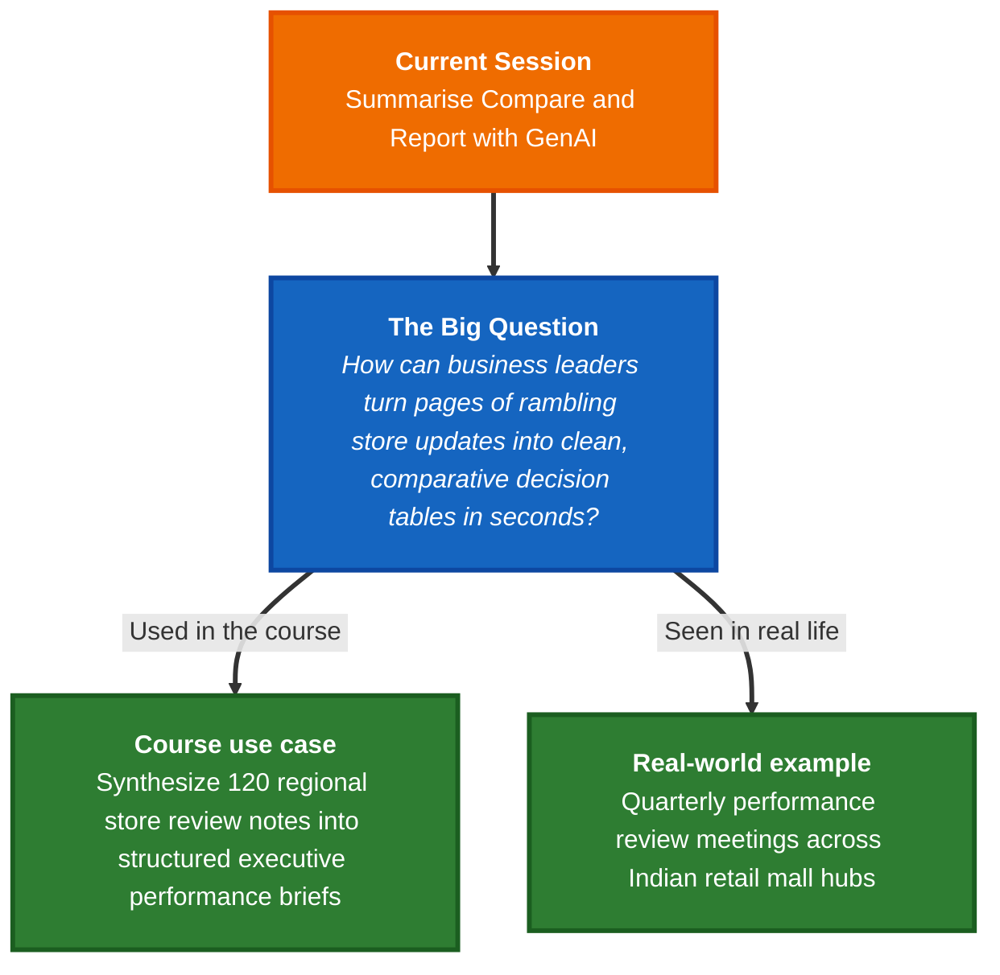

## <span style="color:#2F7DDE">Summarise Compare and Report with GenAI</span>

### <span style="color:#2F7DDE">Mental Map</span>



---

### <span style="color:#2F7DDE">What You'll Learn</span>

Have you ever faced an inbox overflowing with dozens of multi-page team reports and wondered how to find the critical numbers without reading thousands of words?

By the end of this session, you will be able to:

- <span style="color:#D9660B">**Write**</span> comparative prompts that instruct GenAI to contrast multiple stores against shared financial targets.
- <span style="color:#D9660B">**Extract**</span> quantitative facts and causal drivers while filtering out polite conversational fluff.
- <span style="color:#D9660B">**Generate**</span> structured markdown tables sorted by variance percentage for rapid executive scanning.
- <span style="color:#D9660B">**Refine**</span> prompts iteratively with negative constraints to eliminate subjective adjectives.

> <span style="color:#2F7DDE">**Topics you will meet:**</span> Comparative prompt drafting; Fact extraction hierarchy; Filtering opinions vs facts; Structured markdown tables; Negative constraints; Iterative prompt refinement cycles.
>
> Join the session to learn each of these in detail.

---

### <span style="color:#2F7DDE">Why You Are Learning This Topic</span>

A retail director oversees stores across ten major cities.

At the end of every quarter, each store manager emails a 500-word performance memo.

One manager writes about staff morale; another writes about festive lighting; a third explains that mall entrance remodeling dropped morning footfall.

Finding the revenue variance and ranking underperforming stores requires hours of tedious manual reading.

A <span style="color:#D9660B">**structured report**</span> means a concise, tabular summary that presents standardized metrics side by side so decision-makers can spot bottlenecks and allocate resources instantly.

Learning to prompt GenAI for structured synthesis transforms overwhelming qualitative text into high-density executive intelligence.

> <span style="color:#2F7DDE">**Think about it:**</span> Why does a sorted comparison table help a leadership team act faster than a five-page narrative memo?

---

### <span style="color:#2F7DDE">The Quarterly Store Review Puzzle</span>

A regional briefing log records performance commentary from four city store hubs.

| Store Hub | Target (₹L) | Actual (₹L) | Achievement (%) | Manager Commentary |
|:----------|:-----------:|:-----------:|:---------------:|:-------------------|
| Mumbai | 65.0 | 52.0 | 80.0% | Mall remodeling dropped morning footfall |
| Bengaluru | 69.0 | 81.4 | 118.0% | Festive early access campaign was very popular |
| Delhi | 60.0 | 52.8 | 88.0% | Supply chain delay slowed weekend restocking |
| Pune | 56.0 | 58.8 | 105.0% | Footfall felt energetic and staff worked hard |

<span style="color:#D9660B">**What you want to happen:**</span>

- Discard vague statements like "staff worked hard" and extract the exact ₹ gap for each store.
- Rank the stores by achievement percentage to highlight Mumbai and Delhi at the top.
- Require GenAI to output an executive table with exactly one sentence stating the primary bottleneck.

Here is how it might start. You do not need to understand it yet.

```python
import pandas as pd
df = pd.read_csv("data/tatacliq_quarterly_store_reviews.csv").head(4)
print(df[["city", "sales_target_inr", "actual_sales_inr", "achievement_pct"]])
```

> <span style="color:#D9660B">**Wonder about this:**</span>
>
> - Why do language models default to writing wordy paragraphs instead of clean tables?
> - What prompt instruction forces an AI to sort data by percentage variance?

---

### <span style="color:#2F7DDE">Think It Through</span>

There is no wrong first try. Keep your guesses for the session.

**1. If you ask an LLM to "summarise this memo", why does it often omit the exact rupee numbers?**
Hint: General summaries aim for broad overviews unless you explicitly demand quantitative metrics.

**2. How does adding a negative constraint like "Do NOT include conversational adjectives" improve an executive brief?**
Hint: Think about preserving high information density and cutting out reading time.

**3. Why should a comparison table of underperforming stores be sorted by gap rather than alphabetically?**
Hint: Consider what an executive needs to address first in a 30-minute business meeting.

---

### <span style="color:#2F7DDE">One Question to Carry Into the Session</span>

> <span style="color:#2F7DDE">**How can a business executive turn hours of qualitative reading into a two-minute decision brief using AI?**</span>
>
> What is the single most effective constraint you can add to a business reporting prompt?
