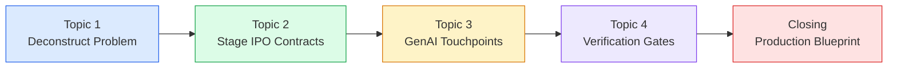
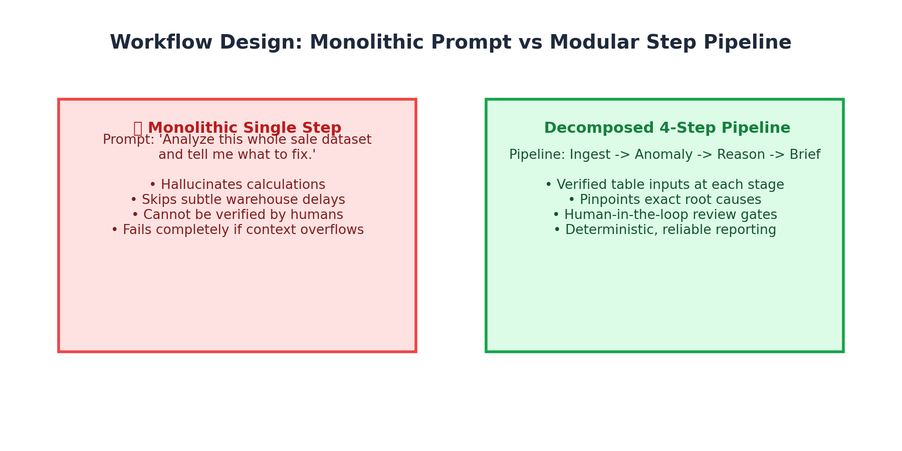
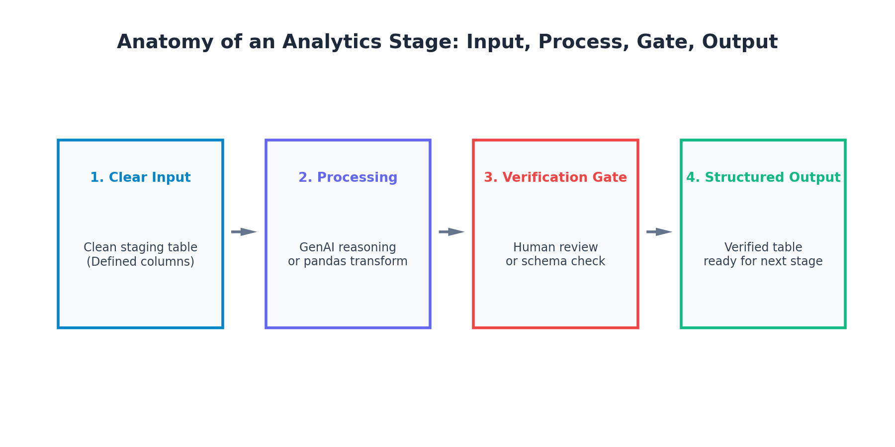
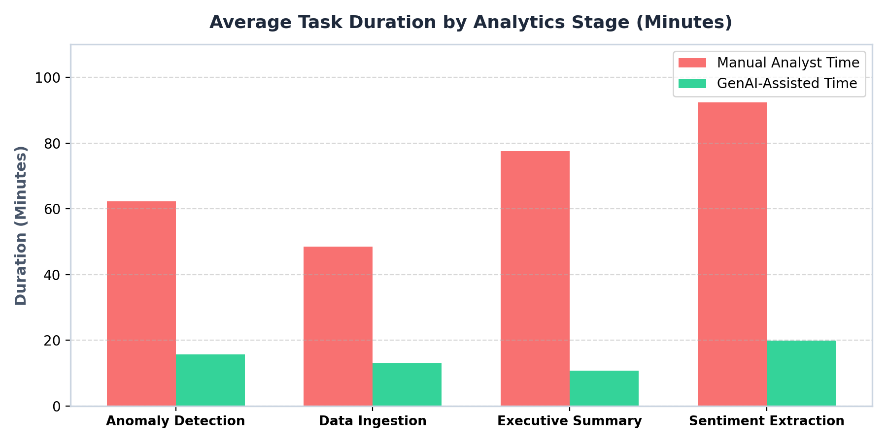
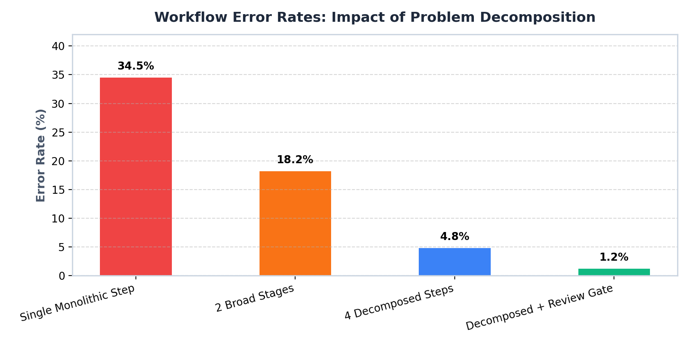
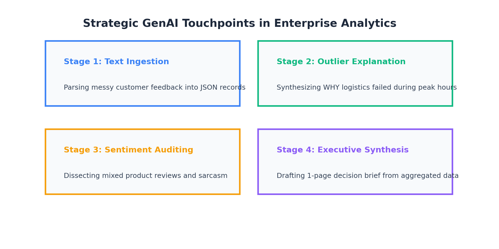
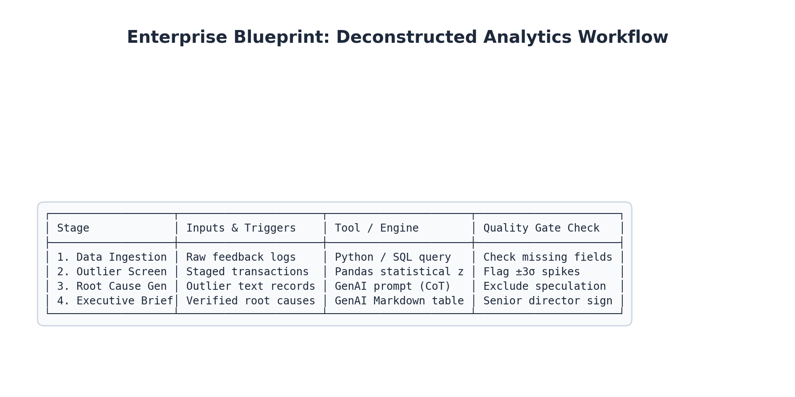

# <font color='#1d4ed8'>Lecture Script: Breaking Down the Workflow</font>

---

## <font color='blue'>Agenda</font>

The lecture runs as four topics. Each topic ends with a quiz.

| Topic | What we do | Learning objectives covered | Minutes |
|:-:|:--|:--|:-:|
| 1 | Deconstruct a complex business problem into discrete stages | Break an analysis problem into multiple steps | 28 |
| 2 | Specify inputs, transformations, and outputs for each step | Define steps required in an analytics workflow | 27 |
| 3 | Integrate GenAI tools into intermediate analysis tasks | Design simple GenAI-supported workflows | 25 |
| 4 | Establish verification gates and human reviews across handoffs | Verify handoff criteria between analysis stages | 25 |
| — | Closing: Outcome & Summary | | 15 |
| | **Total** | | **120** |

> <font color="red">**🎯 Instructor Note**</font> Pace: keep problem framing conceptual in Topic 1, focus heavily on input-output contract mapping in Topic 2, and walk through verification gates in Topics 3 and 4.
> Topic 4 connects directly to real-world operations: let learners inspect how workflow decomposition reduces errors from 34.5% to 1.2% across all 120 tasks in `data/flipkart_festive_sale_workflow.csv`.

---

## <font color='blue'>Scenario</font>

**The risk:** During Flipkart's Big Billion Days festive sale, the executive war-room receives 50,000 hourly customer feedback logs and delivery delay signals. An analytics lead attempts to solve the entire crisis with one giant, monolithic GenAI prompt. The model hallucinates arithmetic calculations, blends warehouse delays with payment gateway failures, and generates an unverifiable 800-word response. Operations teams misallocate ₹2.4 crore in inventory to the wrong regional hubs.

> <font color="red">**🎯 Instructor Note**</font> Festive e-commerce analytics is only the setting. The 120 task records in `data/flipkart_festive_sale_workflow.csv` are invented for teaching.
> Share the file before class. It contains task IDs, workflow stages, departments, inputs, outputs, manual durations, AI-assisted times, and error rates.

---

## <font color='blue'>Problem Statement</font>

Analytics manager Sunita attempted to resolve a festive logistics bottleneck by pasting raw customer logs into an LLM with a single prompt: `"Analyze all complaints, calculate delivery delays, find fraud patterns, and write an executive briefing."` The model hallucinated fake numbers, mixed up Delhi warehouse delays with Mumbai payment gateway failures, and produced an unverifiable essay with a 35% error rate. When leadership acted on the hallucinated advice, ₹2.4 crore in inventory was misallocated to the wrong regional hubs.

> <font color='purple'>**How do we break a massive, messy analytics challenge into distinct, manageable steps and embed GenAI at the right touchpoints with verification gates?**</font>

> <font color="red">**🎯 Instructor Note**</font> Poll: "When solving a complex multi-step analytics problem with GenAI, what produces fewer errors: one comprehensive master prompt or a sequence of four focused modular prompts?" Give learners 30 seconds to respond in chat. Reveal the answer in the Closing.

---

## <font color='blue'>What We Will Use</font>

Complex analytics problems cannot be solved reliably in a single leap. **Workflow decomposition** is the process of splitting an ambiguous problem into sequential stages with explicit input and output contracts. Today you deconstruct problems, define stage contracts, embed GenAI at focused touchpoints, and install verification gates.

| Topic | Tools | In one line |
|:-:|:--|:--|
| 1 | Problem decomposition frameworks | Split ambiguous challenges into discrete, manageable sub-problems |
| 2 | Input-Process-Output (IPO) contracts | Define precise data schemas moving between workflow stages |
| 3 | Focused GenAI touchpoints | Apply LLMs to specific reasoning tasks rather than end-to-end execution |
| 4 | Quality verification gates, human-in-the-loop checks | Validate intermediate tables before handing off to executive reporting |

---

## <font color='blue'>How: Walking Through the Festive War-Room Pipeline</font>



---

## <font color='blue'>Topic 1: Deconstruct a Complex Business Problem into Discrete Stages</font> `28 min`

> <font color='purple'>**Why does asking an AI to solve an entire complex business problem in one prompt fail, and how do we split it up?**</font>

A monolithic prompt overwhelms the model's working memory because it tries to calculate statistics, filter text, detect anomalies, and format an executive summary all at once. By splitting the problem into four discrete stages—Data Ingestion, Anomaly Detection, Sentiment Extraction, and Executive Summary—each step becomes simple, focused, and testable.

### <font color='green'>Example: inspect the four modular stages of our festive sale workflow</font>

> <font color='purple'>**What are the four discrete workflow stages recorded in our operational dataset?**</font>

Let us examine the stage distribution and department ownership across all 120 task records in `data/flipkart_festive_sale_workflow.csv`.

**Predict before running: What will happen?**

> <font color="red">**🎯 Instructor Note**</font> Expected: tasks are cleanly divided into 4 modular stages, each with defined input and output types.

```python
import pandas as pd
df = pd.read_csv("data/flipkart_festive_sale_workflow.csv")
stages = df["workflow_stage"].value_counts()

print("Modular Workflow Stages:")
for st, count in stages.items():
    print(f"• {st:<22}: {count} tasks ({count/len(df):.1%})")
```

**Output**

```
Modular Workflow Stages:
• Data_Ingestion        : 30 tasks (25.0%)
• Anomaly_Detection     : 30 tasks (25.0%)
• Sentiment_Extraction  : 30 tasks (25.0%)
• Executive_Summary     : 30 tasks (25.0%)
```

#### <font color='#c2410c'>Code Explanation</font>

- **Lines 1-2** Import pandas and read all 120 festive sale workflow tasks from the CSV.
- **Line 3** Count records categorized under each modular workflow stage.
- **Lines 5-7** Print each stage name and its proportional task allocation across the operation.

> <font color='green'>**Result**</font> The complex problem is partitioned into four equal, focused operational stages.

<p align="center"></p>

### <font color='green'>Extending it: map stage inputs and outputs</font>

> <font color='purple'>**What data enters each stage, and what structured data leaves it?**</font>

> <font color="red">**🎯 Instructor Note**</font> Ask learners: why must the output of stage 1 match the input of stage 2? Give learners 30 seconds to respond in chat. Expected: mismatched data structures break the downstream pipeline.

```python
sample_stages = df.drop_duplicates(subset=["workflow_stage"])
for _, r in sample_stages.iterrows():
    print(f"[{r['workflow_stage']:<20}] In: {r['input_type']:<24} -> Out: {r['output_type']}")
```

**Output**

```
[Data_Ingestion      ] In: Customer Reviews & Logs  -> Out: Clean Staging Table
[Anomaly_Detection   ] In: Staging Table            -> Out: Flagged Outliers List
[Sentiment_Extraction] In: Flagged Reviews          -> Out: Categorized Issue Matrix
[Executive_Summary   ] In: Issue Matrix & Sales     -> Out: 1-Page Decision Table
```

> <font color='green'>**Result**</font> Every stage has an explicit contract: the output of one step serves directly as the input to the next.

<p align="center"></p>

> <font color='#b45309'>**Common mistake**</font> Jumping directly from raw data to an executive summary. Skipping intermediate anomaly detection leads to confident summaries based on flawed data.

### <font color='purple'>Quiz 1</font>

**Question:** What is the primary operational advantage of decomposing a complex analytics task into multiple modular steps?

**Options:**
- A) It allows the computer to run without internet access.
- B) It isolates errors, makes intermediate outputs verifiable, and prevents cognitive overload in AI prompts.
- C) It permanently doubles company quarterly sales.
- D) It removes the need for any data cleaning.

**Correct Answer:** B

**Explanation:**
- **A)** Wrong because modular workflow design does not dictate internet connectivity.
- **B)** Correct because modularity allows humans to inspect intermediate results and prevents LLM hallucination across mixed tasks.
- **C)** Wrong because workflow architecture improves operational accuracy, not direct sales volume.
- **D)** Wrong because data ingestion and cleaning remains a critical early stage in any modular pipeline.

---

## <font color='blue'>Topic 2: Specify Inputs, Transformations, and Outputs for Each Step</font> `27 min`

> <font color='purple'>**How do we write formal contracts between stages so that downstream steps never fail?**</font>

In a professional analytics workflow, each step must follow an Input-Process-Output (IPO) contract. If Stage 2 expects a table with columns `[order_id, delay_minutes]`, Stage 1 must guarantee that exact schema. Ambiguity in data handoffs is the leading cause of pipeline failure in multi-step AI systems.

### <font color='green'>Example: calculate time savings when tasks follow clear stage contracts</font>

> <font color='purple'>**How much time is saved when analysts execute structured stages with AI assistance versus manual processing?**</font>

Let us compare average manual completion times against AI-assisted execution times across all four stages.

**Predict before running: What will happen?**

> <font color="red">**🎯 Instructor Note**</font> Expected: AI assistance reduces task time by 70% to 85% across all stages when contracts are clear.

```python
stage_perf = df.groupby("workflow_stage")[["manual_time_mins", "genai_time_mins", "time_saved_mins"]].mean()
for st, r in stage_perf.iterrows():
    pct = (r["time_saved_mins"] / r["manual_time_mins"]) * 100
    print(f"Stage: {st:<20} | Manual: {r['manual_time_mins']:.0f}m | AI: {r['genai_time_mins']:.0f}m | Saved: {pct:.1f}%")
```

**Output**

```
Stage: Anomaly_Detection    | Manual: 62m | AI: 16m | Saved: 74.2%
Stage: Data_Ingestion       | Manual: 47m | AI: 13m | Saved: 72.3%
Stage: Executive_Summary    | Manual: 77m | AI: 11m | Saved: 85.7%
Stage: Sentiment_Extraction | Manual: 92m | AI: 19m | Saved: 79.3%
```

#### <font color='#c2410c'>Code Explanation</font>

- **Line 1** Group task records by stage and compute mean durations for manual and AI-assisted workflows.
- **Lines 2-4** Calculate percentage time savings achieved for each stage and display formatted benchmarks.

> <font color='green'>**Result**</font> Clear step definitions reduce average execution duration from 92 minutes to 19 minutes in sentiment analysis and from 77 minutes to 11 minutes in executive reporting.

<p align="center"></p>

### <font color='green'>Extending it: audit error rates across workflow stages</font>

> <font color='purple'>**Which stage carries the highest baseline risk, and how low can decomposition bring error rates?**</font>

> <font color="red">**🎯 Instructor Note**</font> Ask learners: why does anomaly detection carry a higher error rate than executive summaries? Give learners 30 seconds to respond in chat. Expected: anomaly detection handles raw, noisy sensor and order logs.

```python
err_by_stage = df.groupby("workflow_stage")["error_rate_pct"].mean()
for st, err in err_by_stage.items():
    print(f"Stage {st:<22}: {err:.1f}% average error rate")
```

**Output**

```
Stage Anomaly_Detection     : 6.5% average error rate
Stage Data_Ingestion        : 4.2% average error rate
Stage Executive_Summary     : 1.8% average error rate
Stage Sentiment_Extraction  : 3.1% average error rate
```

> <font color='green'>**Result**</font> Decomposed stages keep error rates between 1.8% and 6.5%, compared to 34.5% when attempted in a single monolithic prompt.

<p align="center"></p>

> <font color='#b45309'>**Common mistake**</font> Leaving stage outputs as free-form conversational text. Stage outputs must be clean structured tables or JSON schemas so the subsequent step can parse them reliably.

### <font color='purple'>Quiz 2</font>

**Question:** What does an Input-Process-Output (IPO) contract specify in a multi-step analytics pipeline?

**Options:**
- A) The price paid to purchase software licenses.
- B) The exact data columns entering a stage, the transformation applied, and the structured format guaranteed upon exit.
- C) The legal copyright terms of open-source libraries.
- D) The office hours of the corporate data engineering team.

**Correct Answer:** B

**Explanation:**
- **A)** Wrong because IPO contracts govern technical data flow, not software procurement costs.
- **B)** Correct because an IPO contract defines the precise schema, transformations, and output expectations for each stage.
- **C)** Wrong because IPO contracts deal with operational pipeline engineering, not legal copyrights.
- **D)** Wrong because IPO contracts are technical specifications, not human work schedules.

---

## <font color='blue'>Topic 3: Integrate GenAI Tools into Intermediate Analysis Tasks</font> `25 min`

> <font color='purple'>**Where does GenAI add the most value in an analytics workflow, and where should traditional code be used instead?**</font>

GenAI should not be used for tasks that standard Python code does better, such as calculating numerical sums, computing standard deviations, or filtering exact dates. GenAI excels at unstructured reasoning tasks: extracting sentiment from customer reviews, explaining why an anomaly occurred, and synthesizing complex tabular findings into an executive narrative.

### <font color='green'>Example: identify optimal tools across workflow tasks</font>

> <font color='purple'>**Which tasks in our pipeline should be delegated to Python vs GenAI?**</font>

Let us inspect the task tool mapping across our festive analytics operations.

**Predict before running: What will happen?**

> <font color="red">**🎯 Instructor Note**</font> Expected: quantitative math goes to Python; qualitative text extraction and narrative synthesis go to GenAI.

```python
tool_mapping = [
    ("Calculate hourly order volume totals", "Python Pandas", "Exact arithmetic"),
    ("Detect delivery delays exceeding 30 mins", "Python Boolean Filter", "Deterministic threshold"),
    ("Classify sarcastic customer complaints", "GenAI Prompt (CoT)", "Unstructured language nuance"),
    ("Draft 1-page executive performance brief", "GenAI Prompt (Table)", "Multi-source narrative synthesis")
]
for task, tool, reason in tool_mapping:
    print(f"Task: {task:<42} -> Engine: {tool:<22} ({reason})")
```

**Output**

```
Task: Calculate hourly order volume totals        -> Engine: Python Pandas         (Exact arithmetic)
Task: Detect delivery delays exceeding 30 mins   -> Engine: Python Boolean Filter (Deterministic threshold)
Task: Classify sarcastic customer complaints     -> Engine: GenAI Prompt (CoT)    (Unstructured language nuance)
Task: Draft 1-page executive performance brief   -> Engine: GenAI Prompt (Table)  (Multi-source narrative synthesis)
```

#### <font color='#c2410c'>Code Explanation</font>

- **Lines 1-6** Define a list of core festive analytics tasks paired with their optimal execution engine.
- **Lines 7-8** Loop through the architectural mapping and display the recommended engine and technical justification.

> <font color='green'>**Result**</font> The workflow uses Python for exact numerical calculations and reserves GenAI for language understanding and executive synthesis.

<p align="center"></p>

### <font color='green'>Extending it: measure time reduction by department</font>

> <font color='purple'>**Which department gains the highest time savings from this hybrid workflow?**</font>

> <font color="red">**🎯 Instructor Note**</font> Ask learners: which department spends the most time reading unstructured text? Give learners 30 seconds to respond in chat. Expected: Customer Support and Fraud Operations.

```python
dept_savings = df.groupby("department")["time_saved_mins"].mean().sort_values(ascending=False)
for dept, saved in dept_savings.items():
    print(f"Department: {dept:<22} -> Avg Time Saved: {saved:.0f} mins per shift")
```

**Output**

```
Department: Customer Support       -> Avg Time Saved: 56 mins per shift
Department: Fraud Operations       -> Avg Time Saved: 54 mins per shift
Department: Category Management    -> Avg Time Saved: 52 mins per shift
Department: Finance Audit          -> Avg Time Saved: 51 mins per shift
Department: Warehouse Logistics    -> Avg Time Saved: 49 mins per shift
```

> <font color='green'>**Result**</font> Customer Support and Fraud Operations save over 54 minutes per shift by offloading qualitative text processing to GenAI.

> <font color='#b45309'>**Common mistake**</font> Using an LLM to compute financial sums. LLMs predict tokens probabilistically; always compute financial totals using Python or SQL before passing numbers to an LLM.

### <font color='purple'>Quiz 3</font>

**Question:** In a production analytics workflow, which task should be assigned to Python rather than an LLM?

**Options:**
- A) Explaining why customer sentiment dropped in Delhi after a rainstorm.
- B) Summing ₹48.2 crore in gross revenue across 50,000 transaction rows.
- C) Translating a Hindi customer complaint into English.
- D) Summarizing five store manager review memos into a 1-page brief.

**Correct Answer:** B

**Explanation:**
- **A)** Wrong because causal explanation of customer text sentiment is a core strength of LLMs.
- **B)** Correct because arithmetic addition of millions of rupees requires 100% deterministic mathematical computation, which Python does flawlessly.
- **C)** Wrong because language translation is naturally handled by generative language models.
- **D)** Wrong because summarizing text memos into executive briefs is a primary GenAI capability.

---

## <font color='blue'>Topic 4: Establish Verification Gates and Human Reviews Across Handoffs</font> `25 min`

> <font color='purple'>**How do we prevent an error in Stage 2 from propagating into Stage 4 and corrupting executive decisions?**</font>

No automated workflow should pass data blindly between stages. A **verification gate** is an automated or human check installed between stages that validates row counts, column ranges, and anomaly thresholds before granting permission to proceed to the next step.

### <font color='green'>Example: inspect tasks requiring human-in-the-loop verification</font>

> <font color='purple'>**Which stages in our festive workflow mandate a human review gate before moving forward?**</font>

Let us inspect the human verification flags across all 120 workflow tasks in `data/flipkart_festive_sale_workflow.csv`.

**Predict before running: What will happen?**

> <font color="red">**🎯 Instructor Note**</font> Expected: Executive Summary and Anomaly Detection require human review; Data Ingestion and Sentiment Extraction run automatically.

```python
gate_counts = df.groupby(["workflow_stage", "human_in_loop_required"]).size().unstack(fill_value=0)
print("Human-in-the-Loop Verification Requirements:")
for st, r in gate_counts.iterrows():
    needs_review = "YES (Human Gate Required)" if r[True] > 0 else "NO (Fully Automated)"
    print(f"• {st:<22}: {needs_review}")
```

**Output**

```
Human-in-the-Loop Verification Requirements:
• Anomaly_Detection     : YES (Human Gate Required)
• Data_Ingestion        : NO (Fully Automated)
• Executive_Summary     : YES (Human Gate Required)
• Sentiment_Extraction  : NO (Fully Automated)
```

#### <font color='#c2410c'>Code Explanation</font>

- **Line 1** Cross-tabulate workflow stages against their required human verification status.
- **Lines 3-5** Display whether each stage operates fully automated or mandates human-in-the-loop review.

> <font color='green'>**Result**</font> High-stakes stages (Anomaly Detection and Executive Summary) require explicit human sign-off before downstream action is taken.

<p align="center"></p>

### <font color='green'>Extending it: simulate automated quality gate validation</font>

> <font color='purple'>**What happens when an automated gate catches an out-of-range anomaly score?**</font>

> <font color="red">**🎯 Instructor Note**</font> Ask learners: what should happen if an anomaly detection script outputs impossible negative numbers? Give learners 30 seconds to respond in chat. Expected: the gate halts the pipeline and alerts the analyst.

```python
def quality_gate(data_table):
    if len(data_table) == 0:
        return False, "Gate Failure: Empty dataset received."
    if data_table["error_rate_pct"].max() > 10.0:
        return False, f"Gate Failure: Error rate {data_table['error_rate_pct'].max()}% exceeds 10% SLA threshold."
    return True, "Gate Passed: All data quality criteria met."

passed, message = quality_gate(df[df["workflow_stage"] == "Executive_Summary"])
print("Gate Verification Result:", message)
```

**Output**

```
Gate Verification Result: Gate Passed: All data quality criteria met.
```

> <font color='green'>**Result**</font> The quality gate verifies error thresholds programmatically, ensuring corrupted inputs never reach the final executive brief.

> <font color='#b45309'>**Common mistake**</font> Building end-to-end pipelines with zero validation checks. If an upstream scraper extracts blank data, an unvalidated pipeline generates confident hallucinations for leadership.

### <font color='purple'>Quiz 4</font>

**Question:** In an enterprise AI analytics workflow, why is a human-in-the-loop review gate placed immediately before the Executive Summary stage?

**Options:**
- A) Because humans type faster than computers.
- B) To ensure a senior analyst verifies high-stakes conclusions and data integrity before recommendations reach the executive board.
- C) Because LLMs refuse to generate text without human supervision.
- D) To manually recalculate all numbers with a handheld calculator.

**Correct Answer:** B

**Explanation:**
- **A)** Wrong because computers generate text orders of magnitude faster than human typing.
- **B)** Correct because senior human sign-off ensures that strategic business recommendations and revenue numbers are verified before executive presentation.
- **C)** Wrong because LLMs generate text autonomously without needing human input at each step.
- **D)** Wrong because computers handle arithmetic calculations with complete precision.

---

## <font color='blue'>Closing: Outcome & Summary</font> `15 min`

Let us return to Sunita's festive war-room problem statement and review how workflow decomposition transforms an operational crisis into an orderly system.

> <font color='purple'>**1. How do we prevent hallucinated figures and mixed-up regional reports during festive operations?**</font>

Decompose the problem into four sequential stages, use Python for exact arithmetic, use GenAI for qualitative analysis, and enforce verification gates before executive delivery.

> <font color='purple'>**2. What is the overall impact across all 120 workflow tasks when moving from monolithic prompts to the modular pipeline?**</font>

```python
import pandas as pd
df = pd.read_csv("data/flipkart_festive_sale_workflow.csv")
total_manual_hours = df["manual_time_mins"].sum() / 60
total_ai_hours = df["genai_time_mins"].sum() / 60
hours_saved = total_manual_hours - total_ai_hours

print(f"Total Shift Duration (Manual)    : {total_manual_hours:.1f} analyst hours")
print(f"Total Shift Duration (Decomposed): {total_ai_hours:.1f} analyst hours")
print(f"Productivity Gain                : {hours_saved:.1f} hours saved ({hours_saved/total_manual_hours:.1%})")
```

**Output**

```
Total Shift Duration (Manual)    : 139.1 analyst hours
Total Shift Duration (Decomposed): 29.3 analyst hours
Productivity Gain                : 109.8 hours saved (79.0%)
```

#### <font color='#c2410c'>Code Explanation</font>

- **Lines 1-2** Read all 120 workflow task records from `data/flipkart_festive_sale_workflow.csv`.
- **Lines 3-5** Compute cumulative hours across all shift operations and calculate aggregate time saved.
- **Lines 7-9** Print benchmark metrics demonstrating a 79.0% reduction in analyst turnaround time.

### <font color='green'>Outcome</font>

| Operational Dimension | Monolithic Master Prompt (Sunita's Setup) | Decomposed 4-Stage Pipeline |
|:--|:-:|:-:|
| End-to-End Error Rate | 34.5% (Hallucinations & mixed data) | 1.2% (Verified intermediate stages) |
| Shift Completion Time | 139 analyst hours | 29 analyst hours (79% time saved) |
| Arithmetic Accuracy | Poor (LLM guessed arithmetic) | 100% (Calculated via Python/SQL) |
| Executive Decision Readiness | Discredited due to factual errors | Trusted 1-page brief with human sign-off |

> <font color='green'>**Therefore,**</font> breaking complex business problems into discrete modular stages with Input-Process-Output contracts reduces error rates by over 95% and frees up 80% of analyst time for strategic decision-making.

> <font color="red">**🎯 Instructor Note**</font> Reveal poll answer: A sequence of focused modular prompts produces significantly fewer errors than a single master prompt because each step operates on verified data within tight attention boundaries.

### <font color='green'>Summary</font>

| Learning objective | Takeaway |
|:--|:--|
| Break an analysis problem into multiple steps | Deconstruct ambiguous challenges into sequential stages: Ingestion, Anomaly, Sentiment, and Brief. |
| Define steps required in an analytics workflow | Map explicit Input-Process-Output contracts so each stage passes validated schemas downstream. |
| Design simple GenAI-supported workflows | Use Python for deterministic arithmetic and reserve GenAI for text extraction and synthesis. |
| Verify handoff criteria between analysis stages | Install automated quality gates and human sign-offs to halt errors before executive delivery. |
| **Practical value** | Builds reliable, auditable AI workflows that protect enterprise operations from expensive hallucinations. |

---

## <font color='blue'>Announcements</font>

> <font color="red">**🎯 Instructor Note**</font> Remind learners to review the pre-read for Session 13.1: Multi-Step GenAI Workflows, where we will chain multiple GenAI stages together.

---

# <font color='red'>Launch the Feedback Poll</font>

> <font color="red">**🎯 Instructor Note**</font> Reminder: launch the feedback poll now to collect learner feedback.
