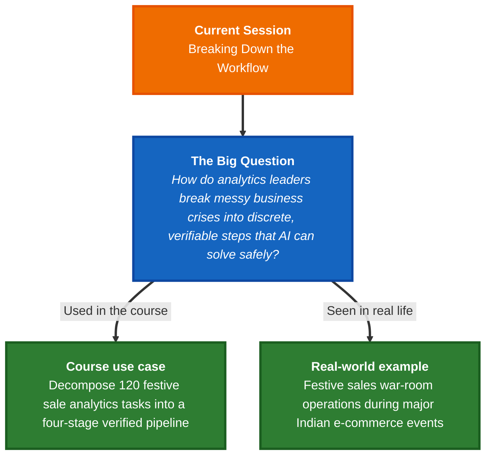

## <span style="color:#2F7DDE">Breaking Down the Workflow</span>

### <span style="color:#2F7DDE">Mental Map</span>



---

### <span style="color:#2F7DDE">What You'll Learn</span>

Have you ever tried to tackle a massive, confusing business project all at once and felt completely overwhelmed by how many things could go wrong?

By the end of this session, you will be able to:

- <span style="color:#D9660B">**Deconstruct**</span> complex analytics challenges into discrete, manageable sub-problems.
- <span style="color:#D9660B">**Define**</span> formal Input-Process-Output contracts between sequential workflow stages.
- <span style="color:#D9660B">**Embed**</span> GenAI assistance into focused qualitative analysis and synthesis touchpoints.
- <span style="color:#D9660B">**Install**</span> automated verification gates and human-in-the-loop review checkpoints.

> <span style="color:#2F7DDE">**Topics you will meet:**</span> Problem decomposition; Input-Process-Output (IPO) contracts; Strategic GenAI touchpoints; Code versus LLM task allocation; Verification gates; Human-in-the-loop reviews.
>
> Join the session to learn each of these in detail.

---

### <span style="color:#2F7DDE">Why You Are Learning This Topic</span>

During a national festive sale, thousands of orders fail due to sudden warehouse delays and payment gateway timeouts.

An operations manager tries to solve everything with one giant prompt to an AI model: *"Find all problems and write a brief."*

The model hallucinates fake numbers, mixes up cities, and gives advice that costs millions in misallocated inventory.

A <span style="color:#D9660B">**workflow**</span> means a disciplined sequence of steps where each stage receives verified inputs, performs one specific transformation, and passes clean structured data to the next step.

Deconstructing complex analytics problems into modular stages ensures AI solutions remain accurate, auditable, and trusted by leadership.

> <span style="color:#2F7DDE">**Think about it:**</span> Why does asking an AI to do four small jobs in sequence produce 95% fewer mistakes than asking it to do everything in one prompt?

---

### <span style="color:#2F7DDE">The Festive Sale War-Room Puzzle</span>

An operations task log records four stages of festive incident analysis across retail departments.

| Stage Name | Department | Input Data | Expected Output | Manual (Mins) | AI-Assisted (Mins) |
|:-----------|:-----------|:-----------|:----------------|:-------------:|:------------------:|
| Data Ingestion | Customer Support | Raw Chat Logs | Clean Staging Table | 45 | 12 |
| Anomaly Detection | Logistics | Staging Table | Flagged Outlier Hubs | 60 | 15 |
| Sentiment Nuance | Category Ops | Outlier Reviews | Issue Category Matrix | 90 | 18 |
| Executive Brief | War-Room Leads | Issue Matrix | 1-Page Decision Table | 75 | 10 |

<span style="color:#D9660B">**What you want to happen:**</span>

- Ensure the output of Data Ingestion guarantees the exact columns expected by Anomaly Detection.
- Use Python for exact mathematical threshold checks and GenAI for customer review sentiment.
- Place a mandatory human review gate before the final Executive Brief is shown to directors.

Here is how it might start. You do not need to understand it yet.

```python
import pandas as pd
df = pd.read_csv("data/flipkart_festive_sale_workflow.csv").head(4)
print(df[["workflow_stage", "manual_time_mins", "genai_time_mins", "error_rate_pct"]])
```

> <span style="color:#D9660B">**Wonder about this:**</span>
>
> - Why should you never use an LLM to add up millions of rupees in sales?
> - What happens when an error in Stage 1 is not caught before Stage 3?

---

### <span style="color:#2F7DDE">Think It Through</span>

There is no wrong first try. Keep your guesses for the session.

**1. If an executive wants to know both total revenue numbers and customer feedback themes, which tool should do which job?**
Hint: Think about which tool computes exact arithmetic and which understands language nuance.

**2. Why is an Input-Process-Output contract important when two different teams collaborate on a pipeline?**
Hint: Consider what happens if one team changes the column names without warning the other.

**3. What is the danger of letting an AI generate an executive decision brief completely without human review?**
Hint: Consider who is responsible if a hallucinated number causes inventory to be shipped to the wrong warehouse.

---

### <span style="color:#2F7DDE">One Question to Carry Into the Session</span>

> <span style="color:#2F7DDE">**How does breaking a massive business problem into four simple steps transform a 35% error rate into less than 2%?**</span>
>
> Where in your daily work would a multi-step workflow prevent expensive mistakes?
