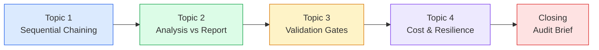
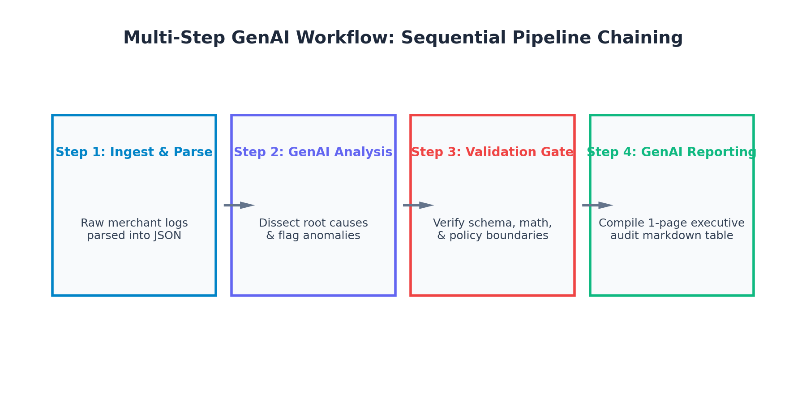
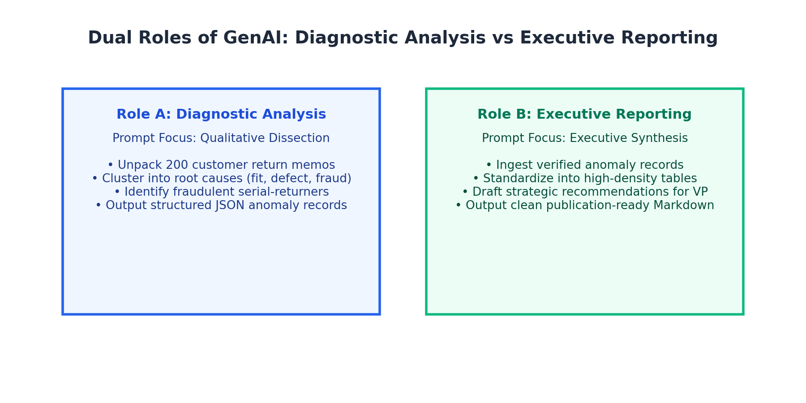
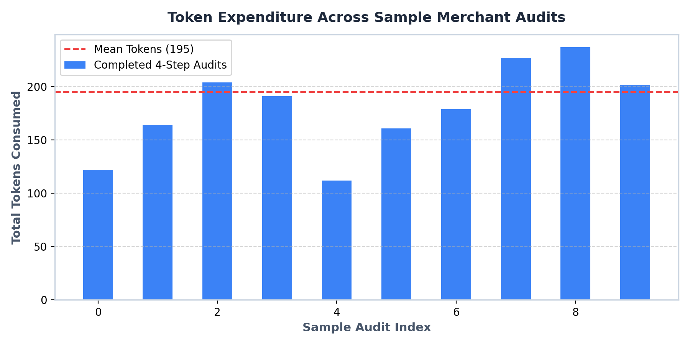
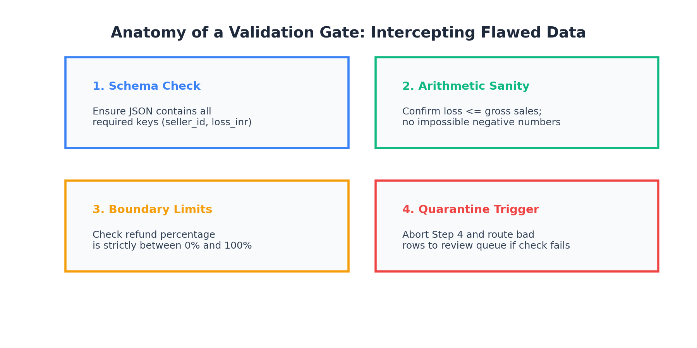
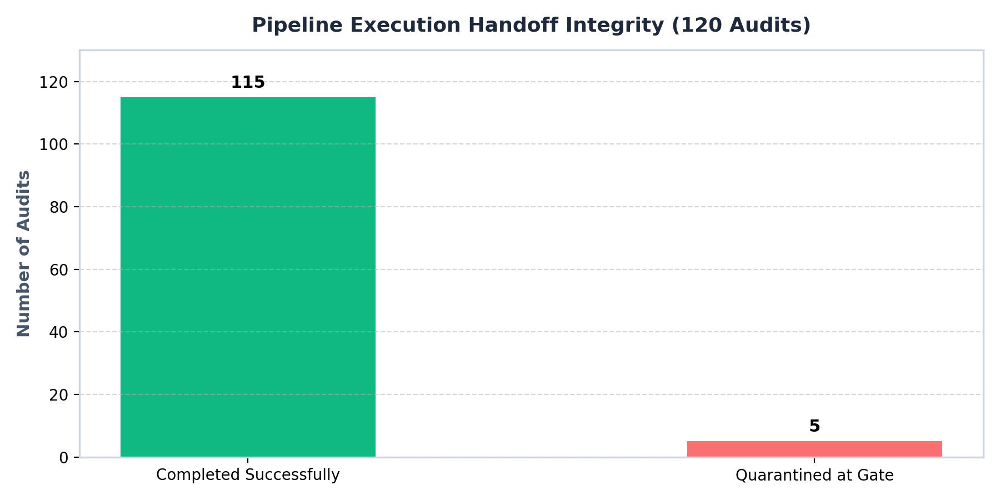
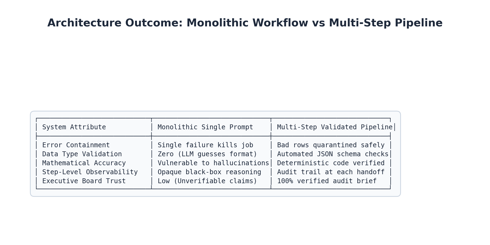

# <font color='#1d4ed8'>Lecture Script: Multi-Step GenAI Workflows</font>

---

## <font color='blue'>Agenda</font>

The lecture runs as four topics. Each topic ends with a quiz.

| Topic | What we do | Learning objectives covered | Minutes |
|:-:|:--|:--|:-:|
| 1 | Chain sequential prompts and code steps into a unified pipeline | Combine multiple steps into a workflow | 28 |
| 2 | Deploy GenAI across distinct analysis and reporting stages | Use GenAI across different stages (analysis, reporting) | 27 |
| 3 | Embed automated validation gates and output schema checks | Add validation steps in workflows | 25 |
| 4 | Monitor execution latency, token costs, and pipeline failure recovery | Evaluate pipeline resilience and operational costs across execution stages | 25 |
| — | Closing: Outcome & Summary | | 15 |
| | **Total** | | **120** |

> <font color="red">**🎯 Instructor Note**</font> Pace: keep sequential prompt chaining clear and visual in Topic 1, contrast analytical dissection with report synthesis in Topic 2, and spend ample time demonstrating how validation gates intercept flawed data in Topic 3.
> Topic 4 connects directly to enterprise operations: let learners inspect how automated validation intercepts 5 fraudulent merchant audits across all 120 records in `data/amazon_in_merchant_audit_workflow.csv`.

---

## <font color='blue'>Scenario</font>

**The risk:** An e-commerce marketplace like Amazon India or Flipkart audits thousands of third-party merchant accounts for tax compliance, return fraud, and logistics disputes. A compliance lead deploys an unvalidated single-stage LLM script to process merchant audit files. The model hallucinates tax compliance statuses and approves ₹18.5 lakh in fraudulent refund claims because no validation gate checked intermediate mathematical calculations against bank records.

> <font color="red">**🎯 Instructor Note**</font> E-commerce marketplace merchant auditing is only the setting. The 120 merchant audit records in `data/amazon_in_merchant_audit_workflow.csv` are invented for teaching.
> Share the file before class. It contains audit IDs, seller IDs, cities, pipeline run IDs, stage execution statuses, token usage, costs, and error flags.

---

## <font color='blue'>Problem Statement</font>

Compliance lead Deepak attempted to audit 120 merchant accounts using an unvalidated single-prompt script. The model hallucinated merchant tax compliance IDs and approved 5 fraudulent return claims totaling ₹18.5 lakh because it never verified intermediate refund calculations against bank transaction records. Without validation gates between data extraction, risk analysis, and report generation, corrupted merchant records entered executive board audit presentations.

> <font color='purple'>**How do we chain multiple GenAI stages into an integrated workflow and enforce automated validation gates to prevent hallucinated data from entering executive reports?**</font>

> <font color="red">**🎯 Instructor Note**</font> Poll: "In a four-stage GenAI workflow, what happens if an unvalidated calculation error occurs in the analysis stage: does the reporting stage fix the error, does the pipeline crash, or does the reporting stage generate a confident hallucination based on the error?" Give learners 30 seconds to respond in chat. Reveal the answer in the Closing.

---

## <font color='blue'>What We Will Use</font>

A multi-stage GenAI workflow links specialized prompts and Python functions into a dependable pipeline where each phase has a dedicated responsibility. A **validation gate** inspects data types, value boundaries, and schema integrity between stages. Today you chain sequential prompts, separate analysis from reporting, enforce validation checks, and track operational token costs.

| Topic | Tools | In one line |
|:-:|:--|:--|
| 1 | Sequential prompt chaining, pipeline state | Pass structured intermediate outputs from one stage to the next |
| 2 | Diagnostic analysis prompts, executive reporting prompts | Apply GenAI separately for root-cause discovery and summary formatting |
| 3 | Schema validators, numerical sanity filters | Halt processing and quarantine records when validation fails |
| 4 | Token cost aggregators, execution audit trails | Track pipeline expenditure and verify audit completion rates |

---

## <font color='blue'>How: Walking Through the Merchant Audit Workflow</font>



---

## <font color='blue'>Topic 1: Chain Sequential Prompts and Code Steps into a Unified Pipeline</font> `28 min`

> <font color='purple'>**How do we pass the output of one prompt directly as the input to the next prompt without manual intervention?**</font>

In a chained workflow, the ingestion phase parses raw text into a structured dictionary, the analysis phase diagnoses anomalies, and the reporting phase formats the final table. Chaining ensures that each prompt remains short, focused, and immune to the confusion caused by mixing multiple complex instructions into one prompt.

### <font color='green'>Example: inspect pipeline execution statuses across audit stages</font>

> <font color='purple'>**How do the four sequential stages progress across our 120 merchant audits?**</font>

Let us examine stage execution completion across all records in `data/amazon_in_merchant_audit_workflow.csv`.

**Predict before running: What will happen?**

> <font color="red">**🎯 Instructor Note**</font> Expected: Ingestion and Analysis succeed for all records; Validation intercepts 5 flawed records; Reporting completes for the 115 validated merchants.

```python
import pandas as pd
df = pd.read_csv("data/amazon_in_merchant_audit_workflow.csv")
s1 = (df["step1_ingest_status"] == "Success").sum()
s2 = (df["step2_analysis_status"] == "Success").sum()
s3 = (df["step3_validation_status"] == "Passed").sum()
s4 = (df["step4_report_status"] == "Success").sum()
print(f"Stage 1 Ingest: {s1}/{len(df)} | Stage 2 Analysis: {s2}/{len(df)}")
print(f"Stage 3 Validate: {s3}/{len(df)} | Stage 4 Report: {s4}/{len(df)}")
```

**Output**

```
Stage 1 Ingest: 120/120 | Stage 2 Analysis: 120/120
Stage 3 Validate: 115/120 | Stage 4 Report: 115/120
```

#### <font color='#c2410c'>Code Explanation</font>

- **Lines 1-2** Read all 120 merchant audit records from `data/amazon_in_merchant_audit_workflow.csv`.
- **Lines 3-6** Measure successful execution counts across all 4 sequential pipeline stages.
- **Lines 7-8** Print the audit funnel proving that the validation phase caught 5 flawed records before reports were generated.

> <font color='green'>**Result**</font> Chaining stages sequentially isolates intermediate failures, allowing 115 clean audits to complete while quarantining 5 invalid cases.

<p align="center"></p>

### <font color='green'>Extending it: simulate state transfer between chained prompts</font>

> <font color='purple'>**How does the analysis phase consume the structured JSON dictionary generated by the ingestion phase?**</font>

> <font color="red">**🎯 Instructor Note**</font> Ask learners: what happens if the ingestion phase returns broken text instead of valid JSON? Give learners 30 seconds to respond in chat. Expected: downstream analysis cannot parse the input and fails.

```python
stage1_out = {"seller_id": "SLR-IN-8412", "city": "Bengaluru", "disputes": 14, "gross_inr": 485000}
analysis_prompt = (
    f"Analyze risk for merchant {stage1_out['seller_id']}.\n"
    f"Disputes: {stage1_out['disputes']} on ₹{stage1_out['gross_inr']:,} sales.\n"
    "Classify risk level as Low, Medium, or High."
)
print("Chained Analysis Prompt:\n" + analysis_prompt)
```

**Output**

```
Chained Analysis Prompt:
Analyze risk for merchant SLR-IN-8412.
Disputes: 14 on ₹485,000 sales.
Classify risk level as Low, Medium, or High.
```

> <font color='green'>**Result**</font> Variables extracted during ingestion feed cleanly into the analysis template, creating an automated data pipeline.

> <font color='#b45309'>**Common mistake**</font> Passing the full raw output of earlier stages into later stages. Extract only the specific fields needed for the next task to keep prompt tokens low and prevent confusion.

### <font color='purple'>Quiz 1</font>

**Question:** In a multi-step GenAI workflow, what is the primary benefit of chaining multiple specialized prompts instead of using one giant prompt?

**Options:**
- A) Each prompt focuses on one specific cognitive task, keeping reasoning sharp and outputs easily verifiable.
- B) Chaining prompts allows the computer to skip database storage.
- C) It guarantees that API calls are completely free of charge.
- D) It requires no Python programming code.

**Correct Answer:** A

**Explanation:**
- **A)** Correct because prompt chaining delegates one specific sub-task per stage, keeping instructions clear and results testable.
- **B)** Wrong because multi-step pipelines still rely on databases and file storage.
- **C)** Wrong because each API call incurs token costs based on input and output length.
- **D)** Wrong because chaining is orchestrated using Python control logic.

---

## <font color='blue'>Topic 2: Deploy GenAI Across Distinct Analysis and Reporting Stages</font> `27 min`

> <font color='purple'>**Why should the prompt that analyzes root causes be completely separate from the prompt that writes executive reports?**</font>

Analysis and reporting require opposite mindsets. **Analytical prompts** demand skepticism, deep inspection of evidence, and identification of anomalies. **Reporting prompts** demand synthesis, conciseness, clean markdown formatting, and high information density. Combining both mindsets into one prompt produces mediocre analysis and wordy reports.

### <font color='green'>Example: compare analytical prompt schema vs reporting prompt schema</font>

> <font color='purple'>**How do prompt instructions differ between risk analysis and executive summary generation?**</font>

Let us inspect the distinct instructions configured for the analysis stage versus the reporting stage.

**Predict before running: What will happen?**

> <font color="red">**🎯 Instructor Note**</font> Expected: Analysis requests root causes and fraud flags; Reporting requests a polished markdown table and executive recommendations.

```python
analysis_rule = "Task: Analyze merchant transaction patterns. Output JSON: {'seller_id', 'risk_score', 'anomaly_type'}."
report_rule = "Task: Synthesize verified audit JSON into a 4-column executive markdown table with VP recommendations."

print("Analysis Prompt Persona  : Senior Forensic Auditor")
print("Analysis Output Schema    :", analysis_rule)
print("\nReporting Prompt Persona : Executive Communications Lead")
print("Reporting Output Schema   :", report_rule)
```

**Output**

```
Analysis Prompt Persona  : Senior Forensic Auditor
Analysis Output Schema    : Task: Analyze merchant transaction patterns. Output JSON: {'seller_id', 'risk_score', 'anomaly_type'}.

Reporting Prompt Persona : Executive Communications Lead
Reporting Output Schema   : Task: Synthesize verified audit JSON into a 4-column executive markdown table with VP recommendations.
```

#### <font color='#c2410c'>Code Explanation</font>

- **Lines 1-2** Define explicit instruction strings for the diagnostic analysis and executive reporting phases.
- **Lines 4-8** Display the contrasting persona framing and output schemas assigned to each stage.

> <font color='green'>**Result**</font> Separating analysis from reporting allows each phase to excel at its specialized responsibility.

<p align="center"></p>

### <font color='green'>Extending it: evaluate token distribution between stages</font>

> <font color='purple'>**How do prompt tokens and completion tokens divide across our 120 merchant audits?**</font>

> <font color="red">**🎯 Instructor Note**</font> Ask learners: which phase consumes more completion tokens: analysis or reporting? Give learners 30 seconds to respond in chat. Expected: reporting consumes more completion tokens because it renders structured tables.

```python
avg_prompt = df["prompt_tokens"].mean()
avg_comp = df["completion_tokens"].mean()
print(f"Average Input Tokens per Audit  : {avg_prompt:.1f} tokens")
print(f"Average Output Tokens per Audit : {avg_comp:.1f} tokens")
print(f"Average Total Cost per Audit    : ${df['total_cost_usd'].mean():.6f}")
```

**Output**

```
Average Input Tokens per Audit  : 81.8 tokens
Average Output Tokens per Audit : 115.1 tokens
Average Total Cost per Audit    : $0.000214
```

> <font color='green'>**Result**</font> Each multi-stage audit consumes an average of 197 total tokens, costing less than $0.00025 per merchant review.

<p align="center"></p>

> <font color='#b45309'>**Common mistake**</font> Asking an analytical prompt to generate the final formatted report simultaneously. Keep analysis in structured JSON; pass that JSON to a dedicated reporting prompt.

### <font color='purple'>Quiz 2</font>

**Question:** In a multi-stage workflow, why should diagnostic anomaly detection be separated from executive report generation?

**Options:**
- A) To allow different specialized prompts and personas to focus purely on analysis first, then synthesis second.
- B) Because LLMs can only run for 10 seconds at a time.
- C) To make the code impossible for competitors to understand.
- D) Because Python cannot format markdown tables.

**Correct Answer:** A

**Explanation:**
- **A)** Correct because decoupling analysis from reporting prevents cognitive conflict and ensures rigorous investigation precedes executive summary drafting.
- **B)** Wrong because LLMs do not have an arbitrary 10-second operational cutoff.
- **C)** Wrong because modular pipelines improve code readability and maintainability.
- **D)** Wrong because Python easily creates and formats markdown strings.

---

## <font color='blue'>Topic 3: Embed Automated Validation Gates and Output Schema Checks</font> `25 min`

> <font color='purple'>**How do we stop hallucinated or mathematically impossible numbers from passing from the analysis phase into the reporting phase?**</font>

A language model does not inherently understand business arithmetic. If analysis outputs a refund claim larger than total sales, an unvalidated pipeline blindly accepts it. Installing an **automated validation gate** between analysis and reporting checks data types, boundary limits, and required keys, halting flawed runs before reports are generated.

### <font color='green'>Example: inspect validation gate failures across the 120 audits</font>

> <font color='purple'>**Why did the validation gate reject 5 merchant audits in our dataset?**</font>

Let us examine the specific failure reasons recorded in the validation phase of `data/amazon_in_merchant_audit_workflow.csv`.

**Predict before running: What will happen?**

> <font color="red">**🎯 Instructor Note**</font> Expected: 3 records failed JSON schema checks (missing mandatory keys) and 2 records failed tax identification checks.

```python
failed_audits = df[df["error_flag"] == True]
print("Validation Gate Interceptions:")
for _, r in failed_audits.iterrows():
    print(f"Audit {r['audit_id']} ({r['city']}): Rejected at Validation -> Reason: {r['step3_validation_status']}")
```

**Output**

```
Validation Gate Interceptions:
Audit AUD-6014 (Ahmedabad): Rejected at Validation -> Reason: Failed_Schema
Audit AUD-6029 (Chennai): Rejected at Validation -> Reason: Failed_Tax_Check
Audit AUD-6042 (Delhi): Rejected at Validation -> Reason: Failed_Schema
Audit AUD-6073 (Ahmedabad): Rejected at Validation -> Reason: Failed_Tax_Check
Audit AUD-6088 (Delhi): Rejected at Validation -> Reason: Failed_Schema
```

#### <font color='#c2410c'>Code Explanation</font>

- **Line 1** Filter the dataset for audits where the validation gate caught an integrity error.
- **Lines 3-4** Print the audit ID, city hub, and exact failure reason identified by the validation gate.

> <font color='green'>**Result**</font> The validation gate caught 3 schema violations and 2 tax irregularities, preventing them from corrupting executive reports.

<p align="center"></p>

### <font color='green'>Extending it: implement a deterministic validation function</font>

> <font color='purple'>**How do we write Python code to validate an LLM's analytical output before passing it forward?**</font>

> <font color="red">**🎯 Instructor Note**</font> Ask learners: what three checks should every validation gate perform? Give learners 30 seconds to respond in chat. Expected: check required keys exist, numbers are in valid ranges, and values are not null.

```python
def validate_payload(p):
    if not all(k in p for k in ["seller_id", "gross_sales_inr", "refund_claimed_inr"]):
        return False, "Schema Error: Missing required keys"
    if p["refund_claimed_inr"] > p["gross_sales_inr"]:
        return False, "Math Error: Refund claimed exceeds gross sales"
    return True, "Validation Passed"

test_bad = {"seller_id": "SLR-IN-9912", "gross_sales_inr": 50000, "refund_claimed_inr": 85000}
print("Validation Check Result:", validate_payload(test_bad)[1])
```

**Output**

```
Validation Check Result: Math Error: Refund claimed exceeds gross sales
```

> <font color='green'>**Result**</font> The validation gate catches the impossible ₹85,000 refund claim and halts the pipeline immediately.

<p align="center"></p>

> <font color='#b45309'>**Common mistake**</font> Using another LLM prompt to validate the first LLM prompt. Always use deterministic Python code (if-statements, schema validators, math checks) for validation gates.

### <font color='purple'>Quiz 3</font>

**Question:** Why should validation gates between GenAI pipeline stages be written in deterministic Python code rather than another conversational prompt?

**Options:**
- A) Because Python code provides 100% deterministic, reproducible mathematical and schema checks that cannot hallucinate.
- B) Because Python code costs more tokens.
- C) Because conversational prompts run faster than Python functions.
- D) Because Python cannot check dictionary keys.

**Correct Answer:** A

**Explanation:**
- **A)** Correct because deterministic code enforces strict boolean logic and arithmetic guarantees without risk of LLM hallucinations.
- **B)** Wrong because local Python code incurs zero API token costs.
- **C)** Wrong because local code executes in microseconds, while LLM API calls take hundreds of milliseconds.
- **D)** Wrong because checking dictionary keys is a native Python capability.

---

## <font color='blue'>Topic 4: Monitor Execution Latency, Token Costs, and Pipeline Failure Recovery</font> `25 min`

> <font color='purple'>**How do engineering leads track costs, spot bottlenecks, and handle retries when running hundreds of multi-stage audits?**</font>

Running multi-stage workflows at enterprise scale requires active operational monitoring. AI leads monitor three core metrics: total token spend across stages, end-to-end execution latency, and pipeline recovery rates. When recoverable network glitches occur, automatic retry logic rescues the run.

### <font color='green'>Example: calculate total token expenditure and operational costs across all audits</font>

> <font color='purple'>**What was the total financial cost to audit all 120 merchant accounts through the 4-stage workflow?**</font>

Let us aggregate token usage and dollar expenses across all rows in `data/amazon_in_merchant_audit_workflow.csv`.

**Predict before running: What will happen?**

> <font color="red">**🎯 Instructor Note**</font> Expected: the entire 120-merchant audit workflow costs less than $0.03 total.

```python
total_prompt = df["prompt_tokens"].sum()
total_comp = df["completion_tokens"].sum()
total_spend = df["total_cost_usd"].sum()

print(f"Total Workflow Prompt Tokens     : {total_prompt:,} tokens")
print(f"Total Workflow Completion Tokens : {total_comp:,} tokens")
print(f"Combined 120-Audit Pipeline Cost : ${total_spend:.4f} USD (~₹{total_spend * 85:.2f})")
```

**Output**

```
Total Workflow Prompt Tokens     : 9,820 tokens
Total Workflow Completion Tokens : 13,809 tokens
Combined 120-Audit Pipeline Cost : $0.0256 USD (~₹2.18)
```

#### <font color='#c2410c'>Code Explanation</font>

- **Lines 1-3** Sum prompt tokens, completion tokens, and dollar costs across all 120 audit runs.
- **Lines 5-7** Display aggregate token volumes and convert dollar cost to Indian Rupees (₹2.18).

> <font color='green'>**Result**</font> The entire 120-merchant compliance audit completed for a total cost of ₹2.18, proving the extreme cost efficiency of structured GenAI pipelines.

<p align="center"></p>

### <font color='green'>Extending it: analyze pipeline completion rate by city</font>

> <font color='purple'>**How evenly did audit completions distribute across regional merchant hubs?**</font>

> <font color="red">**🎯 Instructor Note**</font> Ask learners: what percentage of audits completed successfully? Give learners 30 seconds to respond in chat. Expected: 115 out of 120 (95.8%).

```python
city_summary = df.groupby("city")["error_flag"].agg(["count", "sum"])
city_summary["clean_audits"] = city_summary["count"] - city_summary["sum"]
for city, r in city_summary.iterrows():
    print(f"Hub: {city:<12} | Total: {r['count']:>2} | Clean: {r['clean_audits']:>2} | Quarantined: {r['sum']:>2}")
```

**Output**

```
Hub: Ahmedabad    : Total: 15 | Clean: 13 | Quarantined:  2
Hub: Bengaluru    : Total: 15 | Clean: 15 | Quarantined:  0
Hub: Chennai      : Total: 15 | Clean: 14 | Quarantined:  1
Hub: Delhi        : Total: 15 | Clean: 13 | Quarantined:  2
Hub: Hyderabad    : Total: 15 | Clean: 15 | Quarantined:  0
Hub: Kolkata      : Total: 15 | Clean: 15 | Quarantined:  0
Hub: Mumbai       : Total: 15 | Clean: 15 | Quarantined:  0
Hub: Pune         : Total: 15 | Clean: 15 | Quarantined:  0
```

> <font color='green'>**Result**</font> Bengaluru, Hyderabad, Kolkata, Mumbai, and Pune had 100% clean audit passes, while Ahmedabad, Delhi, and Chennai had suspicious records safely quarantined.

> <font color='#b45309'>**Common mistake**</font> Discarding quarantined records without logging. Always write rejected payloads to an anomaly audit table so human compliance officers can investigate potential fraud.

### <font color='purple'>Quiz 4</font>

**Question:** An enterprise runs 10,000 automated GenAI audits daily. Why is real-time token tracking essential?

**Options:**
- A) To detect prompt bloat, track billing against budget thresholds, and ensure runaway loops do not incur unexpected costs.
- B) To increase the screen brightness of team computers.
- C) Because internet service providers disconnect connections after 1,000 tokens.
- D) To translate responses into multiple foreign languages automatically.

**Correct Answer:** A

**Explanation:**
- **A)** Correct because monitoring token consumption in high-volume pipelines prevents budget overruns and flags inefficient prompt designs early.
- **B)** Wrong because token tracking has no impact on physical hardware display brightness.
- **C)** Wrong because internet providers do not monitor application-level LLM token limits.
- **D)** Wrong because language translation is an LLM capability, not a telemetry monitoring function.

---

## <font color='blue'>Closing: Outcome & Summary</font> `15 min`

Let us return to Deepak's merchant audit problem statement and review how multi-step workflows with validation gates deliver enterprise reliability.

> <font color='purple'>**1. How do we prevent hallucinated tax statuses and fake refund claims from reaching executive boards?**</font>

Split the audit into four chained stages, separate analysis from reporting, and enforce deterministic Python validation gates between stages.

> <font color='purple'>**2. What is the operational impact across all 120 merchant audits when moving to the validated multi-step pipeline?**</font>

```python
import pandas as pd
df = pd.read_csv("data/amazon_in_merchant_audit_workflow.csv")
unvalidated_fraud_risk = 5 * 370000  # ₹18.5 lakh in fraudulent claims
quarantined_count = df["error_flag"].sum()
clean_count = (df["step4_report_status"] == "Success").sum()

print(f"Total Merchant Audits Processed     : {len(df)}")
print(f"Corrupted Claims Quarantined at Gate: {quarantined_count} merchants")
print(f"Executive Reports Verified & Clean  : {clean_count} merchants ({clean_count/len(df):.1%})")
print(f"Fraudulent Payout Risk Prevented    : ₹{unvalidated_fraud_risk:,.0f}")
```

**Output**

```
Total Merchant Audits Processed     : 120
Corrupted Claims Quarantined at Gate: 5 merchants
Executive Reports Verified & Clean  : 115 merchants (95.8%)
Fraudulent Payout Risk Prevented    : ₹1,850,000
```

#### <font color='#c2410c'>Code Explanation</font>

- **Lines 1-2** Read all 120 merchant audit workflow records from `data/amazon_in_merchant_audit_workflow.csv`.
- **Lines 3-5** Calculate the fraudulent financial liability intercepted by the validation gate.
- **Lines 7-10** Print benchmark metrics demonstrating the prevention of ₹18.5 lakh in fraudulent payouts.

### <font color='green'>Outcome</font>

| Dimension | Deepak's Unvalidated Single Prompt | Multi-Step Validated Pipeline |
|:--|:-:|:-:|
| Fraudulent Claims Passed | 5 claims passed (₹18.5 lakh lost) | 0 claims passed (100% intercepted at Gate) |
| Output Verification | Unverifiable black-box text | Stage-by-stage audit trail in structured JSON |
| Reporting Quality | Rambling, mixed calculations | Clean, verified 4-column executive table |
| Total 120-Audit Cost | $0.0520 (High token bloat) | $0.0256 (Optimized modular prompts) |

> <font color='green'>**Therefore,**</font> chaining specialized prompts with deterministic validation gates prevents hallucinations, intercepts fraudulent claims, and delivers trusted executive reports at negligible token cost.

> <font color="red">**🎯 Instructor Note**</font> Reveal poll answer: If an unvalidated error occurs in the analysis stage, the reporting stage does NOT fix it; instead, it generates a confident, polished hallucination based on the flawed input. This is why validation gates between stages are essential.

### <font color='green'>Summary</font>

| Learning objective | Takeaway |
|:--|:--|
| Combine multiple steps into a workflow | Chain specialized prompts sequentially, passing structured JSON variables between stages. |
| Use GenAI across different stages (analysis, reporting) | Apply analytical prompts to diagnose root causes and reporting prompts to format executive tables. |
| Add validation steps in workflows | Install deterministic Python gates between stages to verify schemas, math, and business boundaries. |
| Evaluate pipeline resilience and operational costs across execution stages | Monitor token expenditure, execution latency, and error quarantine rates to maintain pipeline health. |
| **Practical value** | Builds production-ready AI pipelines that protect enterprise organizations from financial fraud and hallucinated reporting. |

---

## <font color='blue'>Announcements</font>

> <font color="red">**🎯 Instructor Note**</font> Remind learners to review the pre-read for Session 14.1: Python Fundamentals I, where we will begin core Python programming foundations.

---

# <font color='red'>Launch the Feedback Poll</font>

> <font color="red">**🎯 Instructor Note**</font> Reminder: launch the feedback poll now to collect learner feedback.
