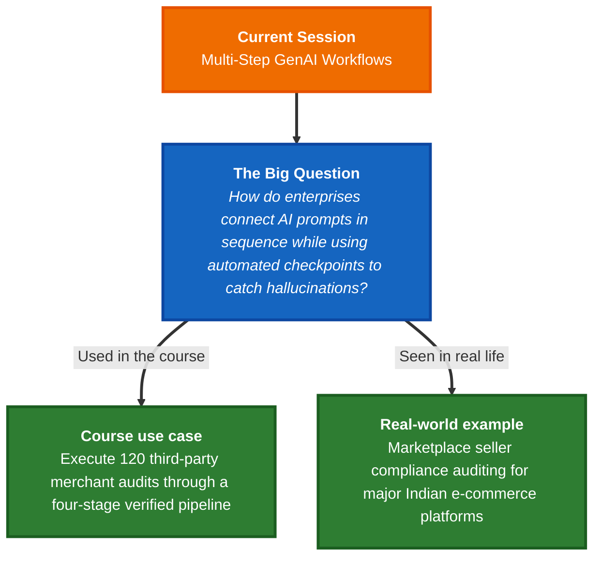

## <span style="color:#2F7DDE">Multi-Step GenAI Workflows</span>

### <span style="color:#2F7DDE">Mental Map</span>



---

### <span style="color:#2F7DDE">What You'll Learn</span>

Have you ever tried using an AI tool for an important project, only to realize that an error in the first paragraph quietly ruined the entire final conclusion?

By the end of this session, you will be able to:

- <span style="color:#D9660B">**Chain**</span> specialized prompts sequentially by passing structured JSON variables between stages.
- <span style="color:#D9660B">**Deploy**</span> GenAI separately for diagnostic risk analysis and executive summary reporting.
- <span style="color:#D9660B">**Install**</span> deterministic validation gates to intercept impossible numbers and schema errors.
- <span style="color:#D9660B">**Monitor**</span> token expenditures and pipeline completion rates across high-volume batch runs.

> <span style="color:#2F7DDE">**Topics you will meet:**</span> Sequential prompt chaining; State transfer; GenAI in analysis versus reporting; Automated validation gates; Schema checks and mathematical sanity bounds; Token telemetry and pipeline monitoring.
>
> Join the session to learn each of these in detail.

---

### <span style="color:#2F7DDE">Why You Are Learning This Topic</span>

An e-commerce marketplace audits thousands of third-party merchants selling electronics and fashion.

Auditors must review return dispute records, verify tax compliance, and calculate refund liabilities.

An unvalidated AI script approves ₹18.5 lakh in fraudulent claims because it never checked if claimed refunds exceeded total sales.

A <span style="color:#D9660B">**validation gate**</span> means an automated checkpoint written in strict Python code that inspects intermediate AI outputs and halts processing if data is corrupted, impossible, or missing required fields.

Chaining specialized prompts with automated validation gates allows business leaders to deploy AI across mission-critical enterprise workflows without fear of costly hallucinations.

> <span style="color:#2F7DDE">**Think about it:**</span> If an AI makes a math error in step 2, why won't step 4 magically correct it on its own?

---

### <span style="color:#2F7DDE">The Merchant Compliance Audit Puzzle</span>

A batch compliance log records four merchant audit runs through a multi-stage pipeline.

| Audit ID | Seller ID | City | Analysis Status | Validation Gate Check | Reporting Status |
|:--------:|:----------|:-----|:---------------:|:---------------------:|:----------------:|
| AUD-6001 | SLR-IN-1420 | Bengaluru | Success | Passed | Success |
| AUD-6002 | SLR-IN-8831 | Mumbai | Success | Passed | Success |
| AUD-6014 | SLR-IN-5104 | Ahmedabad | Success | *Failed_Schema* | Aborted_At_Gate |
| AUD-6029 | SLR-IN-3392 | Chennai | Success | *Failed_Tax_Check* | Aborted_At_Gate |

<span style="color:#D9660B">**What you want to happen:**</span>

- Ensure the diagnostic analysis stage outputs structured JSON with all required keys.
- Catch the missing fields on audit AUD-6014 and quarantine it before executive reports are generated.
- Deliver verified, publication-ready markdown tables for all approved merchant accounts.

Here is how it might start. You do not need to understand it yet.

```python
import pandas as pd
df = pd.read_csv("data/amazon_in_merchant_audit_workflow.csv").head(4)
print(df[["audit_id", "city", "step3_validation_status", "step4_report_status"]])
```

> <span style="color:#D9660B">**Wonder about this:**</span>
>
> - Why should you use strict Python code rather than another AI prompt to validate AI outputs?
> - How does separating analysis from reporting improve the quality of both?

---

### <span style="color:#2F7DDE">Think It Through</span>

There is no wrong first try. Keep your guesses for the session.

**1. If a prompt's job is to uncover complex fraud patterns, should you also ask it to write the final polished executive memo in the same prompt?**
Hint: Think about whether a single prompt can maintain both deep forensic skepticism and concise executive polish simultaneously.

**2. What happens if a validation gate between stages detects that a claimed refund is greater than the merchant's total lifetime sales?**
Hint: Consider whether that record should proceed to the board report or be routed to human investigators.

**3. Why is tracking token counts and costs essential when deploying multi-step AI pipelines across thousands of records?**
Hint: Consider what happens to monthly cloud bills if a prompt accidentally loops or includes bloated text.

---

### <span style="color:#2F7DDE">One Question to Carry Into the Session</span>

> <span style="color:#2F7DDE">**How do automated validation checkpoints make generative AI reliable enough for multi-million-rupee corporate decisions?**</span>
>
> What is the single most critical validation check you would place on an AI-generated business report?
